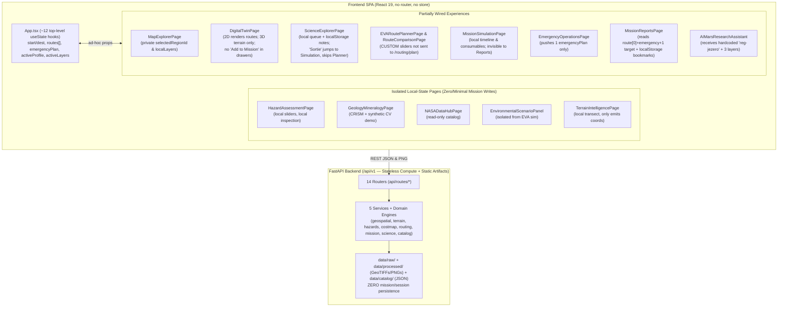
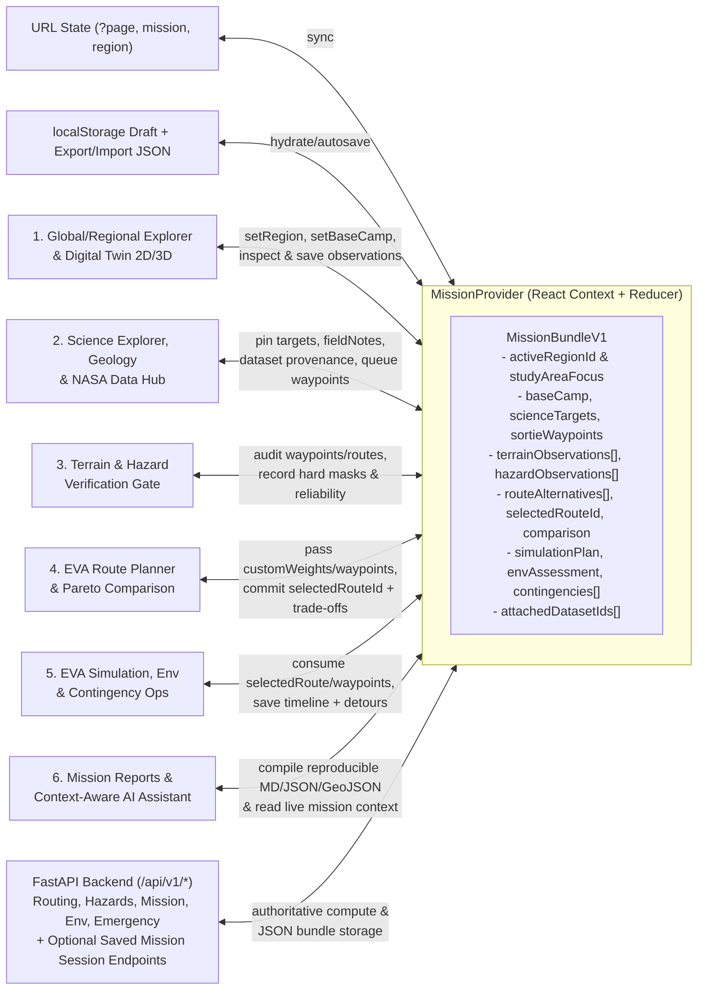

# MARSWALK — M0.4 Experience Architecture & Mission Workflow Integration Plan

**Document Type:** Read-Only Architectural Discovery & Milestone M0.4 Design Plan  
**Status:** Proposed Plan (Awaiting Owner Approval — No Code Modified)  
**Baseline Anchor:** Branch `main` @ `dce6f6985ed150eebf9374912116befc9eb2319c` (`dce6f69`), post-M0.3.4 (`54` uncommitted working-tree entries preserved)  
**Research Prototype Notice:** Marswalk Planner is a research and education decision-support prototype. It is not NASA software, is not endorsed or certified by NASA, and must never be used for operational astronaut-safety or mission decisions.

---

## 1. Executive Summary

Through milestones **M0.1–M0.3.4**, Marswalk Planner built substantial scientific and geospatial foundations: authentic USGS/NASA PDS datasets aligned on Mars `IAU_2015:49900` / `ESRI:103885`, native 1 m HiRISE + 20 m CTX hazard fusion with fail-closed `NoData` semantics (`nodata=255` binary / `nodata=-9999.0` float, `0` disagreements across `212,132` cells between `/api/v1/hazards/inspect` and `hazard_hard_impassable.tif`), multi-dimensional uncalibrated reliability indices (`OBSERVED`, `DERIVED`, `INTERPRETED`, `HEURISTIC`, `SIMULATED`, `UNKNOWN`), deterministic A*/Dijkstra constrained routing, heuristic EVA consumables estimation, and multi-scale planetary exploration views across 12 priority Mars regions.

However, **experience architecture did not co-evolve with scientific depth**. Today, Marswalk operates as **14 loosely coupled pages** wired through an ad-hoc `useState` prop bag in `frontend/src/App.tsx` and **stateless, disconnected backend routers**. Key operational breaks prevent a researcher from executing a continuous mission loop (`EXPLORE -> INVESTIGATE -> TARGET -> QUEUE -> ROUTE -> COMPARE -> SIMULATE -> CONTINGENCY -> REPORT`):

1. **No Shared Mission Object or Persistence:** Refreshing the browser discards `startPoint`, `destPoint`, calculated `routes`, `emergencyPlan`, `queuedSortieWaypoints`, `selectedTarget`, `selectedHazard`, and simulation results. Only isolated `localStorage` blobs exist for `ScienceExplorerPage` field notes and `MissionReportsPage` bookmarks. The backend has zero mission-session persistence (`EmergencyResponseService._incident_log` is process-local and unexposed).
2. **Broken Multi-Page Transitions & Orphaned Controls:**
   - Exploring regions in `MapExplorerPage` / `RegionalMarsMap` (`selectedRegionId`) never updates global app context, and `Enter Local Digital Twin` does not transfer region/layer/coordinate focus.
   - `DigitalTwinPage` inspects hazards, costs, and targets but has **no UI action** to add them to a sortie, set Base Camp, or bookmark an observation.
   - `ScienceExplorerPage`'s `"Plan Multi-Destination Sortie"` jumps straight to `MissionSimulationPage` (`'simulation'`), bypassing `EVARoutePlannerPage` and `RouteComparisonPage`.
   - `EVARoutePlannerPage` exposes a `CUSTOM` profile and 4 weight sliders (`weights`), yet `RouteRequest` (`/api/v1/routing/plan`) does not accept custom weights and `RouteOptimizationEngine` silently falls back to `BALANCED`.
   - `HazardAssessmentPage` displays 3 configurable threshold sliders (`slopeThreshold`, `triThreshold`, `boulderThreshold`) that are purely decorative local state wired to no API or overlay.
   - `/api/v1/terrain/cv/candidates` runs heuristic CV detectors on an in-memory synthetic `100x100` Gaussian grid at runtime and displays results under `GeologyMineralogyPage` without clearly flagging them as synthetic algorithm demonstrations.
3. **Disconnected Simulation, Environment, Contingency, & Reporting:**
   - `EnvironmentalScenarioPanel` runs independently of `EVAMissionPlannerPanel` (environmental dust/thermal/wind findings do not inform EVA consumables or walking speed).
   - Simulation timelines (`MissionPlanSummaryDTO` / `MultiDestinationMissionResponse`), route comparison results (`MultiObjectiveComparisonDTO`), terrain/hazard inspection logs, and dataset provenance are **absent** from `MissionReportsPage` and `reports.ts`.
   - `AIMarsResearchAssistant` receives hardcoded `active_region_id: 'reg-jezero'` and 3 fixed layer names from `App.tsx`, and relies on uncompiled Tailwind utility classes absent from `index.css`.

**M0.4 Goal:** Incrementally unify Marswalk's three signature experiences—**Immersive Mars Explorer**, **Jezero Scientific Digital Twin**, and **Human EVA Mission Planner**—around a typed **Mission Context**, capability-gated multi-region metadata, explicit scientific workflow handoffs, persistent reproducible Mission Bundles, and complete report traceability, without altering or weakening any M0.1–M0.3.4 raster/routing/epistemic engine.

---

## 2. Verified Repository Baseline

### 2.1 Git & Working-Tree State
*(Verified read-only at start of discovery; no changes made to source code, data, or git history.)*
- **Branch:** `main`
- **HEAD Commit:** `dce6f6985ed150eebf9374912116befc9eb2319c` (`dce6f69`)
- **Working Tree:** `54` dirty status entries (`40` modified tracked paths + `14` untracked files/directories across uncommitted M0.1–M0.3.4 work, including `docs/M0_3_4_API_RASTER_CONSISTENCY_REPORT.md` and `docs/audits/`).

### 2.2 Stack & Inventory Counts (Observed Directly)
- **Backend (`backend/app/`):** Python `>=3.11`, FastAPI, Pydantic Settings, Rasterio, NumPy, SciPy, PyProj, Pillow.
  - `14` FastAPI route modules mounted under `/api/v1` (`assistant`, `atlas`, `catalog`, `costmap`, `emergency`, `environmental`, `hazards`, `health`, `mission`, `regions`, `routing`, `science`, `terrain`, `twin`).
  - `5` service modules (`emergency_response`, `environmental_assessment`, `hazard_inspection`, `mission_planning`, `route_comparison`).
  - `11` domain/core packages (`catalog`, `core`, `costmap`, `geospatial`, `hazards`, `ingestion` *[stub]*, `mission`, `models`, `routing`, `science`, `terrain`, `uncertainty` *[stub]*).
  - `31` test files across `backend/tests/{architecture,integration,unit}/`.
- **Frontend (`frontend/`):** React `19.3.1`, TypeScript `~7.0.2`, Vite `^8.3.6`, Leaflet `^1.9.4`, Three.js `^0.187.0`, `oxlint ^1.90.0`.
  - **No client router** (`react-router-dom` absent) and **no external state library** (Zustand/Redux absent).
  - **No Tailwind CSS** configured in `package.json`, `vite.config.ts`, or `src/index.css` (custom monochrome aerospace CSS design system).
  - `14` page components under `frontend/src/pages/`.
  - `13` reusable components under `frontend/src/components/` plus `2` layout components (`MissionControlHeader`, `NavigationSidebar`).
  - `15` API client/utility files under `frontend/src/api/` (`assistant`, `atlas`, `catalog`, `costmap`, `emergency`, `environmental`, `hazards`, `health`, `mission`, `regions`, `reports`, `routing`, `science`, `terrain`, `twin`).

### 2.3 Verification Baseline
*(Re-executed read-only during this discovery session prior to finalizing this plan.)*
- **Backend tests (`cd backend && .venv/bin/pytest -q`):** `283 passed` in `136.60s` (`0` failed, `0` skipped).
- **Backend lint (`cd backend && .venv/bin/ruff check .`):** `All checks passed!` (exit `0`).
- **Frontend lint (`cd frontend && npm run lint`):** `oxlint` found `0 warnings and 0 errors` across `47` files.
- **Frontend build (`cd frontend && npm run build`):** `tsc -b && vite build` succeeded in `318ms` (`63 modules transformed`), emitting an existing non-fatal Vite chunk-size warning (`index-*.js` > 500 kB due to Three.js bundle).
- **Pre-existing hygiene reference:** [M0_3_4_API_RASTER_CONSISTENCY_REPORT.md](file:///Users/vridhivazirani/marswalk-planner/marswalk-planner/docs/M0_3_4_API_RASTER_CONSISTENCY_REPORT.md).

---

## 3. Current Module Inventory (Verified State & Integration Verdict)

### 3.1 Backend Routers, Services, & Domain Packages

| Module Path | Purpose & Functionality | Entry Point / Data Deps | Observed State | Reusability & Verdict |
|---|---|---|---|---|
| `backend/app/core/` (`config.py`, `disclaimer.py`, `epistemic.py`) | Settings (`MARSWALK_` CORS & data dir), mandatory non-NASA `DISCLAIMER`, 7 `EpistemicClass` enums (`OBSERVED`..`UNKNOWN`). | Imported across backend; zero outbound app imports. | **Real & Compliant** | **PRESERVE** as architectural bedrock. |
| `backend/app/api/routes/health.py` & `models/system.py` | Liveness (`/health`) & diagnostic probe (`/health/diagnostic`) checking local MOLA/CTX/HiRISE/M20 files, `rasterio`, `pyproj`, `ATLAS_CATALOGUE` count. | `GET /api/v1/health{,/diagnostic}` | **Real** | **PRESERVE**; optionally add mission-session storage health check in M0.4. |
| `backend/app/catalog/region_registry.py` & `routes/regions.py` | 12 priority Martian exploration regions (`reg-jezero`..`reg-south-polar`) with bounds, dimensions, elevation, datasets, missions. | `GET /api/v1/regions*`; 1/12 (`reg-jezero`) has `has_local_digital_twin=True`. | **Real Curated Metadata** | **PRESERVE & INTEGRATE** via explicit region capability flags (`supports_routing`, `supports_twin`, `supports_science_targets`). |
| `backend/app/catalog/atlas_catalog.py`, `regional_catalog.py`, `geological_units.py`, `planetary_features.py`, `datasets.py` + `routes/atlas.py`, `catalog.py` | 37 planetary map entries, USGS SIM-3292 / SIM-3464 geologic units, CRISM indices/scenes, Perseverance traverse/samples, WMTS/WMS tile proxy, 10–37 dataset dossiers. | `GET /api/v1/atlas/*`, `GET /api/v1/catalog/datasets*`, local/remote tiles & M20 JSON. | **Real** | **PRESERVE & INTEGRATE** so active datasets & provenance attach to Mission Context. |
| `backend/app/geospatial/` (`crs.py`, `grid.py`, `pipeline.py`, `validator.py`, `downloader.py`, `environment.py`) | Mars `IAU_2015:49900` / `ESRI:103885` transforms, 20 m ARD grid synthesis, download manifest w/ SHA-256. | Used by preprocessing & all coordinate inspection/routing endpoints. | **Real** | **PRESERVE**. |
| `backend/app/ingestion/__init__.py` | Planned package for PDS3/PDS4 ingestion (`Status: not implemented yet - planned for Phase 1-2`). | Docstring-only (`8` lines). Real download logic lives in `geospatial/downloader.py`. | **Unimplemented Stub** | **DOCUMENT** accurately as superseded/unimplemented; do not misrepresent as active. |
| `backend/app/uncertainty/__init__.py` | Planned uncertainty package (`Status: not implemented yet - planned for Phase 3`). | Docstring-only (`8` lines). Real model lives in `hazards/uncertainty.py` & `terrain/multi_resolution.py`. | **Unimplemented Stub** | **DOCUMENT** accurately; defer cleanup/consolidation or keep clearly scoped. |
| `backend/app/terrain/` (`derivatives.py`, `classifier.py`, `mola_global.py`, `regional_jezero.py`, `multi_resolution.py`, `native_hazards.py`, `engine.py`, `hazards_detector.py`, `cv_detector.py`) & `routes/terrain.py` | MOLA+CTX+HiRISE elevation sampling, derivatives, 7-class terrain, transects, multi-res point inspect (`rasterio` reads). **Exception:** `GET /api/v1/terrain/cv/candidates` (`terrain.py#L61-122`) runs `cv_detector.py` on an **in-memory synthetic 100×100 matrix** at request time! | `GET /api/v1/terrain/*`; Jezero processed GeoTIFFs & MOLA binary. | **Real**, except `/terrain/cv/candidates` (**Synthetic Demo**) | **PRESERVE** core terrain; **IMPROVE/FLAG** `/terrain/cv/candidates` with explicit synthetic-sample epistemic banner or accept real Jezero window coordinates! |
| `backend/app/hazards/` & `services/hazard_inspection.py` & `routes/hazards.py` | Native HiRISE + CTX hazard scoring, M0.3.2/M0.3.4 fail-closed hard mask (`61,055` blocked cells), ordinal reliability indices, `0`-discrepancy parity across `212,132` cells. | `GET /api/v1/hazards/*` | **Real & Audited (M0.3.4 PASS)** | **PRESERVE STRICTLY**. |
| `backend/app/science/` & `routes/science.py` | 6 science opportunity layers, 7 exploration objectives, ranked Jezero targets (`jezero_western_delta_20m_science_targets.json`), coordinate inspect. | `GET /api/v1/science/*` | **Real** | **PRESERVE & INTEGRATE** into shared Mission Target Queue. |
| `backend/app/costmap/` (`profiles.py`, `evaluator.py`, `pipeline.py`, `grid.py`) & `routes/costmap.py` | Unified weighted soft costmap (`SAFETY_FIRST`, `SCIENCE_FIRST`, `BALANCED`, `CUSTOM` enum) + point cost inspect + `/costmap/evaluate` preview. | `GET/POST /api/v1/costmap/*`. Note: `DEFAULT_PROFILES` omits `CUSTOM`! | **Real**, `CUSTOM` profile **Disconnected** from routing | **INTEGRATE** custom `CostmapWeights` pass-through cleanly in M0.4. |
| `backend/app/routing/` (`engine.py`, `graph.py`, `search.py`, `simplifier.py`, `emergency.py`) & `services/route_comparison.py` & `routes/routing.py` | A*/Dijkstra 8-connected solver, simplification, multi-profile suite, Pareto trade-off comparison (`SAFETY_FIRST`, `SCIENCE_FIRST`, `BALANCED`), `custom_weights` support already on `engine.compute_route(weights=...)`! | `POST /api/v1/routing/*`, `GET /api/v1/routing/scenarios`. Note: router `RouteRequest` omits `weights`. | **Real** | **PRESERVE** core solver; **INTEGRATE** optional `custom_weights` & multi-waypoint route saving. |
| `backend/app/mission/` (`assumptions.py`, `calculator.py`, `models.py`, `environmental.py`) & `services/mission_planning.py`, `environmental_assessment.py` & `routes/mission.py`, `environmental.py` | Heuristic EVA timeline, metabolic/O2/battery budget, sequential multi-destination sortie planner, diurnal/dust/TI/suitability engine. | `GET/POST /api/v1/mission/*`, `GET/POST /api/v1/environmental/*`. Stateless; environmental assessment is not coupled into EVA consumables yet. | **Real (Heuristic/Simulated)** | **PRESERVE & INTEGRATE** environmental factor linkage (explicitly flagged `SIMULATED`+`HEURISTIC`) & Mission Bundle capture. |
| `backend/app/services/emergency_response.py` & `routing/emergency.py` & `routes/emergency.py` | 6 curated + custom hazard injections, corridor intersection, dynamic reroute, abort return-to-base. | `GET /scenarios`, `POST /simulate`, `POST /abort-to-base`. `_incident_log` in-memory only, never queried. | **Real & Stateless** | **INTEGRATE** into Mission Session incident timeline & report bundle. |
| `backend/app/api/routes/twin.py` | Digital Twin layers metadata, PNG overlays, Perseverance GeoJSON, contour GeoJSON, 3D elevation grid matrix. | `GET /api/v1/twin/*` | **Real** | **PRESERVE**. |
| `backend/app/api/routes/assistant.py` | Keyword-matched QA grounded in CRISM indices, `region_registry`, and SIM-3464 descriptions + `/explain-map` viewport summary. | `POST /api/v1/assistant/{query,explain-map}`. Does not read active routes/hazards/targets from mission session. | **Rule-Based / Partial Context** | **IMPROVE** by feeding active `MissionContext` summary into assistant queries (no LLM hallucination; strictly grounded). |

### 3.2 Frontend Pages, Panels, Components, & API Modules

| Frontend Module | Current Functionality & Local State | Connections & Disconnections | Verdict |
|---|---|---|---|
| `App.tsx` | Holds all cross-page state in ~12 `useState` hooks (`activePage`, `selectedRegion` missing!, `startPoint`, `destPoint`, `routes`, `emergencyPlan`, `queuedSortieWaypoints`, `activeProfile`, `weights`, `selectedTarget`, `selectedHazard`, `selectedCost`, `activeLayers`). Reads `?page=` / hash once at mount; never updates URL; comments claim `12` pages while `PAGE_TITLES` has `14`. | Isolated from `MapExplorerPage` region/layers, simulation output, environmental scenarios, terrain/hazard logs, & reports bookmarks. `AIMarsResearchAssistant` gets hardcoded `reg-jezero` & 3 fixed layers. | **REDESIGN INCREMENTALLY** into `MissionProvider` + URL sync + Workspace Shell. |
| `layout/NavigationSidebar.tsx` & `MissionControlHeader.tsx` | 5 groups / 14 pages; header shows telemetry, API health, profile. | Sidebar hardcodes `JEZERO CRATER • MARS`; header hardcodes `37 PDS PRODUCTS` and uses unharmonized colored status dots (`#38bdf8`, `#4ade80`). | **IMPROVE** to read dynamic `activeRegion`, `datasetCount`, and `activeMission` status. |
| `MissionInitializationScreen.tsx` | 7-stage boot sequence calling `/health/diagnostic` and `/atlas/categories`, auto-proceed countdown (`37 audited products` hardcoded in label). | Solid standalone onboarding gate. | **PRESERVE** (bind counts dynamically if desired). |
| `pages/MissionOverviewPage.tsx` | Executive hub: fetches `/atlas` count + renders 4 experience switcher cards (`01 Mars Explorer` uses non-B&W `#c2410c` orange highlight) + quick workflow cards. | Static workflow launch cards; lacks an **Active Mission Resume / Bundle Summary** banner showing what targets, routes, simulations, or hazards are currently loaded. | **IMPROVE** to act as Mission Control Hub (New/Resume/Import Mission + Journey Tracker). |
| `pages/MapExplorerPage.tsx` + `GlobalMarsGlobe3D.tsx` + `GlobalMarsMap.tsx` + `RegionalMarsMap.tsx` | 6 tabs (`MARS_EXPLORER`, `MARS_MONOCHROME`, `GLOBAL_GLOBE`, `GLOBAL_MAP`, `REGIONAL_MAP`, `CATALOGUE`). Manages **private** `selectedRegionId` & `localLayers`. `GlobalMarsMap` has uncompiled Tailwind classes (`L679`); `GlobalMarsGlobe3D` cyan button (`#22d3ee`) vs B&W theme. | Clicking `Enter Jezero Twin` sets internal tab; `Enter Local Digital Twin (1m)` jumps to `'digital-twin'` **without** syncing `selectedRegionId`, coordinates, or layers! Other 11 regions show `RegionalMarsMap` cleanly, then lack clear capability messaging if user tries local planning. | **INTEGRATE** with `MissionContext.activeRegionId`, study-area focus, & "Add Coordinate / Region to Mission" actions. |
| `pages/DigitalTwinPage.tsx` + `MarsMap2D.tsx` + `MarsMap3D.tsx` | 2D Leaflet (`IAU_2015:49900` Plate Carrée) + 3D Three.js mesh. Inspects coordinate hazard, cost, target; renders routes & emergency detours in 2D (`MarsMap2D`), **not in 3D** (`MarsMap3D` only renders terrain + `ortho.png`). | Inspection drawer cards (`selectedTarget`, `selectedHazard`, `selectedCost`) have **zero buttons** to "Set Start / Dest", "Add Target to Sortie", or "Log Hazard Observation to Mission". Route comparison overlay vs active route distinction is minimal. | **INTEGRATE & IMPROVE**: add inspector handoff CTAs, synchronized 2D/3D overlays, and Jezero-only capability guard/banner. |
| `pages/TerrainIntelligencePage.tsx` | 5 tabs (`INSPECTION`, `DERIVATIVES`, `CLASSIFIER`, `VISUAL_QC`, `TRANSECT`), presets, raster PNG switcher, transect chart. | Calls `onSelectCoords` on inspect, but **does not read** `App` inspected coords when navigated from Digital Twin, and **cannot save** terrain inspections/transects to Mission Context or Reports! | **INTEGRATE** bidirectional coordinate sync + `"Attach Observation to Mission"`. |
| `pages/HazardAssessmentPage.tsx` | Hazard layer cards, 3 local sliders (`slopeThreshold`, `triThreshold`, `boulderThreshold`), M0.3 raster visualizer, `/hazards/inspect` query. | Takes **zero props**! 3 threshold sliders (`L104-153`) do nothing; inspection results cannot be sent to routing/simulation/reports or seeded from map click. | **INTEGRATE & FIX**: wire to `MissionContext` inspected coordinate, add `"Log Hazard Assessment"` CTA, and replace non-functional sliders with read-only authoritative M0.3.4 threshold display (unless parameterized backend preview is intentionally scoped later). |
| `pages/GeologyMineralogyPage.tsx` | CRISM scenes/indices, USGS SIM-3464 units, diurnal/dust/TI plots, `/terrain/cv/candidates`. | Takes **zero props**; hardcodes Jezero diurnal coords `(18.45, 180.0, 320.0, 0.4)`; displays synthetic `/terrain/cv/candidates` without flagging synthetic input; cannot bookmark CRISM/unit observations or link to targets. | **INTEGRATE**: link geological units/CRISM scenes to science targets & attach selected findings to Mission Context; flag synthetic CV demo clearly. |
| `pages/ScienceExplorerPage.tsx` | 7 objectives, ranked candidate targets, local `queuedWaypoints`, `localStorage` `fieldNotes`, JSON session export. | `"Plan Multi-Destination Sortie"` jumps to `'simulation'`, skipping `EVARoutePlannerPage` & `RouteComparisonPage`; single-target route sets `destPoint` (overwriting prior target); queued waypoints live locally and disappear when switching pages unless sent! | **INTEGRATE**: promote sortie waypoint queue & researcher field notes directly into `MissionContext` so queue persists across ALL pages and drives both Route Planner & Simulation. |
| `pages/NASADataHubPage.tsx` | Displays dataset dossiers from `/catalog/datasets` (`ALL`, `ELEVATION`, `IMAGERY`, `SCIENCE`, `IN_SITU`). | Read-only isolated catalog; no ability to pin datasets/provenance citations to active Mission Bundle or jump to map layers using that product. | **INTEGRATE**: allow attaching/viewing active mission dataset provenance & quick-linking to relevant Digital Twin/Atlas layer. |
| `pages/EVARoutePlannerPage.tsx` | Start/Dest coordinate inputs, profile pills (`SAFETY_FIRST`, `SCIENCE_FIRST`, `BALANCED`, `CUSTOM`), custom weight sliders, single-route & 3-route suite planning. | `Plan CUSTOM Route` ignores `weights` sliders because `planRoute` doesn't send custom weights! Lacks awareness of `queuedSortieWaypoints` from Science Explorer; no direct `"Send to Simulation"` / `"Compare Trade-offs"` / `"Test Contingency"` next-step links! | **INTEGRATE & FIX**: support multi-waypoint preview + custom weights pass-through + direct workflow handoff CTAs. |
| `pages/RouteComparisonPage.tsx` + `MultiObjectiveComparisonPanel.tsx` | Priority sliders (`safety`, `science`, `efficiency`), curated scenarios, `/routing/compare` trade-off evaluation, pushes `routes` up to `App.tsx`. | Updates `App.tsx` routes, but **never records chosen/recommended route or comparison rationale (`MultiObjectiveComparisonDTO`) into Mission Context** for Simulation or Reports. | **INTEGRATE**: persist comparison matrix & user's selected route choice (`activeRouteId`) into Mission Context. |
| `pages/MissionSimulationPage.tsx` + `EVAMissionPlannerPanel.tsx` + `EnvironmentalScenarioPanel.tsx` | Point-to-point & multi-destination EVA timeline/consumables + animated playback + crew/suit assumptions + curated/custom environmental scenarios. | Two panels live on the same page with **zero data coupling** (`EnvironmentalScenarioPanel` never informs `EVAMissionPlannerPanel`); simulation result stays local inside `EVAMissionPlannerPanel`, unavailable to `EmergencyOperationsPage` or `MissionReportsPage`! | **INTEGRATE**: lift latest `SimulationResult` & `EnvironmentalScenarioResult` into `MissionContext`, link active route/profile/waypoints automatically, and expose optional explicit `SIMULATED` environmental factor coupling. |
| `pages/EmergencyOperationsPage.tsx` + `EmergencyResponsePanel.tsx` | 6 curated + custom hazard injections, crew progress slider, abort return-to-base, pushes `emergencyPlan` to `App.tsx`. | Evaluates against `(startPoint, destPoint, activeProfile)` rather than the user's selected active sortie leg/multi-waypoint route; no log of tested scenarios; only latest single `emergencyPlan` reaches Reports. | **INTEGRATE**: bind to active sortie route & track a list of tested contingency scenarios in Mission Context. |
| `pages/MissionReportsPage.tsx` & `api/reports.ts` | Generates Markdown, JSON, and GeoJSON client-side + `localStorage` study bookmarks (`INITIAL_BOOKMARKS` hardcoded). | Missing: active region, attached terrain/hazard observations, selected science target queue & field notes, route comparison matrix, EVA consumables & timeline simulation, environmental assessment, and dataset provenance! Non-reproducible (`Date.now()` ID, no bundle snapshot). | **REDESIGN/EXTEND** cleanly around canonical **Mission Bundle** export/import & complete traceable Markdown/JSON/GeoJSON report. |
| `components/AIMarsResearchAssistant.tsx` | Floating assistant + `"Explain This Map"` drawer. | Uncompiled Tailwind utility classes; receives hardcoded context from `App.tsx`; ignorant of active routes, targets, hazards, simulation warnings. | **IMPROVE**: restyle to aerospace CSS (`index.css`) & pass rich summary of `MissionContext`. |

---

## 4. Current Application Architecture

Today Marswalk follows a **Client Prop-Bag + Stateless Compute API** topology with weak cross-view cohesion:



---

## 5. Experience Audit (All 15 Experiences)

| # | Experience Name | Entry Point | Current User Journey | What Works vs. Broken / Incomplete | Target Workflow Role (M0.4) |
|---|---|---|---|---|---|
| **1** | **Mission Overview & Control Center** | `MissionOverviewPage` (`overview` sidebar) | Displays dataset stats, 4 Explorer mode cards, and 4 quick-action operational cards. | **Works:** Clean orientation & telemetry summary. **Broken/Incomplete:** Passive launcher only—no active Mission status card, no workflow step progress, no mission create/load/save, non-B&W `#c2410c` highlight. | **Mission Control Home:** Launch/resume/duplicate Mission Bundle, inspect readiness across all 9 workflow steps, and jump to current active step. |
| **2** | **Mission Initialization Screen** | `MissionInitializationScreen` (boot) | 7-step probe of frontend, `/health/diagnostic`, `/atlas/categories`, WebGL readiness, and countdown proceed. | **Works:** Authentic health telemetry & skip/proceed. **Incomplete:** Hardcodes `'37'` in stage sublabel (`L45`) & `'14 Operational Exploration Views'`; doesn't hydrate saved Mission Bundle. | **Preflight & Session Hydration Gate:** Verifies runtime + loads active/last Mission Bundle + deep-link route on complete. |
| **3** | **Immersive Mars Explorer / Monochrome** | `MapExplorerPage` (`MARS_EXPLORER`, `MARS_MONOCHROME`) -> `GlobalMarsMap` | Opens global Viking natural color or MOLA monochrome relief map with click sampling & `"ENTER JEZERO TWIN ->"`. | **Works:** High-impact global exploration, multi-scale elevation sample, telemetry HUD. **Incomplete:** Clicking map or `"Enter Jezero"` fails to set `MissionContext.activeRegionId` or pass chosen site into Digital Twin; uses unstyled Tailwind classes in toolbar (`L679`). | **Experience 1 Entry (Planetary Discovery):** Lets user inspect any global coordinate, jump to a priority region or study area, and seed Mission Region/Focus. |
| **4** | **Global 3D Mars Globe** | `MapExplorerPage` (`GLOBAL_GLOBE`) -> `GlobalMarsGlobe3D` | Interactive Three.js Mars sphere with landing sites, IAU features, click-to-select region. | **Works:** Proper M0.1 WebGL disposal, `IAU_2015:49900` lat/lon sphere math, 12-region click matching. **Incomplete:** Region selection stays inside `MapExplorerPage.selectedRegionId`; `#22d3ee` cyan button clashes with monochrome spec unless harmonized. | **Global 3D Spatial Entry:** Click region -> set `MissionContext.activeRegionId`, optionally launch Regional Atlas or Jezero Digital Twin. |
| **5** | **Global Mars 2D Atlas** | `MapExplorerPage` (`GLOBAL_MAP`) -> `GlobalMarsMap` | Interactive 2D global tile/WMS layers, USGS SIM-3292 geology, IAU features, search, coverage check. | **Works:** Layer switching, search, elevation/coverage query. **Incomplete:** No `"Pin Dataset/Site to Mission"` or region transfer beyond `"Enter Jezero"`. | **Global Thematic Layer & Site Selection:** Attach global context datasets or pin landing/exploration ROI coordinates to active Mission. |
| **6** | **Regional Mars Map & Multi-Region Switching** | `MapExplorerPage` (`REGIONAL_MAP`) -> `RegionalMarsMap` | Switch among 12 regions, inspect dossiers, elevation profiles, layer comparison; for Jezero (`★`), toggle geology/CRISM/Perseverance traverse/sols & launch `LOCAL DIGITAL TWIN (1m)`. | **Works:** Rich multi-region dossiers & Jezero regional overlays. **Broken/Incomplete:** 11 non-Jezero regions silently have no Digital Twin button (no clear capability matrix explaining what works locally vs globally); selecting a region never informs `NavigationSidebar`, `Header`, `Science`, `Hazards`, or `Assistant`! | **Region Gatekeeper & Regional Context Hub:** Sets global `activeRegionId` in `MissionContext` and publishes capability flags so planning tools either focus on that region (`reg-jezero`) or display clear, honest non-Jezero scope notices. |
| **7** | **Jezero Scientific Digital Twin (2D & 3D)** | `DigitalTwinPage` -> `MarsMap2D` & `MarsMap3D` | Toggle raster/vector layers (`ortho`, `elev`, `slope`, `hazard`, `confidence`, `science`), click to inspect point hazard + cost, toggle 2D/3D view, view active routes & emergency detour in 2D. | **Works:** Clean synchronized coordinate/hazard/cost inspection + 2D route/detour overlay. **Broken/Incomplete:** 1) `MarsMap3D` renders elevation + `ortho.png` ONLY (no routes, targets, or hazards in 3D); 2) Inspection cards lack `"Set Base Camp"`, `"Set Destination"`, `"Add Science Target to Mission"`, or `"Save Observation"`; 3) Cannot compare all 3 suite routes interactively with hover/selection in map drawer. | **Experience 2 Core (Jezero Digital Twin):** Unified visual canvas linking Science Targets, Terrain/Hazard Inspections, Active Sortie Routes, and Emergency Detours in 2D (and route/target markers in 3D). |
| **8** | **Terrain Intelligence** | `TerrainIntelligencePage` | Inspect multi-resolution terrain window (slope, TRI, relief, roughness, VRM, TPI), 7 terrain classes, PNG layer viewer, continuous transect generator. | **Works:** Authentic multi-res GeoTIFF inspection & transect calculations. **Broken/Incomplete:** Unidirectional (`onSelectCoords` out only—never loads map/mission selected point automatically); cannot pin transects or terrain diagnostics into the active Mission Bundle. | **Terrain Diagnostic Workbench:** Inspects Mission Waypoints, Base Camp, or Transect Legs directly from Mission Context and attaches quantitative terrain evidence to Mission Bundle/Report. |
| **9** | **Hazard & Uncertainty Intelligence** | `HazardAssessmentPage` | View 6 hazard factor explanations, 5 M0.3 raster PNGs (Overall Hazard, Data Reliability Index, Evidence Reliability Index, Nominal Precision Tier, Resolution Uncertainty), run point `/hazards/inspect`. | **Works:** Strict M0.3.4 parity with `hazard_hard_impassable.tif`, accurate uncalibrated index disclosures. **Broken/Incomplete:** Takes zero shared props; 3 threshold sliders (`L104-153`) are disconnected/dead controls; point inspections cannot inspect active route waypoints or save hazard flags into Mission Bundle. | **Safety & Epistemic Verification Gate:** Audits Base Camp, Candidate Targets, and Route Waypoints for hard restrictions & uncertainty tiers, and logs findings to Mission Bundle. |
| **10** | **Geology & Mineralogy** | `GeologyMineralogyPage` | Browse CRISM scenes/spectral indices, USGS SIM-3464 units, diurnal/dust/TI plots, and `/terrain/cv/candidates`. | **Works:** Rich mineral/unit reference + thermophysical plots. **Broken/Incomplete:** Completely isolated (`() => void`); hardcodes Jezero diurnal test coords; `/terrain/cv/candidates` displays synthetic 100×100 demo outputs (`terrain.py#L69`) without a prominent synthetic-sample disclosure badge; cannot link outcrops/units to Science Targets or Mission Notes. | **Stratigraphic & Mineralogical Context:** Cross-filters with Science Targets by CRISM/USGS unit and attaches cited observations (`OBSERVED`/`INTERPRETED`) to Mission Context (with synthetic CV demo clearly tagged `SIMULATED`/`HEURISTIC` sample). |
| **11** | **Science Target Explorer** | `ScienceExplorerPage` | Filter ranked targets across 7 research objectives, inspect multi-criteria opportunity breakdown, write `localStorage` field notes, queue sortie waypoints, export `.json`. | **Works:** Great scientific dossier & waypoint queueing UX. **Broken:** Waypoint queue is page-local (lost if user visits Route Planner without clicking `"Plan Multi-Destination Sortie"`), AND clicking that button jumps straight to **Simulation**, skipping Route Planning & Trade-off Comparison! | **Science Target & Hypothesis Curation:** Directly manages `MissionContext.scienceTargets` & ordered `MissionContext.plannedSortieWaypoints`, letting user send queue into **EVA Route Planner** (`route-planner`) or **Comparison** first. |
| **12** | **NASA / PDS Data Hub** | `NASADataHubPage` & `MapExplorerPage` (`CATALOGUE`) | Search/filter authentic dataset dossiers (`catalog/datasets` & `atlas_catalog`), read caveats/DOI/CRS/ACCEPT decisions. | **Works:** Honest provenance & caveat display. **Incomplete:** Read-only archive; user cannot pin datasets as "Mission Reference Provenance" or jump directly from a dataset card to that layer in Atlas / Digital Twin. | **Dataset & Provenance Registry:** Shows which authentic products are active in current Mission Layers/Analysis and attaches exact citations/checklists to Mission Bundle. |
| **13** | **EVA Route Planner & Route Comparison** | `EVARoutePlannerPage` + `RouteComparisonPage` + `MultiObjectiveComparisonPanel` | Single-profile or 3-profile route solve (`astar`), custom weight sliders, Pareto multi-objective ranking by safety/science/efficiency sliders + curated scenarios. | **Works:** Deterministic constraint-safe routing & multi-objective trade-off math. **Broken:** 1) `CUSTOM` weight sliders never affect `/routing/plan`; 2) Multi-stop waypoints queued in `ScienceExplorerPage` aren't surfaced in `EVARoutePlannerPage`; 3) User cannot explicitly "Select Route Alternative as Active Sortie Route" to drive Simulation, Emergency, and Report! | **Experience 3 Planning Core:** Solves single-leg or multi-waypoint routes (including optional custom weights), ranks trade-offs in Comparison, commits a **Selected Route Alternative** into `MissionContext`, and hands off cleanly to Simulation. |
| **14** | **Mission Simulation & Emergency Response** | `MissionSimulationPage` (`EVAMissionPlannerPanel` + `EnvironmentalScenarioPanel`) & `EmergencyOperationsPage` (`EmergencyResponsePanel`) | Multi-leg/round-trip EVA timeline playback, consumables (O2/battery/kcal), feasibility warnings, curated/custom environmental & hazard injection, abort return-to-base. | **Works:** Detailed deterministic heuristic/simulated models & abort routing. **Broken:** 1) Environmental panel never couples to EVA consumables/duration; 2) Simulation outputs stay local to `EVAMissionPlannerPanel` and never appear in `MissionReportsPage`; 3) Emergency uses raw `(start, dest, profile)` instead of active selected/multi-stop sortie; only 1 latest `emergencyPlan` retained. | **Simulation & Contingency Workbench:** Runs consumables/timeline against the committed Active Sortie + selected Environmental Scenario, executes multiple Contingency Scenarios against that sortie, and persists full results to Mission Bundle. |
| **15** | **Mission Reports & AI Mars Research Assistant** | `MissionReportsPage` (`reports.ts`) & `AIMarsResearchAssistant` | Compile Markdown/JSON/GeoJSON report + bookmarks; open floating AI assistant / Explain Map. | **Works:** Mandatory disclaimers present, client exports download cleanly. **Broken:** Report omits Comparison Matrix, EVA Simulation Timeline/Consumables, Environmental Assessment, Terrain/Hazard Observations, Multi-Stop Queue, Dataset Provenance, & Field Notes; Assistant gets hardcoded context & broken Tailwind styling. | **Traceable Reporting & Mission-Aware Assistant:** Generates complete reproducible Mission Bundle reports (`Markdown`/`JSON`/`GeoJSON`) from full `MissionContext`, and feeds live `MissionContext` (region, targets, route, hazards, sim warnings) to styled `AIMarsResearchAssistant`. |

---

## 6. Shared Mission Context Assessment (All 12 Domain Entities)

| # | Mission Domain Entity | Exists Today? | Current Location & Persistence | Current Deficiencies & Required M0.4 Structure |
|---|---|---|---|---|
| **1** | **Active Mission** | **No** (fragmented) | Title/crew only inside `MissionReportsPage` (`useState`); coords in `App.tsx`. Ephemeral on reload. | Create `MissionSession` root entity (`missionId`, `title`, `createdAt`, `updatedAt`, `crewCount`, `assumptions`, `epistemicNotice`, `version`) synced to `localStorage` draft + optional backend JSON/SQLite store. |
| **2** | **Selected Mars Region** | **Partial** (local only) | `MapExplorerPage` & `RegionalMarsMap` (`selectedRegionId` local `useState`); `Sidebar`/`Header`/`Assistant` hardcode Jezero. | Promote `activeRegionId` (`'reg-jezero'` default) + capability flags (`has_local_digital_twin`, `supports_routing`, etc.) from `/api/v1/regions` into `MissionContext`. |
| **3** | **Selected Study Area** | **Static** | `twin.ts` returns fixed Jezero Western Delta extent; no sub-ROI / site focus in state. | Represent `studyAreaFocus` (`bbox` / `center` / `label` / `bookmarkId`) so bookmarks, regions, and map zoom share a spatial focus. |
| **4** | **Science Targets** | **Partial** | `selectedTarget` (single) in `App.tsx`; multi-target `queuedWaypoints` + `fieldNotes` inside `ScienceExplorerPage` only. | Store ordered `scienceTargets` (`targetId`, `name`, `coords`, `objectiveId`, `rank`, `score`, `fieldNote`, `epistemicClass`) in `MissionContext`, addable from Science Explorer, Digital Twin, or Geology. |
| **5** | **Terrain Observations** | **No** (ephemeral) | Last inspection result stays local inside `TerrainIntelligencePage` (`inspectResult`, `transectResult`). | Store `terrainObservations[]` & `transectProfiles[]` (coords, elevation, slope, TRI, source tier `HiRISE`/`CTX`/`MOLA`, `confidenceScore`, timestamp) when user inspects or pins a point/leg. |
| **6** | **Hazard Observations** | **Partial** | Single `selectedHazard` in `App.tsx` (Digital Twin only); `HazardAssessmentPage` `inspection` is local. | Unify into `inspectedLocation` + saved `hazardObservations[]` carrying authoritative M0.3.4 `hard_restriction_codes`, `is_passable`, ordinal reliability tiers, and source attribution. |
| **7** | **Selected Datasets** | **Partial** | `App.tsx` holds `activeLayers` (`digitalTwin`); `MapExplorerPage` holds separate `localLayers`; `NASADataHubPage` tracks none. | Maintain `activeLayerIds` + `attachedDatasets[]` (product IDs, DOIs/URNs, resolution, epistemic class, caveats) automatically seeded by used services and inspectable in Hub/Reports. |
| **8** | **EVA Sorties (Origin, Destination, Multi-Stop Waypoints)** | **Fragmented** | `startPoint`, `destPoint`, `queuedSortieWaypoints` in `App.tsx`; `EVAMissionPlannerPanel` copies `initialWaypoints` into private `multiWaypoints`. | Unify `activeSortie`: `baseCamp` (origin), ordered `waypoints[]` (stops w/ durations), `returnToBase` boolean, linked `scienceTargetIds`. |
| **9** | **Route Alternatives** | **Partial** | `routes: RouteFeature[]` in `App.tsx`; `MultiObjectiveComparisonDTO` stays local inside `MultiObjectiveComparisonPanel`. | Store `routeAlternatives[]`, `activeProfile`, `customWeights`, `comparisonSummary` (trade-off table + preferences), and explicit `selectedRouteId` so Planning, Twin, Simulation, Emergency, and Reports refer to the exact same route. |
| **10** | **Simulation Results** | **Local Only** | `missionPlan` / `multiPlanResult` & `EnvironmentalAssessmentReportDTO` trapped inside `EVAMissionPlannerPanel` & `EnvironmentalScenarioPanel`. | Store `latestSimulation` (`MissionPlanSummaryDTO | MultiDestinationMissionResponse`) & `environmentalAssessment` (`EnvironmentalAssessmentReportDTO`) with `routeId` + `assumptions` linkage inside `MissionContext`. |
| **11** | **Emergency Scenarios** | **Partial** | Latest single `emergencyPlan` in `App.tsx`; backend `EmergencyResponseService._incident_log` unexposed. | Maintain `contingencyScenarios[]` (`DynamicReroutePlanDTO` + tested `hazardEvent` + active comparison delta against `selectedRouteId`) with a selected active contingency overlay. |
| **12** | **Mission Reports** | **Partial / Lossy** | Built on the fly in `MissionReportsPage` / `reports.ts` from 4 partial fields (`route[0]`, `emergencyPlan`, `1 target`, `localStorage bookmarks`). | Assemble `MissionReportBundle` deterministically from the entire `MissionContext` (covering items 1–11, epistemic breakdown table, dataset provenance, caveats, and mandatory `DISCLAIMER`). |

---

## 7. End-to-End Workflow Gap Matrix (Transitions A–K)

| ID | Workflow Transition | Current State | Specific Root Break / Missing Link | Required M0.4 Integration |
|---|---|---|---|---|
| **A** | **Explore Mars -> Investigate Region** | **Broken across Shell** | `GlobalMarsGlobe3D` / `GlobalMarsMap` update `MapExplorerPage`'s private `selectedRegionId`, leaving `App.tsx`, `Sidebar`, `Header`, and `Assistant` unaware. | Dispatch `SET_ACTIVE_REGION(regionId)` into `MissionContext`; dynamically display region capabilities & telemetry header. |
| **B** | **Investigate Region -> Open Digital Twin / Local Area** | **Half-wired (Jezero only, no handoff payload)** | `"ENTER JEZERO TWIN"` jumps to `'digital-twin'` with default view; 11 non-Jezero regions have no local twin and no explicit multi-region scope indicator. | On Jezero, jump to Digital Twin carrying active study focus/coordinates/layers; on non-Jezero regions, keep Regional Exploration mode active with explicit capability badge explaining local Twin/Routing scope is Jezero-only. |
| **C** | **Digital Twin / Terrain / Hazard -> Inspect -> Flag / Save Observation** | **Missing Action** | `DigitalTwinPage` shows hazard & cost cards (`L184-243`) with no `"Save Observation"`, `"Set Base Camp"`, or `"Set Destination"`. `TerrainIntelligencePage` & `HazardAssessmentPage` cannot save findings. | Add 1-click inspector actions (`Set Start`, `Set Dest`, `Save Observation to Mission`, `Verify Hazard Here`) wired to `MissionContext`. |
| **D** | **Geology / CRISM / Science Explorer -> Identify Science Target** | **Siloed** | `GeologyMineralogyPage` & `ScienceExplorerPage` are unlinked; selecting a geologic unit or CRISM scene cannot filter or highlight matching Science Targets. | Cross-link CRISM/USGS unit IDs to matching `ScienceExplorerPage` targets & allow pinning map-inspected coordinates as custom science targets. |
| **E** | **Science Target -> Add to Mission / Sortie Queue** | **Trapped in Local State & Misrouted** | Queue stays in `ScienceExplorerPage` local state; clicking `"Plan Multi-Destination Sortie"` sets `queuedSortieWaypoints` and skips directly to `'simulation'`, bypassing `'route-planner'` and `'comparison'`! Single-target button overwrites `destPoint`. | Maintain `MissionContext.sortie.waypoints[]` across all pages; offer `"Add to Sortie Queue"`, `"Set as Primary Destination"`, and `"Open in EVA Route Planner"` (preserving multi-stop order). |
| **F** | **Mission Targets / Waypoints -> Plan EVA Route** | **Partial + Broken `CUSTOM` Weights** | `EVARoutePlannerPage` ignores `queuedSortieWaypoints` and ignores `CUSTOM` weight sliders when calling `/routing/plan`; `RouteOptimizationEngine` silently falls back to `BALANCED`. | Wire optional `custom_weights` through `RouteRequest` -> `RouteOptimizationEngine`, surface `sortie.waypoints` inside `EVARoutePlannerPage` for point-to-point or leg-by-leg route planning, and show next-step CTAs (`Compare Trade-offs`, `Inspect Terrain/Hazards Along Route`). |
| **G** | **Plan EVA Route -> Compare Routes** | **Lossy** | `MultiObjectiveComparisonPanel` replaces `routes` in `App.tsx`, but discards `MultiObjectiveComparisonDTO` trade-off rationale & user selection once user leaves page. | Save `comparisonResult` (`MultiObjectiveComparisonDTO`) and explicit `selectedRouteId` inside `MissionContext`, synced back to Digital Twin 2D highlight and Overview. |
| **H** | **Compare Routes -> Simulate Mission (Consumables & Environment)** | **Disconnected** | `MissionSimulationPage` does not auto-adopt the selected comparison route or environmental scenario; `EnvironmentalScenarioPanel` has zero effect on `EVAMissionPlannerPanel`; sim output is invisible to other pages. | Run EVA Mission Simulation directly against `MissionContext.selectedRoute` / `sortie.waypoints` (plus optional explicit `SIMULATED` environmental stressor multiplier), and save `simulationResult` + `environmentalAssessment` to `MissionContext`. |
| **I** | **Simulate Mission -> Test Contingencies** | **Uncoupled** | `EmergencyResponsePanel` ignores multi-destination sorties and active simulation progress, evaluating only `(startPoint, destPoint, activeProfile)` and keeping only 1 `emergencyPlan`. | Pre-seed contingency testing from the active simulated sortie (base camp, destination/legs, chosen profile, progress `%`), and log tested scenarios cleanly in `MissionContext.contingencyScenarios[]`. |
| **J** | **Test Contingencies -> Recompute / Update Mission** | **Dead End** | Emergency detour renders on `DigitalTwinPage` 2D map, yet user has no button to adopt the detour/abort route into Simulation consumables/report or compare detour vs nominal timeline side-by-side cleanly. | Add `"Adopt Detour / Record Contingency Impact"` action storing detour delta metrics (`Δkm`, `Δmin`, `ΔO2`, `ΔWh`) alongside nominal plan inside Mission Bundle. |
| **K** | **Mission -> Generate Reproducible Report + Export/Reload** | **Incomplete / Non-Reproducible** | `MissionReportsPage` omits comparison matrix, simulation results, environmental scenario, terrain/hazard logs, dataset provenance, multi-stop queue, and field notes; cannot export/re-import full Mission Bundle JSON to resume session. | Upgrade `MissionReportsPage` to compile complete traceable Markdown/GeoJSON/JSON from full `MissionContext` + support **Export / Import Mission Bundle JSON** (and optional backend session save). |

---

## 8. Proposed Target Architecture

Rather than rewriting Marswalk's working geospatial/routing backend or multi-page shell, M0.4 introduces a clean **4-Layer Experience & Integration Architecture** reusing M0.1–M0.3.4 verbatim underneath:

```text
+-------------------------------------------------------------------------+
| 1. MISSION SHELL & CONTEXT LAYER (App Shell + MissionProvider)         |
|  - Top Mission Strip: Active Mission, Region, Active Route/Sortie,      |
|    API & Epistemic Notice, Export/Save Mission Bundle                   |
|  - URL Hash/Query Sync (#/explorer, #/twin, #/planner?mission=...)     |
|  - Context-Aware AI Mars Assistant (styled in index.css, reads Mission) |
+-------------------------------------------------------------------------+
        |                        |                         |
        v                        v                         v
+-------------------+   +--------------------+   +------------------------+
| 2. SCIENTIFIC     |   | 3. MISSION         |   | 4. MISSION             |
| EXPLORATION       |   | PLANNING           |   | INTELLIGENCE &         |
|                   |   |                    |   | VERIFICATION           |
| - Global 3D/2D    |   | - Science Queue    |   |                        |
| - Regional Atlas  |   | - EVA Route Solver |   | - Terrain Intelligence |
| - Jezero 2D/3D    |   | - Trade-Off Matrix |   | - Hazard & Uncertainty |
|   Digital Twin    |   | - EVA Consumables  |   |   Verification Gate    |
| - Geology/CRISM   |   |   & Env Simulation |   | - NASA/PDS Provenance  |
|   & Dataset Hub   |   | - Contingency Sims |   | - Reproducible Reports |
+-------------------+   +--------------------+   +------------------------+
        \                        |                         /
         +-----------------------+------------------------+
                                 |
                                 v
+-------------------------------------------------------------------------+
| EXISTING M0.1–M0.3.4 BACKEND COMPUTE & NEW MISSION SESSION STORE        |
|  - Authoritative Rasters, Routing, Hazards, Science, Costmap, Mission   |
|  - Optional File-Backed JSON/SQLite Mission Session Service (M0.4)      |
+-------------------------------------------------------------------------+
```

### Key Architectural Principles
1. **Incremental Integration Over Rewrite:** Keep the 14 focused routes/views accessible from `NavigationSidebar` (no features deleted), while introducing a persistent **Mission Breadcrumb / Workflow Rail** across the top so users always see where they are in the 9-step journey and can carry data smoothly across views.
2. **Honest Region Capability Boundaries:** Only `reg-jezero` has `1 m` HiRISE / `20 m` CTX ARD rasters (`has_local_digital_twin=True`). All planning views explicitly inspect `activeRegion.capabilities` (`supportsLocalTwin`, `supportsRouting`, `supportsHazardInspection`) and prevent silent fallback to Jezero coordinates when another region is active.
3. **Visual Consistency Preserved:** Keep strict black-and-white aerospace design tokens (`--bg-primary: #090909`, `--bg-panel: #181818`, `--text-primary: #f5f5f5`, `--status-warning: #d97706`, `--status-critical: #dc2626`) from `frontend/src/index.css`; replace broken Tailwind classes in `AIMarsResearchAssistant.tsx` and `GlobalMarsMap.tsx` and unapproved `#c2410c` / `#22d3ee` accents during shell cleanup.

---

## 9. Proposed Frontend / Backend Responsibility Boundaries

Respecting `AGENTS.md` §4 (`api -> services -> domain -> core`):

- **Backend Responsibilities (Authoritative Compute, Provenance, & Persistence):**
  1. All planetary geodesy (`IAU_2015:49900`, `ESRI:103885`), raster reads, native 1 m + 20 m hazard fusion, fail-closed `NoData` checks, costmap math, A*/Dijkstra search, multi-objective scoring, EVA physiology heuristics, and environmental equations remain **exclusively server-side**.
  2. Accept optional validated `custom_weights` on `/api/v1/routing/plan` and `/api/v1/mission/plan` (forwarding into `RouteOptimizationEngine.compute_route(weights=...)`, which already supports `CostmapWeights`).
  3. Provide an explicit, lightweight **Mission Bundle Persistence Service** (`backend/app/services/mission_sessions.py` + `api/routes/missions.py` or `mission.py` session endpoints) storing serialized JSON Mission Bundles on disk (`data/missions/` or SQLite—git-ignored or excluded from `data/raw/`) with schema validation, mandatory `DISCLAIMER`, and deterministic `bundle_id` + checksum.
  4. Route inspection & synthetic CV disclosure: explicitly flag `/api/v1/terrain/cv/candidates` payload with `"data_origin": "SYNTHETIC_DEMO_WINDOW"` (matching `AGENTS.md` rule 2: never confuse synthetic examples with observed Jezero detections) and optionally add a route-elevation/hazard audit endpoint (`POST /api/v1/hazards/audit-path` or `MissionPlanningService` attachment).

- **Frontend Responsibilities (Unified Workflow UX, Client Draft Sync, Visualization):**
  1. `MissionContext` (`React.createContext` + `useReducer`) holds live client working state, auto-persisted cleanly to `localStorage` as `marswalk_active_mission_v1`, synced with backend saved mission sessions when the user clicks Save/Export/Share.
  2. Bidirectional URL hash/query synchronization (`?page=<page>&mission=<id>&region=<id>&lat=<>&lon=<>`) supporting Back/Forward navigation and reload restoration without requiring new runtime dependencies.
  3. 2D/3D synchronization: `MarsMap3D` consumes `routes`, `selectedTarget`, and hazard/elevation overlays alongside `MarsMap2D` using proper Three.js cleanup (`dispose()`).
  4. Epistemic badge & disclaimer rendering on every panel, table, and exported artifact.

---

## 10. Data & State-Flow Architecture

### 10.1 Canonical `MissionBundle` / `MissionContext` Schema (Version `1.0`)

```typescript
interface MissionBundleV1 {
  schemaVersion: '1.0'
  missionId: string
  title: string
  crewCount: number
  createdAt: string
  updatedAt: string
  activeRegionId: string // e.g., 'reg-jezero'
  studyAreaFocus?: { label: string; lat: number; lon: number; bounds?: [[number, number], [number, number]] }
  baseCamp: { lat: number; lon: number; label: string }
  destination: { lat: number; lon: number; label: string }
  scienceTargets: MissionTargetRef[]          // with per-target researcher fieldNote + epistemicClass
  sortieWaypoints: SortieWaypointRef[]        // ordered stops for multi-destination planning
  terrainObservations: TerrainObservationRecord[]
  hazardObservations: HazardObservationRecord[]
  attachedDatasetIds: string[]
  activeMapLayers: Record<string, boolean>
  routing: {
    activeProfile: 'SAFETY_FIRST' | 'SCIENCE_FIRST' | 'BALANCED' | 'CUSTOM'
    customWeights: CostmapWeightsDTO
    alternatives: RouteFeature[]
    selectedRouteId: string | null
    comparisonSummary: MultiObjectiveComparisonDTO | null
  }
  simulation: {
    assumptions: MissionPlanningAssumptionsDTO | null
    pointToPointPlan: MissionPlanSummaryDTO | null
    multiDestinationPlan: MultiDestinationMissionResponse | null
    environmentalScenario: EnvironmentalScenarioInputDTO | null
    environmentalAssessment: EnvironmentalAssessmentReportDTO | null
    coupleEnvironmentalToEva: boolean // opt-in explicit SIMULATED+HEURISTIC modifier
  }
  contingencies: DynamicReroutePlanDTO[]
  selectedContingencyId: string | null
  bookmarks: StudyAreaBookmark[]
}
```

### 10.2 State-Flow Diagram (Target M0.4 Architecture)



---

## 11. M0.4 Milestone Breakdown (Refined Incremental Plan)

Reviewing Phase F's candidate `M0.4.1–M0.4.6` breakdown against the real codebase reveals two crucial refinements:
1. Fixing broken parameter wiring (`CUSTOM` routing weights, synthetic CV transparency, non-functional `HazardAssessmentPage` threshold sliders) belongs early—inside `M0.4.3`/`M0.4.4`—so workflows never connect broken controls into shared state!
2. Multi-region capability guarding belongs right inside `M0.4.1`/`M0.4.2` alongside Explorer-to-Twin integration so switching to Gale or Olympus Mons never silently leaves Jezero data active without clear context!

Here is the detailed 6-submilestone plan:

### Milestone M0.4.1 — Shared MissionContext, URL Deep-Link Routing & Shell Unification
- **Objective:** Replace fragile `App.tsx` prop-bag with a typed `MissionProvider` + reducer, client draft persistence, URL deep-linking, and live header/sidebar mission telemetry.
- **Scope:** Frontend `MissionContext` + reducer, `localStorage` draft persistence (`marswalk_active_mission_v1`), URL query/hash navigation (`?page=&region=&mission=`), dynamic sidebar/header region & mission indicators, and cleanup of `App.tsx` comment/count drift (`14` pages).
- **User Workflow Enabled:** Seamless reload recovery, shareable deep links across all 14 views, consistent active region/mission visibility in shell header & sidebar, plus New / Reset / Export / Import Mission Bundle JSON from Overview.
- **Frontend Files Impacted:** `frontend/src/App.tsx`, new `frontend/src/context/MissionContext.tsx`, `frontend/src/components/layout/{MissionControlHeader,NavigationSidebar}.tsx`, `frontend/src/pages/MissionOverviewPage.tsx`, `frontend/src/index.css`.
- **Backend Files Impacted:** None required for M0.4.1 (keep backend untouched in M0.4.1 for safe incremental risk).
- **New / Updated API Contracts:** None.
- **Data / State Changes:** Introduces `MissionBundleV1` client schema + `marswalk_active_mission_v1` `localStorage` draft; cleanly migrates `marswalk_study_bookmarks_v1` and `marswalk_science_field_notes_v1`.
- **Invariants Preserved:** Zero changes to rasters, geodesy, disclaimers, or routing math; `oxlint` & `tsc -b` strict mode preserved.
- **Dependencies:** None (first M0.4 submilestone).
- **Risks:** Stale `localStorage` schema breaking updated components -> mitigate via explicit `schemaVersion: '1.0'` validator with safe default fallback.
- **Verification & Tests:** Frontend TypeScript build + lint + Playwright/browser state persistence test across page switches and hard browser refresh; URL `?page=...` navigation + Back/Forward verification.
- **Exit Gate:** Navigating across all 14 pages and refreshing preserves coordinates, active region, active profile, and draft mission metadata with `0` console/type/lint errors.

### Milestone M0.4.2 — Global Explorer -> Regional Capability Gating -> Digital Twin & 3D Synchronization
- **Objective:** Connect Transitions **A, B, C** seamlessly across `MapExplorerPage`, `RegionalMarsMap`, `DigitalTwinPage` (`MarsMap2D`/`MarsMap3D`), `TerrainIntelligencePage`, and `HazardAssessmentPage`.
- **Scope:**
  1. Wire `MapExplorerPage` & `RegionalMarsMap` region switching directly to `MissionContext.activeRegionId`; remove hardcoded Jezero-only `Header`/`Sidebar` assumptions; publish explicit regional capability flags from `/api/v1/regions` so non-Jezero regions clearly indicate Global/Regional scope vs Jezero 1 m Local Twin/Planning scope.
  2. Add inspector drawer CTAs in `DigitalTwinPage` (`Set Base Camp`, `Set Destination`, `Add Custom Target`, `Save Hazard/Cost Observation to Mission`).
  3. Upgrade `MarsMap3D.tsx` to overlay active `routes` and `scienceTargets` markers cleanly over the elevation mesh.
  4. Sync inspected coordinate bidirectionally between `DigitalTwinPage`, `TerrainIntelligencePage`, and `HazardAssessmentPage`, and replace the dead local threshold sliders in `HazardAssessmentPage` with honest read-only M0.3.4 authoritative threshold metadata (preserving `AGENTS.md` rule against fake controls).
  5. Harmonize broken Tailwind utility styling in `GlobalMarsMap.tsx` and `#c2410c` / `#22d3ee` accents to match `index.css` aerospace B&W + status tokens.
- **User Workflow Enabled:** `EXPLORE MARS -> SELECT REGION -> INSPECT DIGITAL TWIN / TERRAIN / HAZARDS -> LOG OBSERVATIONS & SET MISSION POINTS`.
- **Frontend Files Impacted:** `MapExplorerPage.tsx`, `RegionalMarsMap.tsx`, `GlobalMarsMap.tsx`, `GlobalMarsGlobe3D.tsx`, `DigitalTwinPage.tsx`, `MarsMap2D.tsx`, `MarsMap3D.tsx`, `TerrainIntelligencePage.tsx`, `HazardAssessmentPage.tsx`, `api/regions.ts`, `index.css`.
- **Backend Files Impacted:** Optional read-only capability helper fields in `backend/app/catalog/region_registry.py` / `routes/regions.py` (`capabilities: {digital_twin, routing, hazard_analysis, science_targets}` derived from `has_local_digital_twin`).
- **New / Updated API Contracts:** Optional additive `capabilities` object on `RegionSummaryDTO` / `RegionMetadata` (backward-compatible).
- **Data / State Changes:** Populates `terrainObservations[]`, `hazardObservations[]`, `studyAreaFocus`, and `activeRegionId` in `MissionContext`.
- **Invariants Preserved:** `/api/v1/hazards/inspect` M0.3.4 raster parity (`0` disagreements across `212,132` cells) untouched; `IAU_2015:49900` & `ESRI:103885` unaltered; Three.js WebGL cleanup preserved.
- **Dependencies:** M0.4.1.
- **Risks:** Three.js route overlay memory leaks -> verify `disposeHierarchy()` covers line geometries/markers on unmount.
- **Verification & Tests:** Backend `pytest` for `test_region_registry.py` (if additive capability field added); browser test switching Jezero vs Gale (verify explicit non-Jezero guard) and verifying Twin inspect -> Base Camp/Observation flow + 3D canvas cleanup.
- **Exit Gate:** Coordinate inspection from Twin/Terrain/Hazard shares context cleanly, Twin drawers can commit Base Camp/Dest/Observations, and switching regions reflects accurate capability scope everywhere.

### Milestone M0.4.3 — Science Target, Geology/CRISM & Dataset Provenance Curation Loop
- **Objective:** Connect Transitions **D & E** across `ScienceExplorerPage`, `GeologyMineralogyPage`, and `NASADataHubPage` without skipping EVA route planning.
- **Scope:**
  1. Move `ScienceExplorerPage`'s `queuedWaypoints` and `fieldNotes` into `MissionContext` (`sortieWaypoints`, `scienceTargets`).
  2. Change `"Plan Multi-Destination Sortie"` route handoff from `'simulation'` -> `'route-planner'` (preserving an explicit quick-simulate option only after or alongside routing).
  3. Allow `GeologyMineralogyPage` to filter/cross-link CRISM scenes & USGS units with matching `ScienceExplorerPage` targets and attach cited geology notes (`OBSERVED`/`INTERPRETED`) to the Mission Bundle; prominently disclose that `/api/v1/terrain/cv/candidates` demonstrates `cv_detector.py` on an **illustrative synthetic 100×100 terrain window** (`SYNTHETIC_DEMO_WINDOW`).
  4. Enable `NASADataHubPage` to pin reference datasets & track active mission dataset provenance (`attachedDatasetIds`).
- **User Workflow Enabled:** `INSPECT GEOLOGY / DATA HUB -> SELECT SCIENCE TARGET -> RECORD FIELD HYPOTHESIS -> QUEUE SORTIE WAYPOINTS -> OPEN IN ROUTE PLANNER`.
- **Frontend Files Impacted:** `ScienceExplorerPage.tsx`, `GeologyMineralogyPage.tsx`, `NASADataHubPage.tsx`, `api/terrain.ts`, `MissionContext.tsx`.
- **Backend Files Impacted:** `backend/app/api/routes/terrain.py` (add explicit `"data_origin": "SYNTHETIC_DEMO_WINDOW"` & disclosure field on `/terrain/cv/candidates` without breaking existing keys).
- **New / Updated API Contracts:** Additive provenance/disclosure field on `GET /api/v1/terrain/cv/candidates`.
- **Data / State Changes:** Mission `scienceTargets[]`, `sortieWaypoints[]`, and `attachedDatasetIds[]` shared across all views.
- **Invariants Preserved:** `AGENTS.md` §2 abiotic mineral caveats & non-fabricated data rules strictly enforced; existing `/science/*` rasters/targets preserved.
- **Dependencies:** M0.4.1, M0.4.2.
- **Risks:** Overwriting user's multi-stop queue when inspecting a single point -> separate `selectedTarget` inspection from `sortieWaypoints[]` mutations (`Set Primary Destination` vs `+ Append Stop`).
- **Verification & Tests:** Unit test for `/terrain/cv/candidates` disclosure field; frontend build/lint + browser verification that targets queued in Science Explorer appear immediately inside `EVARoutePlannerPage` and `DigitalTwinPage`.
- **Exit Gate:** Science queue & field notes persist across navigation; `Geology` and `Data Hub` feed `MissionContext`; CV synthetic demo cannot be mistaken for real Jezero detections.

### Milestone M0.4.4 — Unified EVA Route Planning, Custom Weights, & Trade-Off Commitment
- **Objective:** Connect Transitions **F & G** across `EVARoutePlannerPage` and `RouteComparisonPage` (`MultiObjectiveComparisonPanel`) so planned sorties and selected routes accurately drive Simulation and Digital Twin.
- **Scope:**
  1. Extend `POST /api/v1/routing/plan` (and `POST /api/v1/mission/plan`) with optional `custom_weights: CostmapWeightsInput | None`, forwarding directly into `RouteOptimizationEngine.compute_route(weights=...)` so the UI's `CUSTOM` profile sliders actually affect A*/Dijkstra pathfinding!
  2. Expose `MissionContext.sortieWaypoints` in `EVARoutePlannerPage` with multi-leg preview / sequential leg solving (`/api/v1/routing/plan` per leg or `/api/v1/mission/multi-destination` reuse) alongside point-to-point planning.
  3. Persist `MultiObjectiveComparisonDTO` (`comparisonSummary`) and add explicit `"Select as Active Mission Route"` / `"Proceed to Mission Simulation ->"` actions in both `EVARoutePlannerPage` and `RouteComparisonPage`.
- **User Workflow Enabled:** `SORTIE WAYPOINTS -> SOLVE CONSTRAINED ROUTE (INC. CUSTOM WEIGHTS) -> COMPARE PARETO TRADE-OFFS -> COMMIT ACTIVE ROUTE`.
- **Frontend Files Impacted:** `EVARoutePlannerPage.tsx`, `RouteComparisonPage.tsx`, `MultiObjectiveComparisonPanel.tsx`, `api/routing.ts`, `api/mission.ts`, `MissionContext.tsx`.
- **Backend Files Impacted:** `backend/app/api/routes/routing.py`, `backend/app/api/routes/mission.py`, `backend/app/services/mission_planning.py` (`custom_weights` passthrough).
- **New / Updated API Contracts:** Optional `custom_weights` object `{w_terrain, w_hazard, w_uncertainty, w_science}` on `RouteRequest` and `MissionPlanRequest` (non-breaking default `None`).
- **Data / State Changes:** `MissionContext.routing` stores `alternatives[]`, `selectedRouteId`, `comparisonSummary`, and active `customWeights`.
- **Invariants Preserved:** Hard impassable mask (`61,055` blocked cells) ALWAYS overrides soft cost weights even under `CUSTOM` weights; multi-objective rule ("never claim one route is universally optimal") preserved.
- **Dependencies:** M0.4.1, M0.4.3.
- **Risks:** Invalid custom weights (`sum <= 0` or negative) -> validated by existing `CostmapWeights` dataclass + Pydantic `gt/ge` bounds returning clear HTTP `400/422`.
- **Verification & Tests:** Pytest unit/integration tests proving `CUSTOM` weights change route geometry/cost while still crossing `0` restricted cells; frontend workflow test committing Safety vs Science route to `MissionContext`.
- **Exit Gate:** Changing custom sliders alters `/routing/plan` path deterministically; multi-stop waypoints solve cleanly; committed route updates Twin 2D/3D and carries forward to Simulation.

### Milestone M0.4.5 — Integrated Mission Simulation, Environmental Coupling, & Contingency Testing
- **Objective:** Connect Transitions **H, I, J** across `MissionSimulationPage` (`EVAMissionPlannerPanel` + `EnvironmentalScenarioPanel`) and `EmergencyOperationsPage` (`EmergencyResponsePanel`).
- **Scope:**
  1. Hydrate `EVAMissionPlannerPanel` automatically from `MissionContext` (`baseCamp`, `sortieWaypoints` / `destination`, committed `activeProfile` / `customWeights` / `selectedRouteId`), and persist `MissionPlanSummaryDTO` / `MultiDestinationMissionResponse` back to `MissionContext.simulation`.
  2. Persistently record `EnvironmentalAssessmentReportDTO` in `MissionContext` and provide an **explicit opt-in toggle** (`"Apply Environmental Stressor Modifiers (SIMULATED + HEURISTIC)"`) documenting any dust/thermal/wind overhead multiplier transparently without altering baseline defaults when unchecked.
  3. Feed active sortie endpoints, profile, and simulated crew progress directly into `EmergencyResponsePanel`, retain a full **Tested Contingencies Log** (`MissionContext.contingencies[]`), and add `"Save Contingency Impact to Mission Bundle"` / visual detour comparison in Twin.
- **User Workflow Enabled:** `COMMITTED ROUTE -> SIMULATE CONSUMABLES + ENVIRONMENT -> INJECT CONTINGENCIES -> RECORD DETOUR/ABORT DELTAS IN MISSION`.
- **Frontend Files Impacted:** `MissionSimulationPage.tsx`, `EVAMissionPlannerPanel.tsx`, `EnvironmentalScenarioPanel.tsx`, `EmergencyOperationsPage.tsx`, `EmergencyResponsePanel.tsx`, `MissionContext.tsx`.
- **Backend Files Impacted:** Optional support for explicit environmental modifier summary or multi-leg progress on `EmergencySimulationRequest`; optional read/list helper if backend incident log is synchronized, otherwise keep stateless compute deterministic.
- **New / Updated API Contracts:** Additive optional fields only (no breaking schema changes).
- **Data / State Changes:** Populates `MissionContext.simulation` and `MissionContext.contingencies[]`.
- **Invariants Preserved:** All physiological/suit numbers remain explicitly labeled `HEURISTIC` ("illustrative placeholder") and environmental/contingency inputs remain `SIMULATED`; baseline `EVAMissionCalculator` defaults unchanged when environmental toggle is off.
- **Dependencies:** M0.4.4.
- **Risks:** Silently conflating baseline `EVAMissionCalculator` outputs with environmental stressors -> enforce separate display line item + explicit toggle + `SIMULATED` epistemic tag.
- **Verification & Tests:** Pytest verifying baseline vs coupled simulation math & emergency incident deltas; frontend check confirming switching away from Simulation/Emergency retains all timeline, O2/battery, and detour results in `MissionContext`.
- **Exit Gate:** Simulation reflects the exact committed route/waypoints, environmental results persist, and multiple contingency tests remain attached for Report compilation.

### Milestone M0.4.6 — Reproducible Mission Bundles, Traceable Reports, & Context-Aware AI Assistant
- **Objective:** Complete Transition **K**—deliver full mission traceability, persistent backend Mission Bundle save/load, comprehensive Reports, and Mission-Aware AI Assistant.
- **Scope:**
  1. Build lightweight backend persistence (`backend/app/services/mission_sessions.py` + `GET/POST /api/v1/mission/sessions{,/{id}}`) storing versioned `MissionBundleV1` JSON snapshots under `data/missions/` (git-ignored) alongside client JSON file Export/Import.
  2. Upgrade `MissionReportsPage.tsx` & `frontend/src/api/reports.ts` so generated Markdown, JSON, and GeoJSON reports include **every** connected Mission Bundle section: Region & Study Area, Science Targets & Field Notes, Terrain & Hazard Observations (with reliability tiers), Route Alternatives & Pareto Trade-Off Choice, EVA Timeline & Consumables Simulation, Environmental Assessment, Tested Contingency Deltas, Dataset Provenance Citations, Epistemic Classification Ledger, and Mandatory Disclaimer.
  3. Upgrade `AIMarsResearchAssistant.tsx` & `assistant.py` so the assistant receives live `MissionContext` metadata (active region, coordinates, active layers, targets count, active route profile, latest hazard restriction/warning status) and is cleanly restyled using `index.css` monochrome aerospace styles (removing broken Tailwind utility classes).
- **User Workflow Enabled:** `COMPLETE END-TO-END MISSION -> SAVE/LOAD SESSION -> EXPORT FULL TRACEABLE REPORT (MD/JSON/GEOJSON) -> QUERY CONTEXT-AWARE ASSISTANT`.
- **Frontend Files Impacted:** `MissionReportsPage.tsx`, `api/reports.ts`, `api/mission.ts`, `AIMarsResearchAssistant.tsx`, `App.tsx`, `MissionOverviewPage.tsx`, `index.css`.
- **Backend Files Impacted:** New `backend/app/services/mission_sessions.py`, `backend/app/api/routes/mission.py` (session endpoints), `backend/app/api/routes/assistant.py` (optional extended context fields), `.gitignore` (ensure `data/missions/` excluded if created).
- **New / Updated API Contracts:** `POST /api/v1/mission/sessions`, `GET /api/v1/mission/sessions`, `GET /api/v1/mission/sessions/{id}`, and extended `AssistantContext` optional fields.
- **Data / State Changes:** Saved `MissionBundleV1` records in `data/missions/` + deterministic Report ID / manifest hashes.
- **Invariants Preserved:** `AGENTS.md` layering (`api -> services -> domain -> core`), `DISCLAIMER` parity between backend/frontend/reports, zero invented datasets or URLs in assistant responses.
- **Dependencies:** M0.4.1–M0.4.5.
- **Risks:** Backend session directory write permissions or malformed imports -> validate strictly with Pydantic `MissionBundle` model, atomic writes, and safe read-only fallback to client Export/Import JSON.
- **Verification & Tests:** Backend pytest for session CRUD, schema validation, and assistant context; frontend report snapshot test verifying all 11 mission sections + `DISCLAIMER` appear in exported Markdown/JSON/GeoJSON; full 9-stage browser E2E walkthrough!
- **Exit Gate:** User can complete an entire Jezero EVA mission across all stages, reload the browser or import/load the saved Mission Bundle, query the context-aware assistant, and export a 100% traceable report with all automated gates passing.

---

## 12. Acceptance Criteria

### Per-Milestone Exit Verification
- **M0.4.1:** `MissionContext` hydrates cleanly; URL updates on navigation; page refresh retains coordinates, region, profile, and draft state; `oxlint` + `vite build` exit `0`.
- **M0.4.2:** Digital Twin inspect drawer commits Base Camp/Dest/Observations; Twin/Terrain/Hazard inspect the shared point; MarsMap3D renders route & target geometry without WebGL leaks; non-Jezero regions block local Jezero assumptions with explicit capability notice.
- **M0.4.3:** Waypoint queue & field notes persist globally; `"Plan Multi-Destination Sortie"` routes to `route-planner`; `Geology` & `NASADataHub` attach provenance/targets; `/terrain/cv/candidates` explicitly identifies synthetic demo origin.
- **M0.4.4:** `CUSTOM` slider weights propagate to A*/Dijkstra solver and still guarantee `0` restricted cells crossed; route comparison saves user selection cleanly.
- **M0.4.5:** EVA simulation runs on committed route/waypoints; environmental assessment persists and couples only via explicit opt-in toggle; multiple emergency tests log delta metrics to Mission Context.
- **M0.4.6:** Saved `MissionBundleV1` round-trips cleanly across reload & backend session API; exported `.md`/`.json`/`.geojson` match active mission state 1:1; `AIMarsResearchAssistant` renders cleanly in pure aerospace CSS and reflects active mission context.

### End-to-End Mission Workflow Acceptance Criteria
1. Starting on **Mars Explorer / Globe**, selecting **Jezero Crater**, entering **Digital Twin**, inspecting terrain/hazards, queuing **>= 2 Science Targets** with field notes, planning a **Safety-First / Custom** route, comparing **Pareto alternatives**, simulating **EVA consumables + environmental scenario**, running **1 contingency detour + 1 abort check**, and generating a **Mission Report** requires **zero manual coordinate re-entry** after initial site selection.
2. Refreshing the browser at any point mid-workflow restores the active mission state cleanly.
3. Exported Markdown/JSON reports match the displayed route metrics, hazard exposure, epistemic classifications, dataset provenance, and `DISCLAIMER` verbatim.

---

## 13. Testing Strategy (Covering Phase G Requirements)

| Test Category | Scope & Exact Method |
|---|---|
| **Backend Unit & Layering (`pytest`)** | Existing `283` tests + new tests for: `route_request.custom_weights` validation & path divergence (`M0.4.4`), synthetic CV provenance flag (`M0.4.3`), regional capability schema (`M0.4.2`), and `MissionSessionService` save/load/reject invalid bundles (`M0.4.6`). Verify `tests/architecture/test_layering.py` remains green (`core <- domain <- services <- api`). |
| **API / Raster & Constraint Parity (`pytest`)** | Keep `test_api_raster_parity.py` (`212,132` cell full-grid check) and custom-weight routing invariant assertions proving custom sliders **never** cross `hazard_hard_impassable.tif == 1` cells. |
| **Frontend Lint & Build (`npm`)** | Run `cd frontend && npm run lint && npm run build` after every submilestone (`0` `oxlint` warnings/errors, strict `tsc -b` clean). |
| **Mission State Persistence & Deep-Link Tests** | Test reducer serialization (`MissionBundleV1` round-trip), schema migration from legacy `localStorage` keys (`marswalk_study_bookmarks_v1`, `marswalk_science_field_notes_v1`), URL query parsing/sync (`?page=...&region=...`), and page reload restoration. |
| **Target-to-Sortie Provenance & Simulation Traceability** | Verify queued science target IDs, field notes, selected route ID, consumables margins (`O2`, `Wh`, duration), and contingency deltas link deterministically by ID into `MissionReportBundle`. |
| **Report Reproducibility** | Snapshot assertions on `generateMarkdownReport()` and JSON/GeoJSON exports verifying inclusion of all sections (`Active Region`, `Targets`, `Comparison`, `Simulation`, `Environment`, `Contingencies`, `Provenance`, `DISCLAIMER`). |
| **Failure, Missing Data, & Non-Jezero Graceful Degradation** | Verify HTTP `503`/`404`/`400`/`422` handling when coordinates lie out of bounds, start/dest is blocked, backend session storage is offline (falls back to local draft + JSON file export), or non-Jezero region is active (`has_local_digital_twin=False`). |
| **Browser End-to-End Verification (Live Server)** | Using browser subagent against running Vite + FastAPI (`127.0.0.1:5173` / `8000`): execute full workflow from Exploration -> Twin -> Science -> Route -> Compare -> Simulation -> Contingency -> Report, checking `console.error`, WebGL cleanup, and zero missing CSS styles (`AIMarsResearchAssistant`, `GlobalMarsMap`). |

---

## 14. Risks & Technical Dependencies

| Risk | Likelihood / Impact | Mitigation |
|---|---|---|
| **In-Place Drift Against Uncommitted M0.1–M0.3.4 Work (`54` dirty entries)** | High / Medium | Commit/checkpoint M0.3.4 cleanly with owner approval *before* coding M0.4.1, or keep M0.4.1–M0.4.6 diffs strictly scoped so prior fixes are never overwritten. |
| **Client-Backend Schema Drift in `MissionBundleV1`** | Medium / Medium | Define explicit `schemaVersion: '1.0'`, share canonical TypeScript/Pydantic field names, and unit-test round-trip serialization. |
| **Non-Jezero Capability Confusion** | High / High | Never silently fall back to Jezero rasters when `activeRegionId !== 'reg-jezero'`; enforce explicit capability gates derived from `region_registry.py`. |
| **Blending `HEURISTIC`/`SIMULATED` Environmental Factors with Baseline EVA Model** | Medium / High | Keep environmental-to-EVA coupling strictly opt-in, display baseline vs coupled delta transparently, and tag coupled outputs `SIMULATED` + `HEURISTIC`. |
| **WebGL Resource Exhaustion Across Heavy Transitions (`GlobalMarsGlobe3D` + `MarsMap3D`)** | Medium / Medium | Maintain single-canvas lifecycle and run Three.js `disposeHierarchy()` cleanup tests whenever routes/targets re-render in `MarsMap3D`. |
| **RAM / Disk Constraints (`8 GB RAM` dev target)** | Medium / Medium | Keep backend Mission Bundles compact JSON referencing route metrics/GeoJSON geometry & raster provenance IDs rather than embedding full grids. |

---

## 15. Explicit Preservation List (Do Not Break During M0.4)

1. **Authoritative Hazard & Parity Logic:** `HazardInspectionService`, `NativeResolutionHazardPipeline`, `HazardIntelligenceEngine`, `61,055`-cell impassable mask, and `0`-discrepancy `/api/v1/hazards/inspect` parity (`test_api_raster_parity.py`).
2. **Raster NoData & Fail-Closed Semantics:** `nodata=255` for uint8 masks/`source_id.tif`, `nodata=-9999.0` for float32 rasters, `UNKNOWN` terrain = impassable by default.
3. **Mars Geodesy & Layering:** `IAU_2015:49900` (`R = 3,396,190 m`), `ESRI:103885`, Areoid vertical datum, zero `EPSG:3857` analysis projections, and `api -> services -> domain -> core` import boundaries (`test_layering.py`).
4. **Scientific Integrity & Disclaimers:** All `EpistemicClass` distinctions (`OBSERVED`, `DERIVED`, `INTERPRETED`, `PREDICTED`, `HEURISTIC`, `SIMULATED`, `UNKNOWN`), abiotic mineral caveats, non-NASA `DISCLAIMER` in API, UI, Assistant, and every exported report.
5. **Visual Identity:** Black-and-white aerospace command theme in `frontend/src/index.css` (without deleting working visualizations or charts).
6. **Immutability of `data/raw/` & Verified Dataset Registry:** Never fabricate dataset URLs, product IDs, or fake Mars observations.

---

## 16. Recommended First Implementation Milestone

**Start with `M0.4.1` (Shared `MissionContext`, URL Deep-Link Routing, & Shell Unification)** once the owner approves beginning M0.4:

1. **First concrete implementation step:** Introduce `frontend/src/context/MissionContext.tsx` defining `MissionBundleV1`, reducer actions, `schemaVersion: '1.0'` validation, `localStorage` draft hydration/persistence, and URL query/hash synchronization (`?page=&region=&mission=`).
2. **Why first:** Every subsequent workflow transition (`Explore -> Twin -> Science -> Route -> Compare -> Simulate -> Contingency -> Report`) depends on a single typed Mission object; decoupling state out of `App.tsx` first avoids compounding brittle prop-drilling bugs in `M0.4.2–M0.4.6` while keeping backend raster/routing/hazard pipelines 100% untouched.
