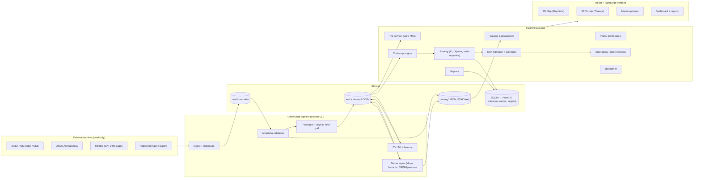
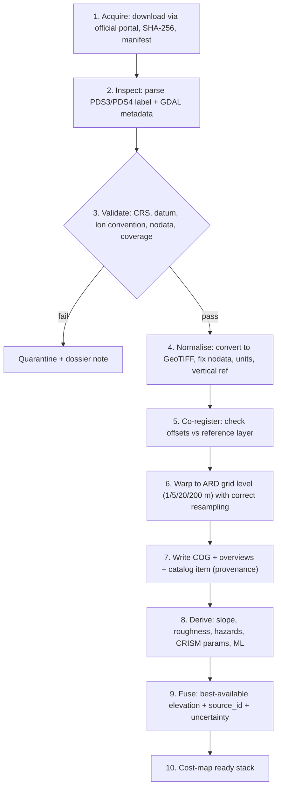

# Marswalk Planner — System Architecture

> [!CAUTION]
> Marswalk Planner is a **research and education decision-support prototype**. It is not NASA software, has not been certified or endorsed by NASA, and must never be presented as an operational astronaut-safety tool.

**Version:** 1.0 (approved as the starting direction on 2026-11-10).
**Related documents:** [data_sources.md](data_sources.md) · [assumptions.md](assumptions.md) · [implementation_roadmap.md](implementation_roadmap.md) · [../AGENTS.md](../AGENTS.md)

**Study area:** Jezero Crater, Mars. Approximate centre is ~18.4° N, 77.5° E (planetocentric, east-positive), and the diameter is ~45 km. *These values are to be verified against official products in Phase 1.*

---

## 0. Guiding principles (these apply to every module)

### 0.1 Epistemic classification: "how do we know this?"
Every raster, vector, and API value carries exactly one `epistemic_class`:

| Class | Definition | Example |
|---|---|---|
| `OBSERVED` | Direct instrument measurement or archived NASA product, used without changing its meaning | HiRISE orthoimage pixel, MOLA elevation, CRISM I/F |
| `DERIVED` | Produced from observed data by a deterministic, documented algorithm | Slope from a DTM, CRISM summary parameter |
| `INTERPRETED` | Human expert interpretation in published literature | Photogeologic unit map |
| `PREDICTED` | Output of a statistical or ML model, with uncertainty | CNN terrain-class probability |
| `HEURISTIC` | A rule of thumb or engineering assumption we chose | "Slopes > 25° are impassable", walking-speed model |
| `SIMULATED` | Hypothetical scenario input that nobody observed | "Dust storm reduces visibility to 1 km" |
| `UNKNOWN` | No data, or data of insufficient quality | Gap between HiRISE DTM strips |

**Why:** a route crosses many layers, and the user must see which parts rest on measurement and which rest on assumption. 🟥 ESSENTIAL.

### 0.2 Unknown ≠ safe
- A cell with no elevation data is **impassable by default** (hard constraint).
- A cell with only low-resolution data (e.g., only MOLA, ~463 m) is **passable but heavily penalised**, and the route is flagged.
- The user may relax this policy explicitly. The relaxation is recorded in the mission report.

### 0.3 Hard constraints vs soft costs
- **Hard constraint:** a binary mask. The route may never enter the cell (steep slope, no data, user exclusion zone). Every block carries a *reason code*.
- **Soft cost:** a positive number that makes a cell more or less expensive (roughness, uncertainty, sand, distance from base).
- These are kept in **separate rasters** and combined only inside the routing engine. That way every rejection can be explained ("blocked because slope = 31° > 25° limit").

### 0.4 Provenance everywhere
Every file has a sidecar metadata record with: source product IDs, download URL as retrieved, checksum, retrieval date, processing steps, software versions, parameters, and epistemic class. 🟥 ESSENTIAL.

### 0.5 Mars-native geodesy
All analysis runs in a **Mars coordinate reference system (CRS)**. Earth Web Mercator (EPSG:3857) is never used. Display projections are kept separate from analysis projections (see §4 and §6).

---

## 1. System architecture

### 1.1 High-level view



### 1.2 Key architectural decisions

| # | Decision | Why (plain language) | Priority |
|---|---|---|---|
| A1 | **Split into an offline pipeline and an online API** | Processing HiRISE data takes minutes to hours, and a web request cannot wait that long. The pipeline runs once and produces ready-to-use files; the API only reads them. | 🟥 |
| A2 | **A core science library (`marswalk`) that is independent of FastAPI** | The science code (CRS, slope, routing) can be tested without a web server and reused by the CLI, notebooks, and API. | 🟥 |
| A3 | **Cloud-Optimized GeoTIFF (COG) as the raster format** | It is a standard GeoTIFF that also supports fast partial reads (only the window you need) and overviews (pre-shrunk versions for zoomed-out views). GDAL and Rasterio read it natively. | 🟥 |
| A4 | **A STAC-like JSON catalog of all layers** | STAC (SpatioTemporal Asset Catalog) is a simple community standard for describing geospatial files. Using its structure gives us provenance and machine-readable metadata for free. Full STAC server compliance is optional. | 🟥 (format) / 🟩 (server) |
| A5 | **One fixed "Analysis-Ready Data (ARD) grid"** | Every layer is resampled onto the same grid (same CRS, origin, pixel size), so pixel *(i, j)* means the same place in every layer. Without this, cost-map arithmetic is wrong. | 🟥 |
| A6 | **Multi-resolution grid pyramid (1 m / 5 m / 20 m / 200 m)** | One metre over the whole crater is ~2.5 billion cells, which is too much for routing on a laptop. We route coarse over the whole crater, then refine at fine resolution inside a corridor. | 🟥 |
| A7 | **Asynchronous job pattern for heavy API calls** | Route optimisation can take seconds to minutes. The API returns a `job_id`, and the UI polls or streams progress. | 🟨 (MVP can be synchronous on small areas) |
| A8 | **SQLite first, PostGIS later** | You are a beginner, and PostGIS adds a server, Docker, and custom Mars SRIDs. SQLite (via SQLModel) is enough to store missions and routes. Move to PostGIS once there are many vector features or multi-user needs. | SQLite 🟥, PostGIS 🟩 |
| A9 | **Python `venv` + pip wheels (conda-forge as fallback)** | The `rasterio`/`pyproj` wheels bundle GDAL and PROJ, so no system GDAL is needed. conda-forge stays the fallback if we need GDAL command-line tools or ISIS. | 🟥 |
| A10 | **Docker Compose** | Gives reproducible deployment and makes PostGIS easy to run. It is not needed for local development at first. | 🟩 |
| A11 | **Architecture Decision Records (`docs/adr/`)** | Each important choice gets a one-page note (context → decision → consequences). This keeps the project's memory and helps you learn. | 🟨 |

---

## 2. Modular folder structure (as implemented in Phase 0)

```text
marswalk-planner/
├── AGENTS.md                 project rules for humans and AI agents
├── README.md                 setup + run instructions
├── .gitignore
├── backend/
│   ├── pyproject.toml        essential dependencies only
│   ├── requirements.lock     exact tested versions
│   ├── app/
│   │   ├── main.py           FastAPI app factory
│   │   ├── api/              HTTP routers (only layer that knows HTTP)
│   │   ├── core/             config, disclaimer, epistemic classes
│   │   ├── models/           Pydantic schemas
│   │   ├── services/         orchestration between API and domain
│   │   ├── catalog/          provenance + dataset catalog
│   │   ├── ingestion/        authentic data acquisition + validation
│   │   ├── geospatial/       Mars CRS, ARD grid, raster IO, co-registration
│   │   ├── terrain/          slope, roughness, curvature, hillshade
│   │   ├── hazards/          hazard layers + reason codes
│   │   ├── uncertainty/      coverage + confidence
│   │   ├── costmap/          hard constraints + soft-cost composition
│   │   ├── routing/          A*, Dijkstra, hierarchical, multi-objective
│   │   ├── science/          CRISM, geology, opportunity mapping
│   │   └── mission/          missions, EVA, scenarios, emergency
│   └── tests/
│       ├── unit/
│       └── architecture/     enforces the layering rules
├── frontend/                 React + TypeScript (Vite)
│   └── src/{api,components}/ grows into pages/, features/, mars/, state/
├── data/
│   ├── raw/                  immutable downloads (git-ignored)
│   ├── interim/              disposable intermediates (git-ignored)
│   ├── processed/            ARD COGs + derived layers (git-ignored)
│   ├── sample/               clipped subsets of verified real products (git-ignored)
│   ├── catalog/              provenance JSON (tracked)
│   └── manifests/            download manifests + SHA-256 (tracked)
├── docs/                     architecture, data sources, assumptions, roadmap, adr/
├── tests/                    cross-system tests: e2e/ (Playwright), validation/
└── scripts/                  helper scripts (check_environment.py)
```

### 2.1 Changes from the original proposal (and why)

| Original proposal | Implemented | Reason |
|---|---|---|
| `backend/src/marswalk` (science) + `backend/src/marswalk_api` (web) | One package, `backend/app/`, with an `api/` layer and domain sub-packages | Simpler for a beginner, and matches the owner's suggested structure. The science/web separation is kept by an **automated architecture test** (`tests/architecture/test_layering.py`): domain packages may not import `app.api`, `app.services` or `fastapi`. |
| Added to the owner's suggestion: `catalog/`, `ingestion/`, `uncertainty/`, `costmap/` | Implemented | Provenance, ingestion, uncertainty and the hard/soft cost engine are core scientific requirements. They need their own homes rather than hiding inside other modules. |
| `models/` meaning | Pydantic data schemas | ML weights will live in `ml/models/` (created in Phase 8) to avoid confusion. |
| conda-forge environment | Python `venv` + pip wheels | The `rasterio` and `pyproj` wheels bundle GDAL 3.12 / PROJ 9.8 (verified: `IAU_2015:49900` resolves). This avoids a conda dependency for now. **Revisit** if we need GDAL command-line tools (`gdalwarp`, `gdal2tiles`) or USGS ISIS, which are easiest via conda-forge. |
| `data/staging`, `data/ard`, `data/derived`, `data/products` | `data/interim`, `data/processed`, `data/sample` (+ `catalog`, `manifests`) | Follows the owner's suggested naming. `processed/` holds both ARD and derived layers, which are told apart by catalog records. |
| ESLint | oxlint (Vite template default) | Faster and needs zero configuration. It can be swapped later if a rule is missing. |

## 3. Data sources

See [data_sources.md](data_sources.md) for candidate products, verification status and the metadata checklist.

## 4. Geospatial processing architecture

### 4.1 Mars coordinate reference systems

| Role | CRS | Why |
|---|---|---|
| **Geographic (storage of lat/lon)** | 🔍 `IAU_2015:49900`: Mars 2015 sphere, planetocentric latitude, east-positive longitude, R = 3,396,190 m (available in PROJ ≥ 8.2; to be checked with `gdalsrsinfo`) | IAU-standard and machine-readable. Matches how most NASA Mars map products are referenced. |
| **Analysis (projected, metres)** | Custom **"Jezero Equirectangular"**: equirectangular, sphere R = 3,396,190 m, centre longitude ≈ 77.5° E, standard parallel ≈ 18.4° N (exact values fixed in ADR-0001) | Matches the native projection style of HiRISE/CTX DTMs, so the highest-resolution data needs minimal resampling. Across the crater (±0.5° latitude) the east–west scale error is ≈0.3%, which is negligible for slope and distance. |
| **Display (2D web map)** | Mercator on the Mars sphere (R = 3,396,190 m), tile indices identical to the standard XYZ scheme | Lets MapLibre work unmodified (see §6.3). **Display only, never used for analysis.** |
| **3D view** | Local metric coordinates derived from the analysis CRS | Simple and exact for a ~50 km area. |

**Canonical API convention 🟥:** planetocentric latitude and **east-positive longitude in [−180, 180)**. Inputs in 0–360 are accepted only with an explicit `lon_convention: "0_360_east"` field. West-positive input is rejected unless declared explicitly. (Jezero, at ~77.5° E, has the same value in both east-positive ranges. That is convenient, but it can also *hide* bugs, so tests use points on both sides of 180°.)

**Vertical reference 🟥:** heights are metres **relative to the Mars areoid** (equipotential "sea level"), because MOLA, HRSC-MOLA, and HiRISE DTMs are typically areoid-referenced 🔍. Products that store planetary *radius* must be converted, and the conversion is logged.

### 4.2 Pipeline stages



### 4.3 ARD grid levels

| Level | Pixel | Extent | Main sources | Used for |
|---|---|---|---|---|
| L3 | 200 m | Jezero + surroundings (~150 × 150 km) | MOLA, HRSC-MOLA | Context, fallback |
| L2 | 20 m | Whole crater (~60 × 60 km) | CTX DTM | **Global route search** |
| L1 | 5 m | Crater (imagery); DTM-derived where available | CTX ortho, HiRISE DTM aggregated | Hazard aggregation, display |
| L0 | 1 m | Only where HiRISE DTMs exist | HiRISE DTM + ortho | **Corridor refinement**, fine hazards |

All levels share the same CRS and are **pixel-aligned**: L2 pixel edges coincide with L0 pixel edges (20 = 20 × 1). 🟥 ESSENTIAL.

### 4.4 Resampling rules (scientific correctness)

| Data type | Upsample | Downsample | Why |
|---|---|---|---|
| Elevation | bilinear/cubic | **average** | Preserves mean height. |
| Slope / roughness | (never upsample) | **max or 95th percentile** plus mean | Averaging slopes hides dangerous steep spots. Hazards are computed at native resolution, then aggregated *conservatively*. |
| Categorical (geology, class) | nearest | **mode**, plus a "fraction of class" band | Avoids inventing new class values. |
| Probability (ML) | bilinear | average + max | Keeps calibrated meaning. |
| Masks (nodata/coverage) | nearest | "any nodata → partial flag" plus coverage fraction | Unknown must not be diluted into "known". |

### 4.5 Co-registration (raster alignment) 🟥
- **Reference frame:** the controlled Mars 2020 products (if accepted). Otherwise HiRISE DTMs controlled to MOLA.
- **Check method:** compute hillshade from the DTM and match it against the orthoimage using phase correlation (OpenCV/scikit-image). This measures the x/y shift in metres. Vertical bias is checked against MOLA PEDR shots.
- **Policy:** offsets below half a pixel of the coarser layer are accepted. Larger offsets are corrected by a documented shift (a DERIVED step) or the layer is rejected. All offsets are recorded in the catalog.

### 4.6 Uncertainty and coverage layers 🟥
For each ARD level:
- `source_id`: which product supplied each pixel.
- `coverage`: fraction of the pixel backed by real (non-interpolated) data.
- `elev_sigma`: per-pixel vertical uncertainty estimate (from product documentation plus resolution class; HEURISTIC where the documentation gives no number).
- `slope_sigma`: propagated from `elev_sigma` and pixel size.
- `confidence`: a combined 0–1 index used by the cost engine and shown to the user.

---

## 5. Backend module responsibilities and API contracts

### 5.1 Module responsibilities (`backend/app/`)

| Module | Responsibility | Inputs → Outputs | Priority |
|---|---|---|---|
| `crs` | Mars CRS registry, lon/lat normalisation, transforms, Mars geodesic distance | coords → coords | 🟥 |
| `catalog` | Provenance models, epistemic class, catalog IO | metadata → catalog JSON | 🟥 |
| `ingestion` | Download with resume plus checksum; PDS label parsing; dossier generation | product IDs → raw files + manifest | 🟥 |
| `raster` | ARD grid definition, warping, resampling rules, masks, COG writing | rasters → aligned COGs | 🟥 |
| `terrain` | Slope (Horn method), aspect, roughness (RMS, TRI), curvature, hillshade | DTM → derivatives | 🟥 |
| `hazards` | Slope classes, rock hazard, sand/dune hazard, crater rim/wall hazard | derivatives + CV → hazard layers + reason codes | 🟥 |
| `vision` | OpenCV texture features, shadow-based rock detection, dune-ripple orientation | imagery → features | 🟨 |
| `ml` | Model loading, tiled inference, calibration, model cards | features/imagery → class probabilities | 🟨 |
| `science` | CRISM parameter mapping, geology-unit scoring, user targets, opportunity layer | CRISM/geology → science value raster | 🟨 |
| `uncertainty` | Coverage, sigma propagation, confidence index | layers → uncertainty rasters | 🟥 |
| `costmap` | Builds the hard-constraint mask and the soft-cost stack from a *profile* | layers + profile → cost bundle | 🟥 |
| `routing` | Graph abstraction, A*, Dijkstra, hierarchical search, smoothing, multi-objective | cost bundle + waypoints → routes | 🟥 |
| `eva` | Traverse time, metabolic and consumables model, walk-back constraints | route + suit profile → EVA estimate | 🟨 |
| `scenarios` | Parameterised environmental scenarios (dust, temperature, illumination) | scenario → modified profile + EVA effects | 🟨 |
| `emergency` | Return-to-base cost field, point of no return, reroute after a blockage | route + events → contingency plans | 🟨 |
| `reports` | Assemble mission report (HTML → PDF), GeoJSON/GeoTIFF exports | mission → files | 🟨 |

### 5.2 API conventions
- Base path `/api/v1`. OpenAPI is generated automatically by FastAPI, and the TypeScript client is generated from it, so frontend and backend types never drift.
- Every analytical response contains a **standard envelope**:

```json
{
  "data": { "...": "..." },
  "meta": {
    "epistemic_summary": { "OBSERVED": 0.42, "DERIVED": 0.31, "HEURISTIC": 0.20, "UNKNOWN": 0.07 },
    "provenance": ["catalog:hirise_dtm_xxx@v1", "catalog:ctx_dtm_mosaic@v1"],
    "crs": "IAU_2015:49900",
    "lon_convention": "pm180_east",
    "warnings": ["Segment 3 crosses 410 m of MOLA-only terrain"],
    "disclaimer": "Research prototype. Not NASA-certified. Not for operational EVA safety decisions."
  }
}
```

(`xxx` is a placeholder. Real IDs come only from verified products.)

### 5.3 Endpoint contracts (summary)

| Method & path | Purpose | Request (key fields) | Response (key fields) | Phase |
|---|---|---|---|---|
| `GET /health` | Liveness | — | status, versions | 4 |
| `GET /datasets` | List catalog products | filters | id, title, source, epistemic_class, resolution, status | 4 |
| `GET /datasets/{id}` | Full dossier + provenance | — | metadata, checksum, processing chain, caveats | 4 |
| `GET /layers` | Display layers + legends | level | id, type, legend, value range, units | 4 |
| `GET /tiles/{layer}/{z}/{x}/{y}.{png\|webp}` | Raster tiles (Mars TMS) | colormap, rescale | image | 4 |
| `GET /terrain/{z}/{x}/{y}` | Elevation tiles/meshes for 3D | encoding | heightmap (float32/terrain-RGB) | 6 |
| `POST /coords/transform` | Convert coordinates between conventions/CRSs | points, from, to | points | 2 |
| `GET /query/point` | All layer values at a point | lon, lat | per-layer value + class + uncertainty | 4 |
| `POST /query/profile` | Elevation/slope along a line | LineString | samples (distance, z, slope, source) | 4 |
| `GET /profiles/cost` | List cost profiles (presets) | — | profiles | 5 |
| `POST /costmaps` | Build/preview a cost map | profile (weights, limits, unknown-policy), bbox, level | costmap_id, stats, preview tile URL | 5 |
| `POST /routes/plan` | Plan a single route | waypoints[], costmap_id or profile, algorithm (`astar`\|`dijkstra`), refine: bool | route GeoJSON + per-segment metrics + blocked reasons | 5 |
| `POST /routes/compare` | Multi-objective set | waypoints, objectives[], method (`weighted_sweep`\|`epsilon`\|`pareto`) | candidate routes + Pareto front | 9 |
| `POST /eva/estimate` | Duration and consumables | route_id, suit_profile, crew, scenario_id | timeline, margins, walk-back check, uncertainty bands | 9 |
| `GET/POST /scenarios` | Define/evaluate scenarios | parameters | scenario_id, effects (all SIMULATED) | 9 |
| `POST /emergency/return-to-base` | Safest return from any point | position, base, profile | route + time + margin | 9 |
| `POST /emergency/reroute` | Replan after a new obstacle | route_id, position, blocked geometry | new route + delta | 9 |
| `GET /emergency/pnr/{route_id}` | Point of no return along a route | — | distance/time of PNR, margin curve | 9 |
| `CRUD /missions` | Save missions (base, waypoints, routes) | mission JSON | mission | 5 |
| `POST /reports` | Generate a report | mission_id, format (`html`\|`pdf`\|`geojson`\|`zip`) | job_id → download URL | 10 |
| `GET /jobs/{id}` | Job status | — | state, progress, result link | 5 |

### 5.4 Example contract: `POST /routes/plan`

```json
// Request
{
  "waypoints": [
    {"lon": 77.45, "lat": 18.44, "label": "Base"},
    {"lon": 77.40, "lat": 18.47, "label": "Target A"}
  ],
  "lon_convention": "pm180_east",
  "profile": {
    "hard": { "max_slope_deg": 25, "unknown_elevation": "forbid", "exclusion_zones": [] },
    "soft": { "w_slope": 1.0, "w_roughness": 0.8, "w_sand": 1.2, "w_uncertainty": 1.5, "w_science": 0.3 },
    "anisotropic_slope": true
  },
  "algorithm": "astar",
  "refine_corridor_m": 200
}
```

```json
// Response (data part)
{
  "route_id": "r_...",
  "geometry": { "type": "LineString", "coordinates": [[77.45, 18.44], "..."] },
  "summary": { "length_2d_m": 0, "length_3d_m": 0, "ascent_m": 0, "descent_m": 0,
               "max_slope_deg": 0, "min_confidence": 0, "est_time_s": null },
  "segments": [ { "from_idx": 0, "to_idx": 57, "dominant_source": "hirise_dtm",
                  "epistemic_class": "DERIVED", "flags": [] } ],
  "blocked_reasons_nearby": [ { "code": "SLOPE_GT_MAX", "count_cells": 0 } ]
}
```

*(Coordinates and numbers here are format placeholders, not results.)*

---

## 6. Frontend page and component architecture

### 6.1 Stack decisions

| Choice | Why | Priority |
|---|---|---|
| React + TypeScript + **Vite** | Fast dev server and simple configuration. TypeScript catches mistakes early. | 🟥 |
| **TanStack Query** | Handles loading/caching of API data with little code. | 🟥 |
| **Zustand** | Small, beginner-friendly global state (selected layers, mission draft). | 🟥 |
| **openapi-typescript** (generated API types) | Frontend types always match backend schemas. | 🟥 |
| **MapLibre GL JS** (2D) | Fast WebGL map with an open licence. Works for Mars with the display-TMS approach in §6.3. | 🟥 |
| **Three.js via react-three-fiber** (3D) | A local terrain mesh avoids globe/ellipsoid complications. Simplest correct 3D option for a ~50 km site. | 🟨 |
| CesiumJS (3D globe) | Supports non-Earth ellipsoids, but is heavier and more complex. Revisit only if a globe view is needed. | 🟩 |
| Charts: Recharts or Vega-Lite | Elevation profiles, Pareto fronts, EVA timelines. | 🟨 |
| UI kit: Mantine or shadcn/ui | Consistent accessible components. | 🟨 |

### 6.2 Pages

| Page | Purpose | Key components |
|---|---|---|
| **Landing / Disclaimer** | Project purpose, non-certification statement, data credits | `DisclaimerBanner`, `CreditsList` |
| **Data Catalog** | Browse datasets, dossiers, provenance, coverage footprints | `DatasetTable`, `ProvenanceTimeline`, `FootprintMap` |
| **Map Explorer (2D)** | Layers, legend, point inspection, profiles | `MarsMap`, `LayerPanel`, `Legend`, `EpistemicBadge`, `CoordinateReadout`, `MarsScaleBar`, `PointInspector`, `ProfileTool` |
| **Terrain 3D** | DTM mesh with draped imagery/hazards; route in 3D | `Terrain3DView`, `VerticalExaggerationControl`, `Route3DLine` |
| **Hazards & Uncertainty** | Hazard layers, reason codes, confidence map | `HazardLayerSelector`, `ReasonCodeLegend`, `UncertaintyOverlay` |
| **Science Opportunities** | CRISM/geology layers, targets | `ScienceLayerPanel`, `TargetEditor`, `SpectralParamLegend` |
| **Mission Planner** | Base, waypoints, profile, compute route | `WaypointEditor`, `ConstraintEditor` (hard), `CostWeightSliders` (soft), `RouteResultPanel`, `SegmentTable` |
| **Route Comparison** | Multi-objective alternatives | `ParetoChart`, `RouteCompareTable`, `RouteMapOverlay` |
| **EVA & Scenarios** | Duration/consumables under scenarios | `SuitProfileForm`, `ScenarioPicker`, `EVATimeline`, `MarginGauge`, `SimulatedBadge` |
| **Emergency** | Return-to-base field, point of no return, reroute | `ReturnFieldOverlay`, `PNRMarker`, `ObstacleDrawTool`, `RerouteDiff` |
| **Mission Dashboard** | Summary of a mission | `MissionSummaryCards`, `RiskBreakdown`, `EpistemicPie` |
| **Reports** | Build and download reports | `ReportBuilder`, `ExportButtons` |

### 6.3 Mars map-rendering strategy (important)

**The problem:** MapLibre assumes Earth Web Mercator (EPSG:3857). It uses Earth's radius in its built-in scale bar, metre conversions, and 3D terrain.

**The solution:**
1. The backend serves tiles in a **Mars Mercator tile matrix set**: a Mercator projection on the Mars sphere, built with `morecantile`/`rio-tiler` custom TMS 🔍.
   - Tile *z/x/y* indices map to the **same latitude/longitude degrees** as standard XYZ tiles.
   - So MapLibre places Mars lat/lon correctly. Only its metre-based features are wrong.
2. **Disable** MapLibre's scale control and built-in terrain. Implement `MarsScaleBar` and a measuring tool with Mars-radius geodesic maths (in `frontend/src/mars/`, created in Phase 4).
3. **Never** compute distances, areas, or slopes in the browser from display coordinates. Those come from the backend in the analysis CRS.
4. Mercator distortion at Jezero (~18° N) is ~5% areal scale (sec 18.4° ≈ 1.054). That is acceptable for *display*, and the Mars-correct scale bar accounts for it.

**Alternative (🟩):** OpenLayers with proj4 supports truly custom display projections, such as the equirectangular analysis CRS. Switch to it if the Mercator display proves inadequate. NASA-JPL's open-source MMGIS (Leaflet-based) is a useful reference implementation of Mars web mapping.

---

## 7. ML and computer-vision strategy

### 7.1 Philosophy: earn the complexity
Start with transparent, physics- or geometry-based rules. Add classical ML next, and use deep learning only where labelled data and measurable improvement justify it.

| Stage | Method | Output | Class | Priority |
|---|---|---|---|---|
| S0 | **DTM-based rules:** slope, roughness, curvature thresholds | Slope/roughness hazards | DERIVED + HEURISTIC thresholds | 🟥 |
| S1 | **Classical CV (OpenCV):** texture (local variance, GLCM, Gabor), shadow detection for rocks, FFT orientation for ripples/dunes, edge density | Feature rasters, rock candidates | DERIVED | 🟨 |
| S2 | **Classical ML:** Random Forest / gradient boosting on S0+S1 features with a small hand-labelled set | Terrain-class probabilities | PREDICTED | 🟨 |
| S3 | **PyTorch U-Net** (or similar) segmentation on HiRISE chips, used only if S2 plateaus and labels are sufficient | Class probabilities | PREDICTED | 🟩 |

### 7.2 Terrain classes (draft)
`smooth_regolith`, `rocky_outcrop`, `boulder_field`, `sand_ripples_dunes`, `layered_bedrock`, `crater_wall_steep`, `fractured_terrain`, `unknown_low_confidence`.
They will be aligned with Stack et al. (2020) units where possible (🔍 verify unit definitions).

### 7.3 Rocks: an honest resolution limit
- HiRISE at ~25 cm/pixel can only detect rocks larger than ~1–1.5 m (a few pixels wide, often detected from their shadows). Precedent: the shadow-based rock-counting methods used in landing-site selection (Golombek et al.) 🔍.
- **Smaller rocks, which matter to a walking astronaut, are not observable from orbit.** We model them statistically using rock size–frequency distributions extrapolated from the visible rocks (a HEURISTIC layer). Their uncertainty is always shown.

### 7.4 Labels and validation
- Hand-label polygons in QGIS following a written **labelling protocol** (`ml/labels/PROTOCOL.md`). These are marked as human interpretation.
- **Spatially blocked cross-validation:** train and test areas are geographically separated. Random pixel splits leak information between neighbouring pixels and inflate accuracy.
- Metrics: per-class IoU/F1, confusion matrix, **calibration** (reliability curve, expected calibration error).
- Predictions below a confidence threshold become `unknown_low_confidence`, and that class is treated as unknown (not safe) by the cost engine.
- Each model ships with a **model card**: data, classes, metrics, known failure modes, intended use.
- Qualitative ground-truthing against Perseverance traverse imagery where it overlaps (🔍 data availability).

### 7.5 Precedent
JPL's SPOC (Soil Property and Object Classification) used HiRISE terrain classification for Curiosity traverse planning 🔍. This shows the approach is scientifically reasonable. We will not claim equivalence.

---

## 8. Routing and optimisation strategy

### 8.1 Graph model 🟥
- **Grid graph** on an ARD level. Each cell is a node.
- 8-connected neighbours at first; **16-connected** is optional (🟨) to reduce zig-zag paths.
- **Hard mask:** impassable cells are removed. Each removal stores its reason code.
- **Edge cost** from cell *u* to *v* (always > 0, which A*/Dijkstra require):

$$
c(u,v) = L_{3D}(u,v)\cdot\big(1 + \bar{s}(u,v)\big)\cdot f_{grade}(\theta_{uv})
$$

  - $L_{3D}$ is the 3D step length in metres.
  - $\bar{s}$ is the mean soft cost of *u* and *v*: a weighted sum of normalised slope, roughness, sand, uncertainty, and (bounded) science-attraction terms.
  - $f_{grade}$ is an **anisotropic** (direction-dependent) function of the signed grade. Uphill and downhill cost differently. It is a HEURISTIC adapted from walking-energetics literature for 0.38 g, and its parameters are documented.
- Science value is a *reward*. To keep costs positive, it is implemented as a bounded discount (the cost multiplier never drops below a floor such as 0.5) or handled as waypoint selection (§8.4).

### 8.2 Algorithms

| Algorithm | Use | Why | Priority |
|---|---|---|---|
| **Dijkstra** (one-to-all) | Cost-to-go fields from base: reachability, return-to-base from *any* point, isochrones | One run answers "how expensive is it to get home from everywhere?" Core of emergency planning. | 🟥 |
| **A\*** (point-to-point) | Interactive route planning | Faster than Dijkstra for one target. The heuristic (straight-line distance × minimum possible cost per metre) is *admissible*, meaning it never overestimates, so A* stays optimal. | 🟥 |
| **Hierarchical planning** | Coarse route on L2 (20 m), then refined A* in a corridor on L0/L1 | Makes crater-scale fine-resolution routing feasible on a laptop. | 🟥 |
| **Path smoothing** (line-of-sight / Theta*-style) | Remove grid artefacts | More natural walking paths. Every smoothed segment is re-checked against the hard mask. | 🟨 |
| **Weighted-sum sweep** | Multi-objective alternatives | Simple and fast. Shows trade-offs. | 🟨 |
| **ε-constraint method** | e.g., "minimise risk subject to time ≤ T" | Finds solutions a weighted sum misses. | 🟨 |
| **Pareto label-setting (NAMOA\*)** | Exact Pareto front on a coarse grid | Rigorous but expensive. | 🟩 |
| **Orienteering heuristic** | Choose which science targets to visit within an EVA budget | Science-maximising itineraries. | 🟩 |
| **D\* Lite** | Incremental replanning | Plain A* re-runs on a corridor are probably fast enough. | 🟩 |

**Implementation:** custom Python with NumPy and `heapq`. Hot loops will be accelerated with **Numba** if needed (🟨). `scikit-image`'s `MCP_Geometric` and `networkx` serve as **independent reference oracles in tests**, not in production.

### 8.3 Objectives (vector per route)
1. Traverse time (EVA model)
2. Energy / metabolic cost (HEURISTIC model)
3. Hazard exposure (integral of hazard along the route)
4. Uncertainty exposure (length through low-confidence or UNKNOWN cells)
5. Science value (sum of visited/nearby science value)
6. Return margin (minimum consumables margin over the route)

### 8.4 EVA, scenarios and emergency logic

**EVA estimator 🟨**
- Speed model v(slope, terrain, suit, gravity) is a HEURISTIC. It is parameterised and cites the literature it draws on (e.g., Apollo traverse experience, analogue-field studies 🔍). It is never presented as validated for real suits.
- Consumables use a **user-supplied suit profile**: O₂, CO₂ scrubbing, power, water, thermal. We do **not** fabricate real suit specifications. Defaults are clearly marked "illustrative placeholder".
- Monte Carlo sampling over speed and consumption gives P10/P50/P90 duration bands.
- **Walk-back rule** (inspired by EVA walk-back limit concepts): at every point, remaining consumables must be ≥ return cost (from the Dijkstra return field) × safety factor.

**Scenarios 🟨 (all SIMULATED)**
- Dust event: lower visibility, more uncertainty weight, lower solar power.
- Temperature extremes: changes consumable rates. MEDA data provides *observed* ranges.
- Illumination: sun elevation via SPICE, plus DTM horizon/shadow casting, gives EVA time windows.

**Emergency 🟨**
- Precompute a **conservative-profile return-to-base field**.
- **Point of no return (PNR):** the furthest point along the route where the return cost still fits the remaining margin.
- **Reroute:** add the obstacle to the hard mask and re-run A* from the current position to the target or base.
- **Safe havens/rally points:** optional extra Dijkstra sources.

---

## 9. Testing and scientific validation strategy

### 9.1 Software testing

| Layer | Tooling | What we test | Priority |
|---|---|---|---|
| Unit | pytest | Every function in `marswalk` | 🟥 |
| Property-based | Hypothesis | CRS round-trips (lon/lat → projected → lon/lat within 1 mm); lon normalisation idempotence; antimeridian handling | 🟥 |
| Scientific golden tests | pytest + synthetic rasters | Slope on planes with known slope, cones, hemispheres; roughness on known noise; resampling rules | 🟥 |
| Routing correctness | pytest | A* cost == Dijkstra cost on random grids; matches `MCP_Geometric`/`networkx` oracle; never enters hard-masked cells; known optimal paths on hand-built mazes | 🟥 |
| Data contracts | pytest | Every catalog item has provenance, CRS, epistemic class, checksum; every ARD layer is pixel-aligned with the grid definition | 🟥 |
| API | FastAPI TestClient / httpx; Schemathesis (🟩) | Status codes, schemas, disclaimer present, envelope fields | 🟥 |
| Frontend unit | Vitest + Testing Library | Mars scale bar, coordinate formatting, badges | 🟨 |
| End-to-end | **Playwright** | Load map → toggle layer → plan route → see blocked reasons → export report; visual snapshot of map tiles | 🟨 |
| Performance | pytest-benchmark | Routing time per grid size; tile latency | 🟩 |

> [!NOTE]
> Test fixtures are **synthetic** (mathematically generated surfaces) or **tiny clipped subsets of real, verified products**. We never create fake data that imitates NASA observations.

### 9.2 Scientific validation (documented in `docs/validation/`)
1. **Geodetic checks:** distances between known features computed in our CRS vs. independent geodesic computation on the Mars sphere. 🔍 Locate the published Perseverance landing-site coordinates (Octavia E. Butler Landing) on the imagery.
2. **Vertical consistency:** HiRISE vs CTX vs HRSC-MOLA vs MOLA PEDR. Report mean bias and RMSE.
3. **Horizontal alignment:** measured offsets between layers (phase correlation), reported in metres.
4. **Slope realism:** compare slope distributions with any published Jezero slope statistics from landing-site studies 🔍.
5. **Resolution sensitivity:** the same route at 1 / 5 / 20 m. Show how hazard detection changes, which demonstrates why fine data matters.
6. **Cost-weight sensitivity analysis:** how much the route changes per weight change, so users see robustness.
7. **Plausibility vs Perseverance traverse:** a qualitative comparison only (a rover is not a human, and the planning criteria differ).
8. **ML evaluation:** spatial CV metrics, calibration, failure-mode gallery.
9. **Uncertainty honesty audit:** confirm UNKNOWN areas are never displayed or treated as safe.

---

## 10. Implementation roadmap

See [implementation_roadmap.md](implementation_roadmap.md).

## 11. Technical risk register

| # | Risk | Area | Likelihood / Impact | Mitigation |
|---|---|---|---|---|
| R1 | **Longitude convention mix-ups** (0–360 vs ±180, east vs west positive; older products sometimes use west-positive) | CRS | High / High | Single canonical convention; explicit `lon_convention` field; property tests across the 180° boundary; dossier records each product's convention |
| R2 | **Planetocentric vs planetographic latitude** (differ by up to ~0.3° at mid-latitudes on Mars, i.e., kilometres) | CRS | Medium / High | Record latitude type per product; convert explicitly; reject ambiguous labels |
| R3 | **Sphere vs ellipsoid / legacy "Mars 2000" WKT and ESRI codes**; old PROJ lacks the IAU authority | CRS | Medium / Medium | Pin GDAL/PROJ versions; normalise all CRS to the registry in `crs/`; log the original WKT |
| R4 | **PDS3 label misinterpretation by GDAL** (projection centre, offsets, west-positive) | CRS / ingest | Medium / High | Cross-check GDAL-derived bounds against label values and known features; ingestion validator |
| R5 | **Vertical datum mismatch** (areoid vs sphere vs radius; scale/offset factors) | Elevation | Medium / High | Vertical-reference field mandatory; PEDR bias check; reject unknown datum |
| R6 | **Horizontal misregistration** between HiRISE, CTX, CRISM, and uncontrolled mosaics (tens to hundreds of metres possible) | Alignment | High / High | Prefer the co-registered Mars 2020 product set; phase-correlation checks; offset thresholds; document residuals |
| R7 | **Resampling artefacts / hazard dilution** when downsampling | Raster | High / High | Conservative aggregation rules (§4.4); compute hazards at native resolution |
| R8 | **DTM artefacts** (interpolated patches, seams, stereo-matching errors in shadows/bland sand) | Elevation | High / Medium | Use quality/interpolation masks where provided; roughness spikes flagged; low-confidence → UNKNOWN |
| R9 | **Incomplete HiRISE DTM coverage** of the crater | Availability | High / Medium | Multi-resolution fusion with `source_id`; penalise coarse-only areas; optional own DTMs (ASP) later |
| R10 | **Large files and download limits** (HiRISE products are hundreds of MB to GB) | Availability | High / Medium | Clip to AOI early; resumable downloads; ~100–300 GB disk planned; COG overviews |
| R11 | **Product names/locations differ from my recollection** | Availability | Medium / Medium | Phase-1 verification gate; nothing enters the pipeline unverified |
| R12 | **Licensing/registration** (e.g., Mars Climate Database, non-NASA datasets) | Availability | Medium / Low | Check terms in the dossier; keep non-NASA data clearly labelled and optional |
| R13 | **MapLibre Earth assumptions** (scale bar, metres, terrain exaggeration, geodesic measurements) | Rendering | High / High | Mars TMS; disable built-in scale/terrain; custom Mars measurement tools; backend-only analysis |
| R14 | **Tile performance** with large rasters | Rendering | Medium / Medium | COG + overviews; tile caching; pre-render static tiles for heavy basemaps |
| R15 | **3D accuracy confusion** (vertical exaggeration, curvature ignored over ~50 km, i.e., ~90 m drop at 25 km) | Rendering | Medium / Low | Always display the exaggeration factor; state that it is a "local flat-projected view" |
| R16 | **Routing scale** (billions of cells at 1 m) | Routing | High / High | Hierarchical planning; corridor refinement; Numba if needed |
| R17 | **Grid artefacts and metric bias** (8-connectivity overestimates length by up to ~8%) | Routing | High / Low | 16-connectivity/smoothing; re-measure final path in true 3D |
| R18 | **ML domain shift / overconfidence**; few labels | ML | High / High | Spatial CV; calibration; unknown class; model cards; ML is never a sole hard constraint without review |
| R19 | **Unvalidated human-EVA models** (speed, metabolic, suit) | Science | Certain / High | HEURISTIC/SIMULATED labels; user-supplied profiles; uncertainty bands; prominent disclaimer |
| R20 | **Small-rock hazard unobservable from orbit** | Science | Certain / High | Statistical rock model labelled HEURISTIC; explicit "not observable" note in reports |
| R21 | **macOS GDAL install issues** | Tooling | High / Medium | conda-forge env; version pin; smoke test in P0 |
| R22 | **Scope creep for a solo developer** | Project | High / High | Strict MVP (P0–P5) first; optional items deferred; ADRs for scope changes |

---

## 12. Summary: essential vs optional

| Essential (MVP, P0–P5) | Recommended (P6–P10) | Optional / advanced |
|---|---|---|
| Phase-1 data verification; provenance catalog; Mars CRS module; ARD grid + COGs; resampling rules; co-registration checks; slope/roughness hazards; coverage & uncertainty; hard/soft cost engine; A*, Dijkstra, hierarchical routing; FastAPI catalog/tiles/query/routes; MapLibre with Mars TMS + Mars scale bar; disclaimers; pytest + golden tests | Three.js 3D; CRISM + geology science layer; OpenCV features; Random Forest classifier; multi-objective sweeps/ε-constraint; EVA estimator; scenarios; emergency/PNR; reports; Playwright E2E; ADRs; SPICE illumination | PostGIS; Docker; CesiumJS globe; PyTorch U-Net; NAMOA* Pareto; orienteering; D* Lite; own DTMs via ASP/ISIS; STAC server; Numba; Schemathesis |
