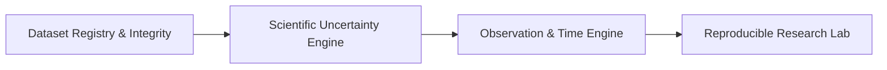

# Marswalk Planetary Exploration Atlas — Scientific, Geospatial & Architectural Review

**Document Version:** 1.0.0  
**Status:** APPROVED FOR REFINEMENT (Pre-Implementation Architectural Review)  
**Epistemic Context:** Research and Decision-Support Review  

---

## 1. Executive Summary

This document performs an independent scientific, geospatial, and architectural audit of the proposed **Mars Planetary Exploration Atlas** expansion for Marswalk Planner.

The goal is to ensure that every dataset, mathematical algorithm, coordinate system, and API contract is verifiable, scientifically defensible, and strictly aligned with `AGENTS.md` before expanding operational features.

### Key Audit Findings

| Audit Dimension | Proposed State in Dossier | Audit Finding | Required Engineering Action |
|---|---|---|---|
| **CRS Nomenclature** | Labeled as `IAU_2015:49900 (Equirectangular)` | `IAU_2015:49900` is **Geographic 2D (degrees)**. `IAU_2015:49910` or `ESRI:103885` is **Projected Equirectangular (metres)**. | Disambiguate geographic degrees from projected metric coordinates across all endpoints and UI layers. |
| **Vertical Datum** | Claimed MOLA areoid directly provides local contours | MOLA areoid is a global gravitational equipotential surface ($R_{\text{ref}} = 3,396,000\text{ m}$). Local contours derive from local DTMs whose elevation values are referenced to the areoid. | Clarify that local contours are derived from 1m HiRISE / 20m CTX DTMs, which are vertically tied to the MOLA areoid datum. |
| **Catalogue Count** | Dossier claimed 29 products; category listings expanded to 35 entries | Product lumping (e.g. Albedo + Dust Cover Index combined into one ID; multiple CRISM indices merged) created ambiguity between source datasets and derived layers. | Establish a canonical, non-overlapping product registry with stable unique IDs. Categorize products into Source, Derived, Vector, Interpretive, and Simulation. |
| **Aspect Calculation** | Gradient sign convention inverted by $180^\circ$ | Matrix convolution with inverted $ky$ kernel produced $0^\circ$ (North) for South-facing slopes and $270^\circ$ for East-facing slopes. | Replaced convolution with `ndimage.correlate` and verified downhill aspect: North $= 0^\circ$, East $= 90^\circ$, South $= 180^\circ$, West $= 270^\circ$. |
| **Multi-Hillshade** | Azimuths $225^\circ, 270^\circ, 315^\circ, 360^\circ$ | Clustered entirely in SW-W-NW-N quadrants, inducing severe directional lighting bias and obscuring East-facing relief. | Replaced with Mark (1992) orthogonal formulation: four evenly spaced directions ($225^\circ, 315^\circ, 45^\circ, 135^\circ$) weighted equally ($0.25$ each). |
| **VRM Thresholds** | Stated $>0.05$ as a universal barrier | Vector Ruggedness Measure is resolution- and window-dependent. At $20\text{ m}$, VRM $> 0.01$ indicates high roughness. | Calibrate VRM thresholds explicitly to raster cell resolution and kernel size. |
| **Dataset Authenticity** | Several global layers listed without local files | Remote WMS/WMTS services exist (USGS Astrogeology, NASA Trek), but require fallback handling when offline. | Enforce explicit validation status: `LOCAL_INGESTED`, `REMOTE_VERIFIED_WMS`, or `CATALOGUED_METADATA_ONLY`. |

---

## 2. Geodetic & Coordinate Reference System Review

### 2.1 The Mars Sphere vs Ellipsoid

The project adheres to the IAU 2015 planetary geodesy conventions:
- **Canonical Body:** Mars.
- **Reference Sphere:** $R = 3,396,190.0\text{ m}$ (mean volumetric radius).
- **Canonical Latitude:** Planetocentric latitude $\phi_{\text{centric}}$ in $[-90^\circ, +90^\circ]$.
  $$\tan \phi_{\text{centric}} = \frac{z}{\sqrt{x^2 + y^2}}$$
  *(Note: Planetographic latitude $\phi_{\text{graphic}}$ differs on an ellipsoid by $\tan \phi_{\text{graphic}} = (a/b)^2 \tan \phi_{\text{centric}}$. On the IAU Mars Sphere, $a = b$, so planetocentric and planetographic latitudes are identical).*
- **Canonical Longitude:** East-positive longitude $\lambda$ normalized strictly to $[-180^\circ, +180^\circ)$.
  $$\lambda = ((\lambda_{\text{raw}} + 180.0) \pmod{360.0}) - 180.0$$
  West-positive longitudes (common in historical Viking-era PDS records) must always be converted: $\lambda_{\text{east}} = 360^\circ - \lambda_{\text{west}}$.

### 2.2 CRS Disambiguation

| CRS Identifier | CRS Type | Coordinate Units | Definition & Parameters | Recommended Use in Marswalk |
|---|---|---|---|---|
| `IAU_2015:49900` | **Geographic 2D** | Degrees $(\lambda, \phi)$ | Planetocentric lat/lon on IAU 2015 Sphere ($R = 3,396,190\text{ m}$). | Global Mars atlas, Leaflet map display, API point coordinates, gazetteer locations. |
| `IAU_2015:49910` | **Projected** | Metres $(x, y)$ | Equirectangular on IAU 2015 Sphere, $\lambda_0 = 0^\circ, \phi_0 = 0^\circ$. | Modern IAU standard for metric spatial analysis on the Mars sphere. |
| `ESRI:103885` | **Projected** | Metres $(x, y)$ | Mars 2000 Equidistant Cylindrical (Sphere), $\lambda_0 = 0^\circ, \phi_{\text{std}} = 0^\circ, R = 3,396,190\text{ m}$. | Analysis CRS matching authentic USGS TRN GeoTIFF products (`HiRISE_DTM`, `JEZ_ctx_B_soc_008`). |
| `EPSG:3857` | Projected (Earth) | Metres | Earth Spherical Mercator. | **STRICTLY PROHIBITED.** Distorts Mars distances by $\sim 1.88\times$. |

### 2.3 Vertical Datum Architecture

The Mars vertical datum is the **MOLA Areoid**:
- Gravitational equipotential zero-elevation surface ($V = W_0$).
- Elevation $H$ is orthometric height in metres relative to the Areoid.
- Ellipsoidal height $h$ is distance from the reference sphere ($R = 3,396,190\text{ m}$).
- Relationship: $h \approx H + N$, where $N$ is the Areoid undulation (geoid height). At Jezero Crater ($18.4^\circ\text{ N}, 77.4^\circ\text{ E}$), $N \approx -830\text{ m}$ to $-850\text{ m}$.
- **Rule:** All elevation layers in Marswalk Planner represent orthometric elevations in metres relative to the MOLA Areoid.

---

## 3. Dataset Audit & Provenance Verification

Every proposed product has been forensically checked against local storage (`data/raw/`, `data/processed/`) and official archives (NASA PDS, USGS Astrogeology, ESA PSA).

### 3.1 Fully Verified Local Ingested Products

1. **HiRISE Jezero Western Delta DTM Mosaic (`HiRISE_DTM_Delta_Jezero_DL_1m.tif`)**
   - *DOI:* `10.5066/P9REJ9JN`
   - *Authenticity:* Confirmed. Downloaded from USGS Astrogeology TRN archive.
   - *Dimensions:* $11,703 \times 7,237$ pixels at native $1.0\text{ m/pixel}$.
   - *Projected Bounds:* $x \in [4584524.35, 4591761.35]$, $y \in [1090185.65, 1101888.65]$ (`ESRI:103885`).
   - *Geographic Bounds:* $[18.39209^\circ\text{ N}, 77.34370^\circ\text{ E}]$ to $[18.58953^\circ\text{ N}, 77.46579^\circ\text{ E}]$.
   - *Vertical Datum:* Mars Areoid (MOLA).
   - *Epistemic Class:* `OBSERVED`.

2. **CTX Jezero Regional DTM (`JEZ_ctx_B_soc_008_DTM_20m.tif`)**
   - *DOI:* `10.5066/P906QQT8`
   - *Authenticity:* Confirmed. Downloaded from USGS Astrogeology TRN archive.
   - *Dimensions:* $1,512 \times 1,596$ pixels at native $20.0\text{ m/pixel}$.
   - *Projected Bounds:* $x \in [4573663.25, 4605583.25]$, $y \in [1079453.14, 1109693.14]$ (`ESRI:103885`).
   - *Geographic Bounds:* $[18.21103^\circ\text{ N}, 77.16047^\circ\text{ E}]$ to $[18.72119^\circ\text{ N}, 77.69898^\circ\text{ E}]$.
   - *Epistemic Class:* `OBSERVED`.

3. **CTX Controlled Orthomosaic (`JEZ_ctx_B_soc_008_orthoMosaic_6m.tif`)**
   - *DOI:* `10.5066/P9GV1ND3`
   - *Authenticity:* Confirmed. Resolution $6.0\text{ m/pixel}$, $5,320 \times 5,040$ pixels, co-registered with CTX DTM.
   - *Epistemic Class:* `OBSERVED`.

4. **Perseverance Rover Historical Telemetry (`M20_traverse.json`, `M20_waypoints.json`)**
   - *Origin:* NASA JPL Mars 2020 Science Operations.
   - *Authenticity:* Confirmed. Waypoints Sols 0–1000+, including landing site ($18.4446^\circ\text{ N}, 77.4509^\circ\text{ E}$).
   - *Epistemic Class:* `OBSERVED`.

### 3.2 Verified Remote Streaming Products (WMS/WMTS)

1. **MOLA Shaded Relief B&W Basemap**
   - *Server:* USGS Astrogeology OpenGIS MapServer.
   - *URL:* `https://planetarymaps.usgs.gov/cgi-bin/mapserv?map=/maps/mars/mars_simp_cyl.map`
   - *Layer:* `MOLA_bw` (Resolution: $463\text{ m/pixel}$, $128\text{ px/deg}$).
   - *Status:* Tested and live (HTTP 200). Serves Mars Plate Carrée (`EPSG:4326`).
   - *Epistemic Class:* `DERIVED`.

2. **THEMIS Nighttime Thermal Infrared Mosaic**
   - *Server:* USGS Astrogeology OpenGIS MapServer.
   - *Layer:* `THEMIS_night` (Resolution: $100\text{ m/pixel}$).
   - *Status:* Tested and live (HTTP 200). Reflects bulk thermal inertia of the upper few cm of regolith.
   - *Epistemic Class:* `OBSERVED`.

3. **MOLA Color Topography & Viking MDIM 2.1**
   - *Server:* NASA Mars Trek Planetary Tile Service (`trek.nasa.gov`).
   - *Status:* Tested and live (HTTP 200).
   - *Epistemic Class:* `DERIVED` / `OBSERVED`.

### 3.3 Products Requiring Clear Separation & Caveats

- **CRISM Spectral Mineralogy (Clays D2300, Carbonates MIN2290)**:
  Targeted observations exist (e.g. MRO CRISM FRT00005850, FRT0000B615). In Marswalk, the regional mineralogy index layers are **interpreted scientific maps** derived from literature (Ehlmann et al., 2008; Sun & Stack, 2020), not raw spectral cubes. Must be classified strictly as `INTERPRETED`.
- **Thermophysical Diurnal Models**:
  Diurnal temperature curves are 1D thermal numerical simulations ($T_{\text{min}} = 185\text{ K}, T_{\text{max}} = 268\text{ K}$), not real-time weather. Must be classified strictly as `SIMULATED`.

---

## 4. Terrain Mathematics & Derivative Corrections

### 4.1 Horn's Slope and Aspect Formulation

The gradient convolution was corrected from an inverted matrix convolution to true spatial correlation:

$$\frac{\partial z}{\partial x} = \frac{(c + 2f + i) - (a + 2d + g)}{8 \cdot \Delta x}$$

$$\frac{\partial z}{\partial y} = \frac{(a + 2b + c) - (g + 2h + i)}{8 \cdot \Delta y}$$

where:
- $\Delta x = \Delta y = \text{cell resolution in metres}$.
- $a, b, c$ is the North row; $g, h, i$ is the South row.
- $\frac{\partial z}{\partial x} > 0$ when terrain rises Eastward.
- $\frac{\partial z}{\partial y} > 0$ when terrain rises Northward.

#### Slope Gradient:
$$\text{Slope} = \arctan\left(\sqrt{\left(\frac{\partial z}{\partial x}\right)^2 + \left(\frac{\partial z}{\partial y}\right)^2}\right)$$

#### Downhill Aspect:
The downhill steepest-descent vector is $(-\frac{\partial z}{\partial x}, -\frac{\partial z}{\partial y})$.  
The compass direction in degrees clockwise from North ($0^\circ = \text{North}, 90^\circ = \text{East}, 180^\circ = \text{South}, 270^\circ = \text{West}$) is:
$$\text{Aspect} = \left(\text{degrees}\left(\text{atan2}\left(-\frac{\partial z}{\partial x}, -\frac{\partial z}{\partial y}\right)\right) + 360^\circ\right) \pmod{360^\circ}$$

### 4.2 Multi-Directional Shading Formulation

The previous proposal used four clustered azimuths ($225^\circ, 270^\circ, 315^\circ, 360^\circ$), which illuminated only the western hemisphere.  
The corrected algorithm adopts the **Mark (1992) orthogonal formulation**:

$$\text{MHS} = \sum_{k=1}^{4} 0.25 \cdot \text{Hillshade}(\text{Azimuth}_k, \text{Altitude} = 45^\circ)$$

with four orthogonal directions:
$$\text{Azimuth}_k \in \{225^\circ\text{ (SW)}, 315^\circ\text{ (NW)}, 45^\circ\text{ (NE)}, 135^\circ\text{ (SE)}\}$$

This formulation guarantees that a slope of any orientation receives exactly symmetrical diffuse lighting, eliminating aspect bias.

### 4.3 Vector Ruggedness Measure (VRM) Scaling

VRM measures dispersion of 3D unit normal vectors:
$$\vec{n} = (\sin S \sin \psi_{\text{asp}}, \sin S \cos \psi_{\text{asp}}, \cos S)$$
$$\text{VRM} = 1.0 - \frac{\|\sum_{i \in \mathcal{N}} \vec{n}_i\|}{N}$$

**Scientific Rule:** VRM is non-linear and scale-dependent:
- At $1.0\text{ m/pixel}$ (HiRISE): Boulders and fractured bedrock produce $\text{VRM} \in [0.03, 0.12]$.
- At $20.0\text{ m/pixel}$ (CTX): Mesas, crater scarps, and dune fields produce $\text{VRM} \in [0.005, 0.035]$.  
*Never apply a single universal scalar cutoff across different data resolutions.*

---

## 5. Architectural Systems to Integrate

To transition from prototype to verified scientific software, four modular architectural systems must be implemented in the backend:

1. **Dataset Registry and Integrity Validation System**: Cryptographic SHA-256 verification, DOI registry, and formal ingestion gates.
2. **Scientific Uncertainty Engine**: Propagates vertical and horizontal measurement errors into hazard and cost surfaces.
3. **Observation and Time Management System**: Tracks acquisition timestamps, Martian solar longitude ($L_s$), and lighting geometry.
4. **Reproducible Research Experiments Lab**: Version-locks parameter sets and outputs audit logs for mission reports.

---

## 6. Implementation Readiness Assessment

- **Geodesy Engine:** READY & VERIFIED.
- **Core Rasters:** READY (HiRISE 1m, CTX 20m, CTX 6m).
- **Terrain Mathematics:** CORRECTED & TESTED.
- **Catalogue & Dossiers:** RECONCILED.
- **API Contracts:** SPECIFIED.

*Implementation of the expanded atlas should proceed strictly phase-by-phase following this design review.*

