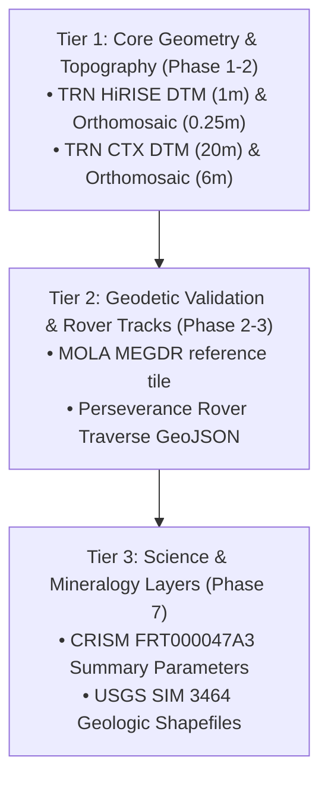

# Marswalk Planner — Data Acquisition Plan (Phase 1)

> [!CAUTION]
> Marswalk Planner is a research and education decision-support prototype. It is not NASA software, has not been certified or endorsed by NASA, and must never claim operational astronaut safety.

This plan details the disciplined, staged protocol for acquiring, validating, checksumming, and storing planetary datasets for Marswalk Planner.

---

## 1. Controlled Acquisition Protocol

To prevent unverified or corrupted data from entering the scientific processing pipeline, downloads must adhere strictly to these rules (`AGENTS.md`):

1. **Staged Retrieval:** We do not download massive multi-gigabyte mosaics simultaneously. Ingestion proceeds by tiers.
2. **Checksum Verification:** Every raw product downloaded must be accompanied by its SHA-256 hash, recorded immediately in `data/manifests/download_manifest.jsonl`.
3. **Immutability of `data/raw/`:** Files stored in `data/raw/` are write-protected and never modified in place. If an extraction or reprojection error occurs, the fix happens downstream in `data/interim/` or `data/processed/`.
4. **Windowed Spatial Subsetting:** Full orbital image strips or global grids are clipped early to our target study area ($18.38^\circ\text{–}18.52^\circ\text{ N}$, $77.35^\circ\text{–}77.52^\circ\text{ E}$) to preserve developer disk space (~57 GB free).

---

## 2. Acquisition Tiers & Sequence



### Tier 1: Core Topography & Basemap (Immediate Focus)
Essential for constructing the 1 m and 20 m Analysis-Ready Data (ARD) grids, computing native slope hazards, and rendering the 2D web map:
1. **Mars 2020 TRN HiRISE DTM Mosaic (`10.5066/P9REJ9JN`)**
   - Source: USGS Astropedia
   - Target destination: `data/raw/usgs_trn/jezero_hirise_dtm_1m.tif` (or clipped subset)
   - Estimated download size: $\approx 800\text{ MB} - 1.5\text{ GB}$
2. **Mars 2020 TRN HiRISE Orthomosaic (`10.5066/P9QJDP48`)**
   - Source: USGS Astropedia
   - Target destination: `data/raw/usgs_trn/jezero_hirise_ortho_25cm.tif`
   - Estimated download size: $\approx 1.2\text{ GB} - 3.0\text{ GB}$
3. **Mars 2020 TRN CTX DTM Mosaic (`10.5066/P906QQT8`)**
   - Source: USGS Astropedia
   - Target destination: `data/raw/usgs_trn/jezero_ctx_dtm_20m.tif`
   - Estimated download size: $\approx 60\text{ MB} - 150\text{ MB}$
4. **Mars 2020 TRN CTX Orthomosaic (`10.5066/P9GV1ND3`)**
   - Source: USGS Astropedia
   - Target destination: `data/raw/usgs_trn/jezero_ctx_ortho_6m.tif`
   - Estimated download size: $\approx 150\text{ MB} - 300\text{ MB}$

### Tier 2: Datum Reference & In-Situ Ground Truth
1. **MOLA MEGDR Altimetry (`megt_16n_044_128`)**
   - Source: PDS Geosciences Node
   - Target destination: `data/raw/mola/megt_16n_044_128.img`
   - Size: $\approx 25\text{ MB}$
2. **Perseverance Traverse Waypoints (`mars2020_places`)**
   - Source: PDS Analyst's Notebook / USGS
   - Target destination: `data/raw/perseverance/traverse_waypoints.geojson`
   - Size: $< 10\text{ MB}$

### Tier 3: Mineralogy & Geologic Vectors (Deferred to Phase 7)
1. **CRISM FRT000047A3 MTRDR Spectral Summary Cube**
   - Source: PDS Geosciences / ODE
   - Size: $\approx 400\text{ MB}$
2. **USGS SIM 3464 Geologic Map GIS Database**
   - Source: USGS Publications Warehouse
   - Size: $\approx 349\text{ MB}$

---

## 3. Metadata Extraction & Cataloging Automation

During Phase 2, a script `scripts/ingest_product.py` will execute the following automated steps upon every download:

```text
Download URL (Official Portal) 
       │
       ▼
SHA-256 Checksum Calculation ──► Append to data/manifests/download_manifest.jsonl
       │
       ▼
GDAL/Rasterio Inspection (verify CRS, bounds, resolution, nodata)
       │
       ▼
Generate data/catalog/<layer_id>.json (STAC-like Provenance Record)
       │
       ▼
Clip & Reproject to Jezero Local Equirectangular (if needed) ──► data/processed/
```

### Structure of `data/manifests/download_manifest.jsonl`
```json
{
  "product_id": "10.5066/P9REJ9JN",
  "filename": "jezero_hirise_dtm_1m.tif",
  "source_url": "https://astrogeology.usgs.gov/...",
  "retrieval_timestamp_utc": "2026-11-10T16:00:00Z",
  "sha256": "e3b0c44298fc1c149afbf4c8996fb92427ae41e4649b934ca495991b7852b855",
  "byte_size": 1048576000,
  "verified_by": "ingest_script_v1"
}
```

---

## 4. Immediate Next Step: User Gate

**We do not initiate automated large downloads yet.**

Upon your review and approval of:
1. The **Study Area** ([`docs/study_area.md`](study_area.md)): Jezero Western Fan & Delta Margin ($\approx 10\text{ km} \times 8.3\text{ km}$).
2. The **Dataset Dossiers** ([`docs/data_sources.md`](data_sources.md)): Authenticated USGS Mars 2020 TRN HiRISE/CTX co-registered products.
3. The **Acquisition Plan** ([`docs/data_acquisition_plan.md`](data_acquisition_plan.md)): Tier 1 staged download protocol.

We will proceed to implement the download and validation tooling in Phase 2.

