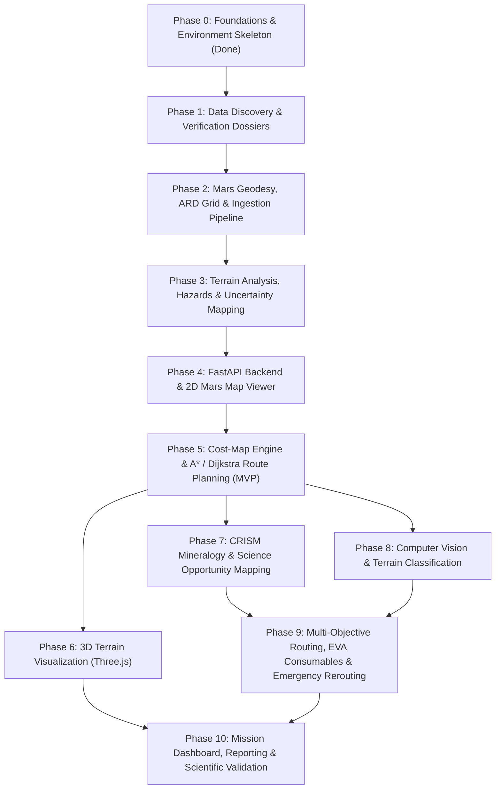

# Marswalk Planner — Implementation Roadmap

> [!CAUTION]
> Marswalk Planner is a research and education decision-support prototype. It is not NASA software, has not been certified or endorsed by NASA, and must never claim operational astronaut safety.

This roadmap details the step-by-step phased execution plan for solo development with AI assistance. Each phase has explicit prerequisites, deliverables, and a Definition of Done (DoD).

---

## Roadmap Overview

---

## Detailed Phases

### Phase 0: Foundations & Project Structure (Completed ✅)
- **Objective:** Establish the modular repository structure, Python virtual environment, dependencies, automated architecture testing, and documentation baselines.
- **Key Deliverables:**
  - `backend/` with modular layout (`core`, `geospatial`, `terrain`, `hazards`, `routing`, etc.)
  - `frontend/` React 19 + TypeScript + Vite application skeleton with `DisclaimerBanner` and `BackendStatus`
  - Automated architecture test enforcing layering rules (`tests/architecture/test_layering.py`)
  - Geospatial environment diagnostic passing `IAU_2015:49900` Mars sphere resolution
  - Git manifests, `.gitignore`, `AGENTS.md`, and documentation suite
- **Definition of Done (DoD):**
  - Backend tests pass (`pytest`) with 0 warnings.
  - Frontend builds cleanly (`npm run lint && npm run build`).
  - Environment check script succeeds (`python scripts/check_environment.py`).

---

### Phase 1: Data Discovery & Verification Gate
- **Objective:** Locate authentic NASA/USGS datasets covering Jezero Crater on official portals; populate data dossiers; zero fabricated data.
- **Key Deliverables:**
  - Complete dossiers in `docs/data_sources.md` for MOLA, USGS HRSC-MOLA 200m, Mars 2020 CTX mosaic, Mars 2020 HiRISE mosaic, and CRISM targeted scenes.
  - Verified coordinate reference systems, datums, vertical offsets, and bounding boxes.
  - Retrieval manifests in `data/manifests/` with SHA-256 hashes.
- **DoD:** Every candidate product has an explicit `ACCEPT` or `REJECT` decision with verified metadata before any data file is placed into `data/raw/`.

---

### Phase 2: Mars Geodesy & ARD Grid Pipeline
- **Objective:** Implement Mars coordinate transformations and the multi-resolution Analysis-Ready Data (ARD) pyramid.
- **Key Deliverables:**
  - `backend/app/geospatial/`: CRS transformations, planetocentric/east-positive conversions, metric equirectangular projection centered on Jezero.
  - Multi-tier ARD grid definition: L3 (200m), L2 (20m), L1 (5m), L0 (1m).
  - CLI script to ingest, validate checksums, warp, and export Cloud-Optimized GeoTIFFs (COGs).
- **DoD:** Property-based tests verifying coordinate round-trips within 1 mm; pixel-perfect grid alignment across ARD tiers.

---

### Phase 3: Terrain Analysis, Hazards & Uncertainty
- **Objective:** Compute slope, roughness, curvature, and binary hazard masks with reason codes.
- **Key Deliverables:**
  - `backend/app/terrain/`: Horn's slope algorithm, roughness (TRI/RMS), aspect, hillshade.
  - `backend/app/hazards/`: Hard constraints mask (`SLOPE_GT_MAX`, `NO_ELEVATION_DATA`) with machine-readable codes.
  - `backend/app/uncertainty/`: Per-pixel coverage fraction, elevation standard deviation $\sigma_z$, and composite confidence index.
- **DoD:** Golden tests against analytical synthetic surfaces (planes, hemispheres, cones); verified conservative aggregation for slope downsampling.

---

### Phase 4: FastAPI Backend & 2D Mars Map
- **Objective:** Serve Mars map tiles, layer queries, and display the interactive 2D map in the browser.
- **Key Deliverables:**
  - REST endpoints for dataset catalog, raster tiles (Mars TMS), point inspection, and elevation profiles.
  - MapLibre GL JS integration with Mars spherical coordinates, custom `MarsScaleBar`, and epistemic badge overlays.
- **DoD:** Map renders HiRISE/CTX tiles correctly; no Earth-radius scale bars shown; point inspector returns authentic elevations.

---

### Phase 5: Cost-Map Engine & Route Planning (MVP Target 🎯)
- **Objective:** Implement weighted traversability cost-maps and custom A* / Dijkstra graph routing.
- **Key Deliverables:**
  - `backend/app/costmap/`: Separate hard-constraint masking from soft-cost calculation.
  - `backend/app/routing/`: A* point-to-point pathfinder, Dijkstra all-to-one return-to-base field, hierarchical corridor search.
  - Frontend Mission Planner UI: interactive waypoint placement, obstacle avoidance, elevation profile display.
- **DoD:** Routes strictly avoid hard constraints; A* matches Dijkstra optimal costs on benchmark graphs; full end-to-end mission planning demonstrable.

---

### Phase 6: 3D Terrain Visualization
- **Objective:** High-fidelity 3D terrain rendering using Three.js / React Three Fiber.
- **Key Deliverables:**
  - Local metric heightfield mesh loaded from ARD DTM tiles.
  - Texture draping of HiRISE orthoimagery, hazard heatmaps, and 3D route trajectory lines.
  - User controls for vertical exaggeration and camera viewpoints.

---

### Phase 7: CRISM Mineralogy & Science Opportunity Mapping
- **Objective:** Ingest CRISM targeted spectral parameter products to highlight astrobiological and mineralogical targets.
- **Key Deliverables:**
  - Spectral parameter layers: Carbonate Index, Olivine Index, Hydrated Silica / Clay indices.
  - Composite Science Value layer integrated into soft-cost routing weights.

---

### Phase 8: Computer Vision & Terrain Classification
- **Objective:** Detect rock fields, sand ripples, and dune hazards from orbital imagery.
- **Key Deliverables:**
  - OpenCV texture analysis and shadow-based boulder detection.
  - Classical ML (Random Forest) classifier for surface units with spatial cross-validation.
  - Machine Learning Model Card documenting limitations (sub-meter rocks remain unobservable).

---

### Phase 9: Multi-Objective Routing, EVA Consumables & Emergency Planning
- **Objective:** Multi-criteria optimization, human physiological models, and contingency planning.
- **Key Deliverables:**
  - Multi-objective Pareto sweeps (optimizing time vs. hazard exposure vs. science gain).
  - EVA consumables model (O₂, metabolic rate, battery power, thermal margins).
  - Point of No Return (PNR) computation and instant dynamic rerouting.

---

### Phase 10: Mission Dashboard, Reporting & Scientific Validation
- **Objective:** Comprehensive mission overview, downloadable reports, and final scientific auditing.
- **Key Deliverables:**
  - Exportable mission briefing packs (PDF/HTML/GeoJSON) with full provenance and disclaimers.
  - Scientific validation report comparing elevations against MOLA PEDR tracks and verifying error residuals.

