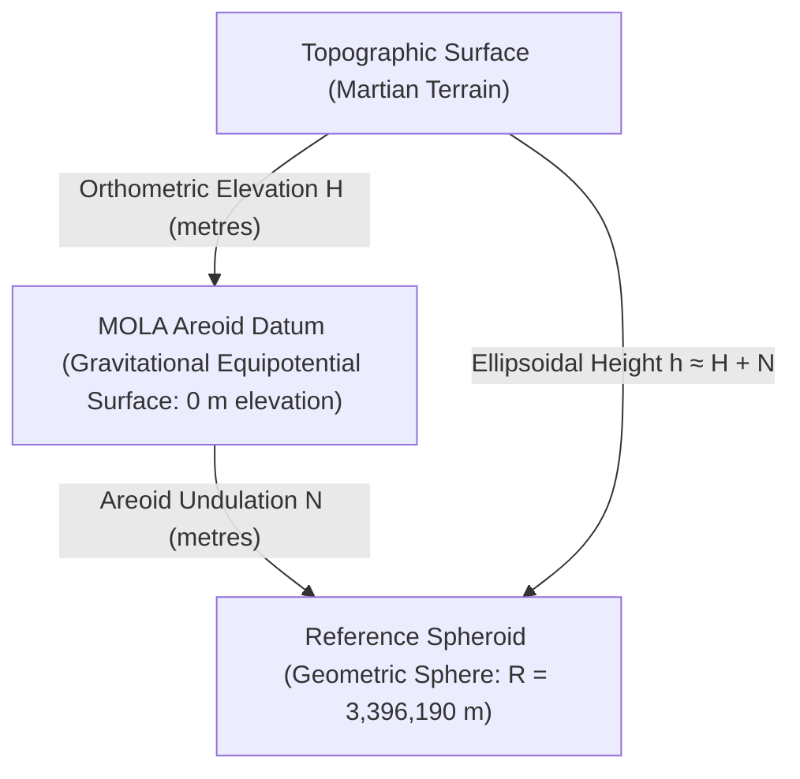

# Mars Geodesy & Cartographic Reference Manual

**Standard Authority:** International Astronomical Union (IAU) Working Group on Cartographic Coordinates and Rotational Elements (Archinal et al., 2018)  
**Target Body:** Mars (IAU Body Code: 499)  
**Marswalk System Reference:** `backend/app/geospatial/crs.py`  

---

## 1. Fundamental Planetary Geodetic Constants

All calculations within Marswalk Planner must strictly conform to authentic Mars geodesy standards. Earth radii, Earth flattening ratios, and Earth coordinate reference systems are forbidden.

### 1.1 Body Parameters

| Parameter | Symbol | Value | Unit | Scientific Authority |
|---|---|---|---|---|
| **Mean Volumetric Sphere Radius** | $R_{\text{vol}}$ | **$3,396,190.0$** | metres | IAU 2015 / Archinal et al. (2018) |
| **Equatorial Semi-Major Axis** | $a$ | $3,396,190.0$ | metres | IAU 2015 / NASA PDS |
| **Polar Semi-Minor Axis** | $b$ | $3,376,200.0$ | metres | IAU 2015 / NASA PDS |
| **Flattening** | $f = (a - b) / a$ | $\approx 0.005886$ ($1/169.89$) | dimensionless | IAU 2015 / NASA PDS |
| **Standard Gravitational Parameter** | $GM$ | $4.282837 \times 10^{13}$ | $\text{m}^3\text{ s}^{-2}$ | Konopliv et al. (2011) |
| **Sidereal Rotation Period** | $T_{\text{rot}}$ | $88,642.663$ | SI seconds ($24.6229\text{ h}$) | Archinal et al. (2018) |

---

## 2. Coordinate System Conventions

### 2.1 Latitude: Planetocentric vs Planetographic

Two competing latitude systems exist in planetary literature. Marswalk Planner standardizes unconditionally on **planetocentric latitude**:

1. **Planetocentric Latitude ($\phi_{\text{centric}}$):**
   - The angle between the equatorial plane and a ray connecting the center of mass of Mars to the surface point.
   - Strictly defined by:
     $$\tan \phi_{\text{centric}} = \frac{z}{\sqrt{x^2 + y^2}}$$
   - Used by: NASA Mars Global Surveyor (MOLA), MRO (HiRISE, CTX, CRISM), and the IAU 2015 recommendations.

2. **Planetographic Latitude ($\phi_{\text{graphic}}$):**
   - The angle between the equatorial plane and the normal to the reference ellipsoid.
   - On an oblate spheroid:
     $$\tan \phi_{\text{graphic}} = \left(\frac{a}{b}\right)^2 \tan \phi_{\text{centric}} \approx 1.01188 \cdot \tan \phi_{\text{centric}}$$
   - At $45^\circ\text{ N}$, the difference $|\phi_{\text{graphic}} - \phi_{\text{centric}}|$ reaches approximately $0.34^\circ$ ($\approx 20\text{ km}$ on the surface).

> [!IMPORTANT]
> **Project Rule:** All APIs, databases, route coordinates, and rasters use **planetocentric latitude**. If external historical datasets (e.g. Viking Orbiter records) provide planetographic latitude, they must be converted before ingestion.

### 2.2 Longitude: East-Positive Normalization in $[-180^\circ, +180^\circ)$

Historical planetary cartography often used west-positive longitudes in $[0^\circ, 360^\circ]$. The modern IAU and NASA standard specifies **east-positive longitude** increasing in the direction of planetary rotation.

#### Normalization Algorithm:
All user inputs, query parameters, and vector coordinates must be passed through canonical normalization:

```python
def normalize_mars_longitude(lon: float) -> float:
    """Normalize longitude to canonical East-positive in [-180.0, 180.0)."""
    return ((lon + 180.0) % 360.0) - 180.0
```

- $180^\circ\text{ W} = -180.0^\circ$
- $0^\circ = 0.0^\circ$ (Airy-0 Crater Prime Meridian)
- $77.4^\circ\text{ E}$ (Jezero Crater) $= +77.4000^\circ$
- $282.6^\circ\text{ W} \implies +77.4^\circ\text{ E}$

---

## 3. Disambiguation of Coordinate Reference Systems (CRS)

A frequent failure mode in planetary software is confusing geographic spherical CRS codes with projected Cartesian CRS codes.

```text
                  +----------------------------------------------+
                  |  PLANETARY BODY: MARS (IAU 2015 SPHERE)      |
                  |  Radius R = 3,396,190.0 m                    |
                  +----------------------------------------------+
                                         │
                 ┌───────────────────────┴───────────────────────┐
                 ▼                                               ▼
+---------------------------------+             +---------------------------------+
|  GEOGRAPHIC 2D CRS              |             |  PROJECTED METRIC CRS           |
|  Authority: IAU_2015:49900      |             |  Authority: ESRI:103885         |
|  Coordinates: (lon, lat)        |             |  Coordinates: (x, y)            |
|  Units: Degrees [°, °]          |             |  Units: Metres [m, m]           |
|  Role: Map display, Leaflet API |             |  Role: Analytical slope, A*, DTM|
+---------------------------------+             +---------------------------------+
```

### 3.1 `IAU_2015:49900` (Geographic 2D)
- **EPSG / IAU URN:** `urn:ogc:def:crs:IAU:2015:49900`
- **Projection:** None (Geographic 2D).
- **Datum:** Mars (2015) - Sphere / Ocentric.
- **Axes:** East-positive longitude (deg), Planetocentric latitude (deg).
- **Scope in Marswalk:** Used for Leaflet 2D web map viewports, user coordinate readouts, and global gazetteer queries.

### 3.2 `IAU_2015:49910` (Projected Equirectangular)
- **EPSG / IAU URN:** `urn:ogc:def:crs:IAU:2015:49910`
- **Projection:** Equirectangular (`Equidistant_Cylindrical`).
- **Parameters:** Central Meridian $\lambda_0 = 0.0^\circ$, Standard Parallel $\phi_1 = 0.0^\circ$, False Easting $= 0.0\text{ m}$, False Northing $= 0.0\text{ m}$.
- **Spheroid:** Mars (2015) Sphere ($R = 3,396,190.0\text{ m}$).
- **Axes:** Easting $x$ (metres), Northing $y$ (metres).

### 3.3 `ESRI:103885` (Projected Equidistant Cylindrical Mars 2000 Sphere)
- **Authority:** ESRI.
- **Parameters:** Mathematically identical to `IAU_2015:49910` ($R = 3,396,190.0\text{ m}$, $\lambda_0 = 0$, $\phi_1 = 0$).
- **Significance:** This is the **exact native GeoTIFF projection tag** embedded by the USGS Astrogeology Science Center in the Mars 2020 TRN delivery products (`HiRISE_DTM_Delta_Jezero_DL_1m.tif` and `JEZ_ctx_B_soc_008_DTM_20m.tif`).
- **Scope in Marswalk:** Analysis CRS for raster alignment, windowed reads, Horn's slope convolution, and pathfinding distance computations.

---

## 4. Vertical Datums: Areoid vs Reference Spheroid

Elevation measurements on Mars require strict vertical datum specification.



1. **MOLA Areoid (Vertical Datum):**
   - The global gravitational equipotential surface computed from the spherical harmonic Goddard Mars Gravity Model (GMM-2B/GMM-3).
   - Serves as the planetary equivalent of Earth's Mean Sea Level (MSL).
   - By definition:
     $$\text{Elevation } H = 0.0\text{ m on the Areoid}$$
   - Zero elevation corresponds approximately to the mean atmospheric pressure level of $6.1\text{ hPa}$ (the triple point of water).

2. **Reference Spheroid ($R = 3,396,190\text{ m}$):**
   - Pure geometric reference sphere used for horizontal coordinates.
   - Does not reflect the gravity field.

3. **Areoid Undulation ($N$):**
   - The vertical separation between the Areoid and the reference sphere: $N = h - H$.
   - Because Mars is an oblate ellipsoid while the analysis uses a sphere, $N$ varies from $\approx -1,500\text{ m}$ at the equator to $+2,000\text{ m}$ at the poles.
   - At Jezero Crater ($18.4^\circ\text{ N}, 77.4^\circ\text{ E}$):
     $$N \approx -830\text{ m to } -850\text{ m}$$

> [!CAUTION]
> **Scientific Integrity Requirement:**
> Never mix ellipsoidal heights $h$ with areoid elevations $H$. Every elevation in Marswalk Planner represents an orthometric height in metres relative to the MOLA Areoid ($H$).

---

## 5. Web Map Display vs Scientific Analysis

To prevent cartographic projection distortions:

1. **Display Projection:**
   The frontend Leaflet map uses an equirectangular display grid (`L.CRS.EPSG4326`) mapped directly to Mars planetocentric degrees. At Jezero Crater ($18.4^\circ\text{ N}$), east-west pixels appear slightly elongated on screen by $\frac{1}{\cos(18.4^\circ)} \approx 1.053$ ($5.3\%$).

2. **Analysis Projection:**
   **No scientific metric distance, area, slope, or cost calculations are ever performed in the display projection.**  
   All routing, obstacle buffers, and cost integrals are computed by the Python backend in the projected metric CRS (`ESRI:103885`), where 1 unit $= 1.000\text{ metre}$ at the equator and scale distortion is explicitly corrected:
   $$ds = \sqrt{(dx \cdot \cos \phi)^2 + dy^2}$$

3. **Prohibition of Earth Web Mercator:**
   Web Mercator (`EPSG:3857`) uses Earth radius $R = 6,378,137\text{ m}$. Using Earth Web Mercator on Mars produces an erroneous distance scale factor:
   $$\text{Error} = \frac{R_{\text{Earth}}}{R_{\text{Mars}}} = \frac{6,378,137}{3,396,190} \approx 1.878\times \text{ (87.8% distance error!)}$$
   `EPSG:3857` is rejected by automated architectural layering tests (`test_layering.py`).

