# MARSWALK — COMPLETE PLATFORM ARCHITECTURE & DEFECT RESOLUTION AUDIT
**NASA Space Apps Challenge 2026: Interplanetary Survival Guide: Martian Map**  
**Document ID:** `MW-ARCH-SPACEAPPS-2026-V1`  
**Classification:** Research Decision-Support Prototype / Epistemic Class: `HEURISTIC` & `SIMULATED`  
**Author:** Senior Multi-Disciplinary Aerospace & Geospatial Engineering Team

---

## 1. EXECUTIVE OVERVIEW

Marswalk is an integrated planetary exploration, geospatial intelligence, and hypothetical human EVA mission-planning platform designed for the **NASA Space Apps Challenge 2026 ("Interplanetary Survival Guide: Martian Map")**. 

This document serves as the **Phase Zero Baseline Audit**, detailing the complete system architecture, comprehensive feature inventory, identified 2D map defects, geodetic boundaries, and the phased implementation trajectory for evolving Marswalk into an end-to-end mission-planning environment.

---

## 2. SYSTEM ARCHITECTURE & COMPONENT TOPOLOGY

```mermaid
graph TD
    subgraph UI ["FRONTEND (React 19 + TypeScript + Leaflet + Three.js + Tailwind)"]
        Nav["Navigation Sidebar<br/>(8 Core Exploration Modules)"]
        Map2D["2D Mars Leaflet Maps<br/>(Global, Regional, Local Twin)"]
        Map3D["3D Mars Globe & Local Mesh<br/>(Three.js Sphere + DTM)"]
        EVAPanel["Human EVA Planner<br/>(Pandolf-Santee Biophysics)"]
        EnvPanel["Environmental What-If Engine<br/>(10 Mars Scenarios)"]
        SciPanel["Science Investigation Workspace<br/>(7 Objectives + CRISM + USGS)"]
        MissionCtrl["Mission Control HUD<br/>(Timeline, Consumables, PNR)"]
        Reports["Scientific Reproducibility Workspace<br/>(Markdown, GeoJSON, CSV)"]
        AIAssistant["AI Mars Research Assistant<br/>(Grounded PDS/USGS QA)"]
    end

    subgraph API ["FASTAPI BACKEND (Python 3.12 + GDAL + PROJ + NumPy)"]
        R_Atlas["/atlas: Global Catalog & Basemaps"]
        R_Regions["/regions: 12-Region Registry"]
        R_Twin["/twin: Local ARD 1m/20m Grid"]
        R_Terrain["/terrain: Slopes, Roughness, CV Detect"]
        R_Hazards["/hazards: Constraint Masks"]
        R_Costmap["/costmap: Multi-Weight Surfaces"]
        R_Routing["/routing: A* & Pareto Fronts"]
        R_Mission["/mission: Pandolf Biophysics"]
        R_Env["/environmental: Diurnal, Dust, Scenarios"]
        R_Emergency["/emergency: Dynamic Rerouting"]
        R_Assistant["/assistant: Grounded QA & Map Explain"]
    end

    subgraph Data ["AUTHENTIC PLANETARY DATA REPOSITORY"]
        PDS_Raw["NASA PDS & USGS Astrogeology Raw Data"]
        ARD_Processed["Multi-Tier ARD Grid (L0-L3 GeoTIFFs)"]
        Geodesy["IAU_2015:49900 Mars Sphere & MOLA Areoid"]
    end

    UI <--> API
    API <--> Data
```

---

## 3. COMPREHENSIVE FEATURE INVENTORY

| Subsystem | Functional Scope | Current Status | Epistemic Class |
| :--- | :--- | :--- | :--- |
| **Global Mars Globe** | Interactive 3D Mars sphere, MOLA 200m elevation, IAU coordinate grids, 12 regional target pins. | Operational | `OBSERVED` |
| **Multi-Region Atlas** | 12 priority exploration regions (Jezero, Gale, Gusev, Valles Marineris, Olympus Mons, Medusae Fossae, Mawrth Vallis, Oxia Planum, Elysium, Hellas, Utopia, Planum Boreum). | Operational | `OBSERVED` |
| **Jezero Digital Twin** | 1m HiRISE TRN DTM, 6m CTX orthomosaic, USGS SIM-3464 stratigraphy, 20m aligned ARD grid. | Operational | `OBSERVED` |
| **Terrain Intelligence** | Horn's metric slope calculation, RMS roughness, Topographic Ruggedness Index (TRI), CV shadow boulder detection, dune ridge detection. | Operational | `DERIVED` / `HEURISTIC` |
| **Hazard Assessment** | Binary hard constraint masks ($>20^\circ$ slope, unobserved terrain, boulder clustering, sand slipfaces). | Operational | `DERIVED` |
| **Science Explorer** | 7 scientific investigation themes, CRISM spectral ratios (`BD2210`, `SINDEX2`, `OLINDEX3`, `BD1900`), Perseverance sample cache provenance. | Operational | `OBSERVED` / `INTERPRETED` |
| **Human EVA Planner** | Adapted Pandolf-Santee biophysical locomotion model ($0.376\ g$), suit mass, speed, metabolic energy, O2 reserves, battery consumption. | Operational | `HEURISTIC` / `SIMULATED` |
| **Environmental What-If Engine** | 10 curated Mars environmental scenarios (dust storms, cryogenic freezes, SPE events, suit leaks) with diurnal/dust cycles. | Operational | `SIMULATED` |
| **Emergency Rerouting** | Real-time contingency path generation around newly detected obstacles or life-support alarms. | Operational | `HEURISTIC` |
| **Mission Control & Reports** | Real-time telemetry cards, study area coordinate bookmarking, Markdown/GeoJSON/CSV exports. | Operational | `HEURISTIC` / `SIMULATED` |
| **AI Research Assistant** | Grounded scientific QA against authentic PDS/USGS records with mandatory disclaimers and "Explain Map" engine. | Operational | `INTERPRETED` |

---

## 4. PHASE ZERO AUDIT: IDENTIFIED 2D MAP DEFECTS & RESOLUTION STRATEGY

An exhaustive review of the existing 2D map implementations (`GlobalMarsMap.tsx`, `RegionalMarsMap.tsx`, `MarsMap2D.tsx`) revealed the following issues:

### Defect 1: Slow Initial Loading & Redundant Requests
- **Root Cause:** Backend raster endpoints (`/api/v1/twin/raster/*.png`, `/api/v1/costmap/raster/*.png`, etc.) returned `FileResponse` without HTTP `Cache-Control` headers. Browsers re-fetched multiple large PNGs every time a layer was toggled or re-rendered.
- **Resolution:** Add `Cache-Control: public, max-age=86400, stale-while-revalidate=3600` headers to all backend raster, tile, and vector endpoints. Implement in-memory client-side image caching to prevent re-instantiating `L.imageOverlay`.

### Defect 2: Black Regions When Navigating & Zooming (NASA Trek WMTS)
- **Root Cause:** NASA Trek global MOLA and imagery WMTS services (`https://trek.nasa.gov/tiles/Mars/EQ/...`) provide native tiles only up to zoom level $z=7$ or $z=8$ for 463m global resolution. When Leaflet zoomed past $z=8$ to $z=12$, it issued requests for non-existent tiles, receiving HTTP 404s rendered by Leaflet as black squares.
- **Resolution:** Configure `maxNativeZoom: 7` on global tile layers while setting `maxZoom: 16`. This instructs Leaflet to smoothly oversample and scale native zoom 7 tiles at higher zoom levels rather than issuing failing HTTP 404 requests. Add `errorTileUrl` fallback.

### Defect 3: Longitude-Wrapping and Anti-Meridian Anomalies
- **Root Cause:** Panning past $\pm 180^\circ$ longitude caused coordinates to jump or wrap improperly in `EPSG:4326`, causing tile layers to stop rendering outside $[-180, 180]$.
- **Resolution:** Enforce `bounds: [[-90, -180], [90, 180]]`, `noWrap: false`, and canonical planetocentric coordinate normalization:
  $$\lambda_{\text{canonical}} = ((\lambda + 180) \pmod{360}) - 180$$

### Defect 4: Raster Bounding Box Mismatch in Regional Map
- **Root Cause:** In `RegionalMarsMap.tsx`, the local 20m Jezero Western Delta rasters (`ortho.png` and `elevation.png`) were assigned the wide regional bounding box `[[18.21103, 77.16047], [18.72119, 77.69898]]` (spanning over 50 km) instead of their actual raster footprint `[[18.39180, 77.34370], [18.58953, 77.46584]]` (7.2 km $\times$ 11.7 km). This caused extreme pixel distortion and misalignment with rover vector tracks.
- **Resolution:** Align the image overlay bounds strictly to the authentic georeferenced ARD grid bounds (`[18.39180, 77.34370]` to `[18.58953, 77.46584]`).

### Defect 5: Raster NoData and Transparency Handling
- **Root Cause:** `ortho_imagery.png` was exported as 8-bit grayscale mode `L` without an alpha channel, causing unobserved/masked pixels to render as solid black blocks that covered lower layers.
- **Resolution:** Ensure transparent RGBA exports where NoData pixels have $\alpha = 0$, allowing seamless alpha-blending with underlying elevation, hillshade, or global base imagery.

### Defect 6: Missing Real Loading Progress Feedback
- **Root Cause:** Map loading was represented by a binary spinner with no insight into tile download progress or network status.
- **Resolution:** Implement a live tile event tracker (`tileloadstart`, `tileload`, `tileerror`) calculating real loaded/pending percentages and displaying a non-intrusive status pill.

---

## 5. PHASED IMPLEMENTATION TRAJECTORY (PHASES 1 THROUGH 7)

Following the audit and stabilization in Phase Zero, the implementation proceeds through the following sequential phases:

1. **Phase One — Complete Mars Planetary Atlas:** Global-to-regional-to-local multi-scale atlas with 12 audited exploration regions, layer manager, and dataset provenance details.
2. **Phase Two — Scientific Intelligence:** Science investigation workspace supporting 7 structured research objectives, CRISM spectral absorption indices, and explainable target scoring.
3. **Phase Three — Human EVA Planning:** Multi-strategy route optimization (Conservative, Balanced, Science-Priority) using adapted Pandolf-Santee Mars biophysics, slope limits, and multi-destination sequencing.
4. **Phase Four — Astronaut Resource Simulator:** Dynamic consumables tracker ($O_2$, battery Wh, cooling water, metabolic fatigue, PNR return feasibility).
5. **Phase Five — Environmental Simulation:** 10 curated Mars environmental what-if scenarios with diurnal and dust climatology.
6. **Phase Six — Mission Control:** Integrated operations dashboard with mission timeline, start/pause/resume simulation, and emergency dynamic reroutes.
7. **Phase Seven — Integrated Science and Mission Reports:** Multi-format exportable mission dossiers (Markdown, GeoJSON, CSV, JSON) with complete geodetic metadata and non-negotiable research disclaimer.

