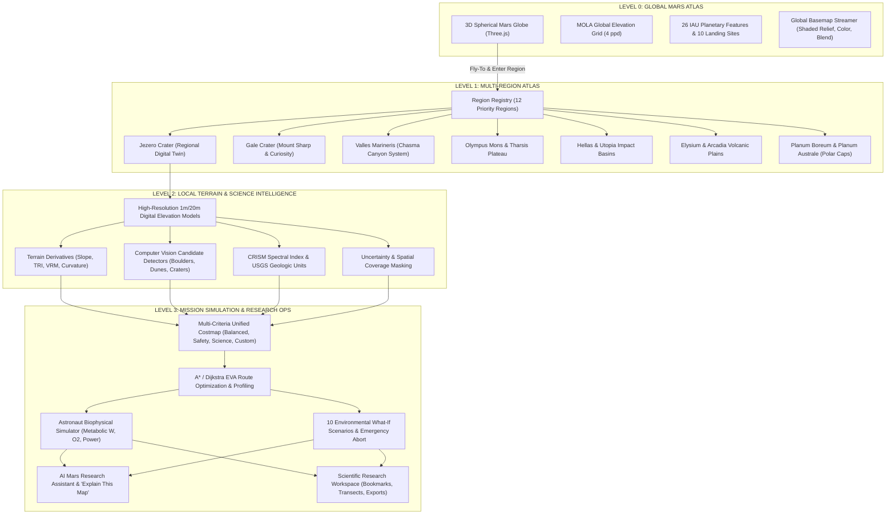
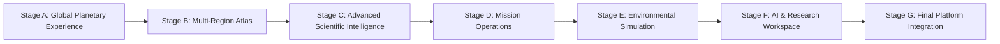

# MARSWALK — MASTER PRODUCT ARCHITECTURE & DEPENDENCY ROADMAP
## Comprehensive Mars Planetary Exploration, Geospatial Intelligence and Mission Simulation Platform

**Document Version:** 1.0.0  
**Date:** November 2026  
**Engineering Team:**
- Principal Software Architect
- Planetary Geospatial Data Scientist
- NASA/PDS Scientific Data Specialist
- 3D Graphics and Visualization Engineer
- GIS and Remote Sensing Engineer
- Machine Learning Engineer
- Simulation and Mission Systems Engineer
- AI Application Engineer
- Senior UI/UX Designer
- Software Quality and Testing Engineer

**Applicable Mandates:** `AGENTS.md`, `IAU_2015:49900` Mars Geodesy, NASA PDS Standards, USGS Astrogeology Standards

---

## 1. EXECUTIVE MANDATE & PRODUCT VISION

MARSWALK is evolved from a Jezero Crater exploration twin into a comprehensive **Mars Planetary Exploration, Geospatial Intelligence and Mission Simulation Platform**.

The platform bridges three continuous levels of geographical scale:
1. **GLOBAL (Level 0):** Whole-planet Mars exploration, interactive 3D globe, planetary physiography, global elevation, landing sites, and orbital datasets.
2. **REGIONAL (Level 1):** Major Martian provinces, impact basins, volcanic shields, rift valleys, and polar ice caps (12 priority regions) powered by a dynamic **Region Registry**.
3. **LOCAL (Level 2/3):** High-resolution digital twins (1m HiRISE / 20m CTX), sub-metre hazard detection, science target inspection, biophysical EVA routing, and environmental mission simulation.

### Strict Non-Negotiable Tenets:
- **Zero Fabrication:** Never invent rasters, product identifiers, observation URLs, or ML accuracy metrics. Missing data must be explicitly reported as `UNAVAILABLE` or `NO_DATA`.
- **Epistemic Class Rigour:** Every layer and query result is classified into: `OBSERVED`, `DERIVED`, `INTERPRETED`, `PREDICTED`, `HEURISTIC`, `SIMULATED`, or `UNKNOWN`.
- **Mars Geodesy:** Spherical datum `IAU_2015:49900` ($R = 3,396,190\text{ m}$), planetocentric latitude $[-90^\circ, 90^\circ]$, east-positive longitude $[-180^\circ, 180^\circ)$, vertical reference Mars Gravitational Areoid ($R_{\text{ref}} = 3,396,000\text{ m}$). Never Earth Web Mercator (EPSG:3857) or Earth ellipsoids.
- **Safety Disclaimer:** Research and educational prototype only. Not certified by NASA. Never claims operational astronaut safety.

---

## 2. EXHAUSTIVE SYSTEM INVENTORY (CURRENT CODEBASE STATE)

### 2.1 Existing Operational Features
1. **Interactive 3D Mars Globe (Milestone 3.0):**
   - Three.js WebGL globe with OrbitControls, free 360° rotation, smooth damping, bounded zoom.
   - Real-time sub-spacecraft nadir telemetry (latitude, longitude, orbital altitude in km).
   - Dynamic cursor raycasting with real-time MOLA elevation sampling.
   - 26 IAU named features and 10 verified landing sites with smooth cubic fly-to lerp animations.
   - Dynamic MOLA texture streaming (shaded relief, hypsometric tint, shaded blend).
   - Visible Jezero Crater cyan footprint ($31.86 \times 30.19\text{ km}$) with one-click regional transition.
2. **2D Global Mars Atlas (Milestone 2.1):**
   - Leaflet / Equirectangular 2D map with custom Mars scale bar and graticule.
   - Global coverage footprint overlays and remote basemap switching (Viking MDIM, THEMIS Day/Night IR, MOLA).
3. **Jezero Regional Atlas (Milestone 2.2):**
   - $31.93 \times 30.24\text{ km}$ ($965.62\text{ km}^2$, 51.2% basin) regional coverage.
   - 16 discrete serving layers (CTX ortho 6m, CTX DTM 20m, USGS SIM-3464 geologic units, CRISM targeted footprints FRT00005850 and HRL000040FF, elevation contours, slope, roughness).
   - Authentic Perseverance rover traverse (Sols 14–2022, 45.25 km) and Three Forks sample depot (10 dropped tubes).
4. **Jezero Local Digital Twin:**
   - 1m HiRISE DTM (`HiRISE_DTM_Delta_Jezero_DL_1m.tif`) over the Western Delta Fan ($7.28 \times 11.75\text{ km}$, $85.54\text{ km}^2$).
   - 550+ detected rock hazards, boulder fields, and sand dune geomorphic classifications.
5. **Terrain Intelligence Engine:**
   - Horn's slope algorithm, aspect, TRI (Terrain Ruggedness Index), VRM (Vector Ruggedness Measure), planform/profile curvature, local relief, elevation variability, multidirectional hillshade.
   - Analytical transect elevation profiling.
6. **Hazard Intelligence Assessment:**
   - Binary hard constraints mask (`SLOPE_GT_MAX`, `NO_ELEVATION_DATA`) with machine-readable codes.
   - Continuous soft hazard scoring (slope penalty, boulder risk, sand mobility).
7. **Scientific Opportunity Explorer:**
   - 6 candidate science targets across delta bottomsets, foresets, and crater floor olivine units.
   - Scientific value scoring and traverse accessibility.
8. **Unified Costmap Engine:**
   - Multi-criteria weighted cost surfaces: `BALANCED`, `SAFETY_FIRST`, `SCIENCE_FIRST`, and `CUSTOM` weight matrices.
9. **EVA Route Optimization & Emergency Operations:**
   - 8-neighbor grid graph, A* shortest path, Dijkstra all-to-one return-to-base potential field.
   - Douglas-Peucker route simplification.
   - Multi-objective route comparison (distance, time, cumulative slope, hazard exposure).
   - Emergency abort-to-base dynamic replanning.
10. **Mission Simulation & Biophysical Consumables:**
    - Pandolf / Santee metabolic energy expenditure equations ($W$).
    - Oxygen consumption rates, battery degradation, consumable safety margins.
    - Environmental scenario modeling (dust storms, temperature extremes, solar drop).
11. **NASA Data Hub & Dataset Catalogue (Milestones 1.0 & 1.1):**
    - 37 audited products across 11 scientific categories with complete provenance, DOIs, PDS product IDs, and epistemic classes.

---

### 2.2 Existing UI Components & Pages

| Component / Page | Location | Responsibility |
| :--- | :--- | :--- |
| `GlobalMarsGlobe3D.tsx` | `frontend/src/components/` | Three.js interactive 3D Mars globe with telemetry and markers |
| `GlobalMarsMap.tsx` | `frontend/src/components/` | 2D Equirectangular global Mars atlas |
| `RegionalMarsMap.tsx` | `frontend/src/components/` | Jezero Crater regional multi-layer exploration environment |
| `MarsMap2D.tsx` | `frontend/src/components/` | Local Jezero digital twin map viewer (Leaflet) |
| `MarsMap3D.tsx` | `frontend/src/components/` | Local 3D terrain heightfield mesh viewer (Three.js) |
| `EVAMissionPlannerPanel.tsx` | `frontend/src/components/` | Interactive sortie waypoint placement and route calculation |
| `EmergencyResponsePanel.tsx` | `frontend/src/components/` | Dynamic emergency abort and contingency simulation |
| `EnvironmentalScenarioPanel.tsx` | `frontend/src/components/` | Environmental what-if sliders and parameter controls |
| `MultiObjectiveComparisonPanel.tsx` | `frontend/src/components/` | Comparative metric cards and radar charts for routes |
| `MapExplorerPage.tsx` | `frontend/src/pages/` | Multi-tab explorer: 3D Globe, 2D Global, Regional Atlas, Catalogue |
| `DigitalTwinPage.tsx` | `frontend/src/pages/` | Local 1m Western Delta digital twin explorer |
| `TerrainIntelligencePage.tsx` | `frontend/src/pages/` | Complete 20m/1m terrain derivatives, transects, statistics |
| `HazardAssessmentPage.tsx` | `frontend/src/pages/` | Hard constraint masking and soft hazard heatmap inspection |
| `ScienceExplorerPage.tsx` | `frontend/src/pages/` | Science target catalog and lithological opportunity scores |
| `EVARoutePlannerPage.tsx` | `frontend/src/pages/` | Full sortie planner, elevation profile, waypoint management |
| `RouteComparisonPage.tsx` | `frontend/src/pages/` | Multi-strategy route comparison workspace |
| `MissionSimulationPage.tsx` | `frontend/src/pages/` | Biophysical consumables simulation (oxygen, power, timeline) |
| `EmergencyOperationsPage.tsx` | `frontend/src/pages/` | Standalone emergency evacuation console |
| `MissionReportsPage.tsx` | `frontend/src/pages/` | Markdown and structured mission briefing telemetry |
| `NASADataHubPage.tsx` | `frontend/src/pages/` | PDS and USGS data ingestion manifests and verification audit |
| `SystemSettingsPage.tsx` | `frontend/src/pages/` | Planetary geodesy definitions and API health diagnostic |

---

### 2.3 Existing Operational REST Endpoints (58 Total)

```text
ATLAS & GLOBE:
  GET    /api/v1/atlas/catalogue
  GET    /api/v1/atlas/categories
  GET    /api/v1/atlas/maps/{map_id}
  GET    /api/v1/atlas/global/basemaps
  GET    /api/v1/atlas/global/layers
  GET    /api/v1/atlas/global/layers/{layer_id}
  GET    /api/v1/atlas/global/features
  GET    /api/v1/atlas/global/landing-sites
  GET    /api/v1/atlas/global/geology
  GET    /api/v1/atlas/global/coverage
  GET    /api/v1/atlas/global/navigation-targets
  GET    /api/v1/atlas/global/elevation-sample
  GET    /api/v1/atlas/global/texture/{texture_type}.png
  GET    /api/v1/atlas/geology/units
  GET    /api/v1/atlas/geology/crism-indices
  GET    /api/v1/atlas/environment/surface-properties
  GET    /api/v1/atlas/regional/jezero/study-area
  GET    /api/v1/atlas/regional/jezero/layers
  GET    /api/v1/atlas/regional/jezero/categories
  GET    /api/v1/atlas/regional/jezero/footprints
  GET    /api/v1/atlas/regional/jezero/elevation-sample
  POST   /api/v1/atlas/regional/jezero/elevation-profile
  GET    /api/v1/atlas/regional/jezero/geology
  GET    /api/v1/atlas/regional/jezero/geology/{unit_symbol}
  GET    /api/v1/atlas/regional/jezero/crism
  GET    /api/v1/atlas/regional/jezero/rover/traverse
  GET    /api/v1/atlas/regional/jezero/rover/waypoints
  GET    /api/v1/atlas/regional/jezero/rover/samples
  GET    /api/v1/atlas/regional/jezero/compare

DATA CATALOGUE & DIGITAL TWIN:
  GET    /api/v1/catalog/datasets
  GET    /api/v1/catalog/datasets/{product_id}
  GET    /api/v1/twin/layers
  GET    /api/v1/twin/elevation/grid
  GET    /api/v1/twin/raster/{layer_name}.png
  GET    /api/v1/twin/vector/contours
  GET    /api/v1/twin/vector/perseverance

TERRAIN, HAZARDS & SCIENCE:
  GET    /api/v1/terrain/layers
  GET    /api/v1/terrain/statistics
  GET    /api/v1/terrain/classes
  GET    /api/v1/terrain/inspect
  POST   /api/v1/terrain/transect
  GET    /api/v1/terrain/raster/{layer_id}.png
  GET    /api/v1/hazards/inspect
  GET    /api/v1/hazards/profile
  GET    /api/v1/hazards/raster/overall.png
  GET    /api/v1/science/targets
  GET    /api/v1/science/inspect
  GET    /api/v1/science/profile
  GET    /api/v1/science/raster/opportunity.png

COSTMAP, ROUTING & MISSION:
  GET    /api/v1/costmap/profiles
  GET    /api/v1/costmap/inspect
  POST   /api/v1/costmap/evaluate
  GET    /api/v1/costmap/raster/{profile_name}.png
  POST   /api/v1/routing/plan
  POST   /api/v1/routing/compare
  GET    /api/v1/routing/scenarios
  POST   /api/v1/routing/suite
  GET    /api/v1/mission/default-assumptions
  POST   /api/v1/mission/plan
  POST   /api/v1/mission/compare
  GET    /api/v1/environmental/scenarios
  GET    /api/v1/environmental/sources
  POST   /api/v1/environmental/assess
  POST   /api/v1/environmental/compare
  GET    /api/v1/emergency/scenarios
  POST   /api/v1/emergency/simulate
  POST   /api/v1/emergency/abort-to-base
  GET    /api/v1/health
```

---

### 2.4 Existing Audited Datasets (Local vs Remote)

| Dataset ID | Product Name | Storage State | Local File Path | Spatial Extent |
| :--- | :--- | :--- | :--- | :--- |
| `PLN-SRC-01` | MOLA 4 ppd MEGDR Global Elevation | `VERIFIED_LOCAL` | `data/raw/mola/megt90n000cb.img` | Global ($180^\circ\text{W} - 180^\circ\text{E}$, $90^\circ\text{S} - 90^\circ\text{N}$) |
| `PLN-SRC-05` | Mars 2020 CTX Jezero Orthomosaic (6m) | `VERIFIED_LOCAL` | `data/raw/usgs_trn/JEZ_ctx_B_soc_008_orthoMosaic_6m.tif` | $31.93 \times 30.24\text{ km}$ Western Jezero |
| `PLN-SRC-06` | Mars 2020 CTX Jezero DTM (20m) | `VERIFIED_LOCAL` | `data/raw/usgs_trn/JEZ_ctx_B_soc_008_DTM_20m.tif` | $31.93 \times 30.24\text{ km}$ Western Jezero |
| `PLN-SRC-08` | HiRISE Jezero Western Delta DTM (1m) | `VERIFIED_LOCAL` | `data/raw/usgs_trn/HiRISE_DTM_Delta_Jezero_DL_1m.tif` | $7.28 \times 11.75\text{ km}$ Western Delta Fan |
| `PLN-VEC-04` | Perseverance Rover Traverse (Sols 14–2022) | `VERIFIED_LOCAL` | `data/raw/perseverance/M20_traverse.json` | 45.25 km traverse line |
| `PLN-VEC-05` | Three Forks Sample Depot & Waypoints | `VERIFIED_LOCAL` | `data/raw/perseverance/M20_waypoints.json` | 10 sample depot tubes + waypoints |
| `PLN-SRC-03` | Viking Orbiter MDIM 2.1 Mosaic | `VERIFIED_REMOTE` | USGS Astropedia WMS/TMS | Global (231 m/px) |
| `PLN-SRC-04` | Mars Odyssey THEMIS Day/Night IR | `VERIFIED_REMOTE` | ASU / NASA Mars Trek WMTS | Global (100 m/px) |
| `PLN-SRC-14` | USGS SIM-3292 Global Geologic Map | `VERIFIED_REMOTE` | USGS Publication / WMS | Global 1:20,000,000 |
| `PLN-INT-02` | USGS SIM-3464 Jezero Geologic Map | `VERIFIED_REMOTE` | USGS Scientific Investigations Map | $118 \times 118\text{ km}$ Nili Planum / Jezero |
| `PLN-INT-03` | CRISM Targeted Scenes (FRT00005850, HRL000040FF) | `VERIFIED_REMOTE` | NASA PDS Geosciences Node | $10 \times 20\text{ km}$ spectral targeted cubes |

---

## 3. AUDIT OF GAPS, TECHNICAL DEBT & SCIENTIFIC LIMITATIONS

### 3.1 Gaps Against the Master Product Vision
1. **Multi-Region Geographical Extent:**
   - *Current:* Only Jezero Crater is populated with regional data. Other priority regions (Gale, Valles Marineris, Olympus Mons, etc.) are only present as point markers on the global globe.
   - *Requirement:* Implement a generic, extensible **Region Registry** (`backend/app/catalog/region_registry.py`) supporting 12 priority regions with regional bounds, target descriptions, available remote datasets, and uniform regional navigation.
2. **Mission Initialization Screen:**
   - *Current:* Direct application load into Mission Overview or Map Explorer.
   - *Requirement:* Cinematic, black-and-white telemetry loading screen verifying actual system states (backend connectivity, geospatial engine, catalogue integrity, terrain services, visualization readiness).
3. **Computer Vision & Automated Geomorphic Detection:**
   - *Current:* Local boulder counts and sand patches precomputed in Jezero processed GeoTIFFs.
   - *Requirement:* Scientifically honest candidate detection algorithms (shadow-based boulder height estimation, morphological dune crest filters, circular Hough / template crater detectors) clearly marked as `HEURISTIC`.
4. **Geology & Mineralogy Workspace:**
   - *Current:* Geologic unit definitions and CRISM footprint metadata served, but no interactive spectral index viewer or mineral absorption breakdown.
   - *Requirement:* Interactive spectral parameter inspector (BD1900, D2300, HCP, LCP, OLINDEX) distinguishing observed spectral ratios from inferred mineral signatures.
5. **AI Mars Research Assistant & "Explain This Map":**
   - *Current:* No natural language query or map explanation engine.
   - *Requirement:* Deterministic, tool-calling AI assistant that queries Marswalk's own APIs to answer terrain, geological, and route questions, citing data sources and quantifying uncertainty.
6. **Scientific Research Workspace & Reproducibility:**
   - *Current:* Users cannot save study areas, record research notes, or export scientific dossiers.
   - *Requirement:* Study area bookmarking, interactive transects, and exportable research reports in GeoJSON, GeoTIFF, CSV, and printable PDF formats.

### 3.2 Technical Debt & Architectural Observations
- **Memory & Raster IO Constraints:** Large GeoTIFF operations on the local machine (8 GB RAM) require windowed reads (`rasterio.windows.Window`) to prevent out-of-memory crashes.
- **Three.js Context Preservation:** Switching between 3D Globe, 2D Global Map, and Regional Atlas must cleanly dispose of WebGL renderers and geometries to prevent GPU memory leaks.
- **Biophysical Model Transparency:** Pandolf / Santee equations must never be represented as medical-grade astronaut life-support diagnostics. They must remain explicitly labeled `HEURISTIC` planning simulations.

---

## 4. MASTER MULTI-SCALE ARCHITECTURAL BLUEPRINT



---

## 5. SEVEN-STAGE IMPLEMENTATION ROADMAP (STAGES A TO G)

To ensure zero disruption to existing working features and rigorous adherence to testing rules, implementation will proceed in 7 discrete, independently testable stages:



---

### STAGE A — GLOBAL PLANETARY EXPERIENCE & SYSTEM INITIALIZATION
*Objective:* Finalize global exploration foundations and cinematic initialization telemetry.
1. **Mission Initialization Screen (`MissionInitializationScreen.tsx`):**
   - Deep monochrome design (`#050505`).
   - Real backend status checks: FastAPI ping, GDAL/rasterio runtime check, MOLA raw grid availability, 37-product catalogue integrity, and Three.js WebGL capability.
   - Graceful fallback: optional services do not block application launch.
2. **Global 3D Globe Polish:**
   - Full keyboard/touch accessibility shortcuts.
   - Enhanced polar stereographic projection perspective when inspecting Planum Boreum and Planum Australe.
   - Comprehensive coordinate search parser (accepts `18.45N, 77.45E`, `18.45, 77.45`, or feature name).
3. **Verification Gate:**
   - Backend health endpoint tests.
   - Frontend component tests and production build.

---

### STAGE B — MULTI-REGION MARS ATLAS & REGION REGISTRY
*Objective:* Expand beyond Jezero to 12 major Martian regions without duplicate code.
1. **Region Registry Engine (`backend/app/catalog/region_registry.py`):**
   - Data model: `RegionMetadata` (ID, name, province, lat/lon bounds, centroid, elevation range, geologic setting, mission history, available remote layers).
   - 12 priority regions: Jezero, Gale, Valles Marineris, Olympus Mons, Tharsis Rise, Hellas Planitia, Utopia Planitia, Elysium Planitia, Arcadia Planitia, Gusev Crater, North Polar Region, South Polar Region.
2. **Region API Endpoints:**
   - `GET /api/v1/atlas/regions`: List all 12 regions with summary metadata.
   - `GET /api/v1/atlas/regions/{region_id}`: Detailed dossier, bounding box, available layers, and remote WMS/TMS URLs.
3. **Frontend Regional Explorer (`RegionalExplorerPage.tsx`):**
   - Dynamic region switcher with regional bounds visualization on the 3D globe.
   - Seamless transition: clicking any region on the globe or list opens its regional dossier and available datasets.
4. **Verification Gate:**
   - Pytest unit tests for region registry bounding boxes and CRS integrity.

---

### STAGE C — ADVANCED SCIENTIFIC INTELLIGENCE
*Objective:* Expand terrain analysis, computer vision candidate detection, and mineralogy.
1. **Computer Vision Feature Candidate Detection (`backend/app/terrain/cv_detector.py`):**
   - Heuristic shadow-based boulder candidate detector with height-from-shadow trigonometry.
   - Morphological dune crest filter for sand hazard identification.
   - Circular Hough transform candidate crater detector.
   - Strict `HEURISTIC` epistemic tagging; zero fabricated ML claims.
2. **Geology & Mineralogy Explorer (`GeologyMineralogyPage.tsx`):**
   - CRISM targeted scene catalogue viewer (`FRT00005850`, `HRL000040FF`).
   - Spectral parameter guide explaining the chemical meaning of absorption indices (hydrated sulfates, phyllosilicates, olivine, pyroxene).
   - Distinction between observed spectral ratios and interpreted mineral occurrences.
3. **Mars Environmental Conditions (`backend/app/mission/environmental.py`):**
   - Surface thermal inertia datasets from TES / THEMIS.
   - Diurnal surface temperature models (equatorial vs. polar extremes).
   - Dust opacity ($\tau$) climatological models.
4. **Verification Gate:**
   - Analytical tests for CV edge filters and shadow trigonometry.

---

### STAGE D — MISSION OPERATIONS & ASTRONAUT EVA SIMULATOR
*Objective:* Comprehensive mission control operations and biophysical simulation.
1. **Mission Control Dashboard (`MissionControlPage.tsx`):**
   - Unified telemetry overview: selected region, crew size, mission timeline, EVA duration, consumable margins, emergency abort status.
   - Separation of real rover tracks (Perseverance, Curiosity) from hypothetical human EVA sorties.
2. **Configurable Astronaut EVA Simulator:**
   - Adjustable inputs: crew size (1–4), walking speed ($0.5 - 1.4\text{ m/s}$), suit mass ($80 - 140\text{ kg}$), metabolic baseline ($120 - 450\text{ W}$), oxygen capacity ($1.2 - 2.5\text{ kg}$), battery reserve ($1.5 - 4.0\text{ kWh}$).
   - Dynamic outputs: total energy expenditure (MJ), metabolic rate curve along slope, consumable burn rate, remaining margin at each waypoint.
   - Multi-waypoint sortie planning with scientific sampling stop durations.
3. **Verification Gate:**
   - Numerical tests verifying Pandolf/Santee equation slope penalties against published physiological benchmarks.

---

### STAGE E — ENVIRONMENTAL WHAT-IF SIMULATION ENGINE
*Objective:* Dynamic scenario-based contingency planning and rerouting.
1. **10 Environmental What-If Scenarios:**
   1. Regional Dust Storm ($\tau = 0.5 \rightarrow 3.5$)
   2. Reduced Visibility ($D_{\text{vis}} < 50\text{ m}$)
   3. Direct Comms Line-of-Sight Loss to Hab / Relay
   4. Suit Life-Support Equipment Degradation
   5. Battery Thermal Degradation (-30% capacity)
   6. Solar Power Generation Drop
   7. Traverse Corridor Obstruction (Rockfall / Dune Inpass)
   8. Accelerated Metabolic Consumption (+50% W)
   9. Immediate Return-to-Base Emergency Abort
   10. Multi-Fault Catastrophic Contingency (Dust storm + Comms loss + Power degradation)
2. **Dynamic Replanning Engine:**
   - Calculates impact on maximum safe sortie radius ($R_{\text{safe}}$).
   - Generates immediate abort path to habitat or pressurized rover shelter avoiding impassable terrain.
3. **Verification Gate:**
   - Integration tests verifying contingency abort paths avoid hard constraints under all 10 failure modes.

---

### STAGE F — AI MARS RESEARCH ASSISTANT & SCIENTIFIC WORKSPACE
*Objective:* Grounded scientific natural language assistant and reproducible research exports.
1. **AI Mars Research Assistant ("Ask Marswalk"):**
   - Tool-calling architecture querying Marswalk API endpoints:
     - `search_datasets(query)`
     - `get_elevation_sample(lat, lon)`
     - `get_geological_unit(lat, lon)`
     - `get_terrain_statistics(region)`
     - `evaluate_route_feasibility(start, destination)`
   - Rigorous grounding: every response cites specific dataset IDs, product identifiers, and epistemic classifications.
   - Explicit uncertainty declaration: states when data is missing or out-of-bounds.
2. **"Explain This Map" Feature:**
   - Contextual panel explaining the physics, instrument, bandpass, CRS, and limitations of any currently active map layer.
3. **Scientific Research Workspace (`ResearchWorkspacePage.tsx`):**
   - Geographic bookmarks and saved study areas.
   - Interactive elevation transects with exportable distance-height profile data.
   - Export pipeline: GeoJSON (traverses, targets), GeoTIFF metadata, CSV (telemetry, transects), and clean printable PDF mission briefing.
4. **Verification Gate:**
   - End-to-end API tool-calling tests and file export format validations.

---

### STAGE G — FINAL PLATFORM INTEGRATION, ACCESSIBILITY & REGRESSION
*Objective:* Complete unification, design system audit, and full production verification.
1. **Unified Navigation System (14 Dedicated Views):**
   1. Mission Overview
   2. Global Mars Globe
   3. Mars Atlas
   4. Regional Explorer
   5. Terrain Intelligence
   6. Geology & Mineralogy
   7. Environmental Analysis
   8. Mission Control
   9. EVA Route Planner
   10. Mission Simulation
   11. Emergency Operations
   12. AI Research Assistant
   13. Research Workspace
   14. Dataset Catalogue
2. **Design System & Performance Optimization:**
   - High-contrast dark monochrome theme (`#050505`, `#101010`, `#181818`, `#292929`).
   - WebGL resource cleanup and dynamic bundle code-splitting.
   - WCAG accessibility compliance (keyboard navigation, ARIA attributes, reduced-motion media query).
3. **Full System Regression Suite:**
   - All backend pytest tests passing (targeting 220+ tests).
   - Clean `ruff` and `oxlint` with 0 warnings.
   - Production Vite build verification.
   - Comprehensive master verification report.

---

## 6. DEPENDENCY GRAPH & STAGE EXECUTION MATRIX

| Stage | Prerequisites | Output Deliverables | Verification Milestone |
| :--- | :--- | :--- | :--- |
| **Stage A: Global Planetary Experience** | Milestone 3.0 Codebase | Initialization Screen, enhanced 3D Globe, coordinate parser | Stage A Health & Test Suite |
| **Stage B: Multi-Region Atlas** | Stage A | `region_registry.py`, 12 Region Dossiers, Regional Explorer Page | Stage B Region Registry Audit |
| **Stage C: Scientific Intelligence** | Stage B | Heuristic CV detector, Mineralogy Explorer, Thermal/Dust models | Stage C Algorithm Validation |
| **Stage D: Mission Operations** | Stage C | Mission Control Dashboard, Multi-crew EVA Simulator | Stage D Biophysical Validation |
| **Stage E: Environmental Simulation** | Stage D | 10 Scenario Simulator, Dynamic Replanner | Stage E Contingency Testing |
| **Stage F: AI & Research Workspace** | Stage E | AI Assistant (Tool Calling), Workspace, Export Pipeline | Stage F Grounding & Export Audit |
| **Stage G: Final Platform Integration** | Stage F | 14-View Navigation, Performance Optimization, Full Regression | Master System Release 1.0 |

---

## 7. NON-OPERATIONAL SCIENTIFIC PROTOCOL & DISCLAIMER

> [!CAUTION]
> **RESEARCH AND EDUCATION PROTOTYPE ONLY**  
> Marswalk Planner is an academic decision-support and exploration system developed for research and educational purposes. It is **not** certified, validated, or endorsed by NASA, JPL, ESA, or any other space flight agency. All traverse costings, slope analyses, obstacle categorizations, and consumable consumption rates are heuristic models and simulation approximations. They must **never** be used for real planetary mission operations or human extravehicular activity (EVA) navigation.

