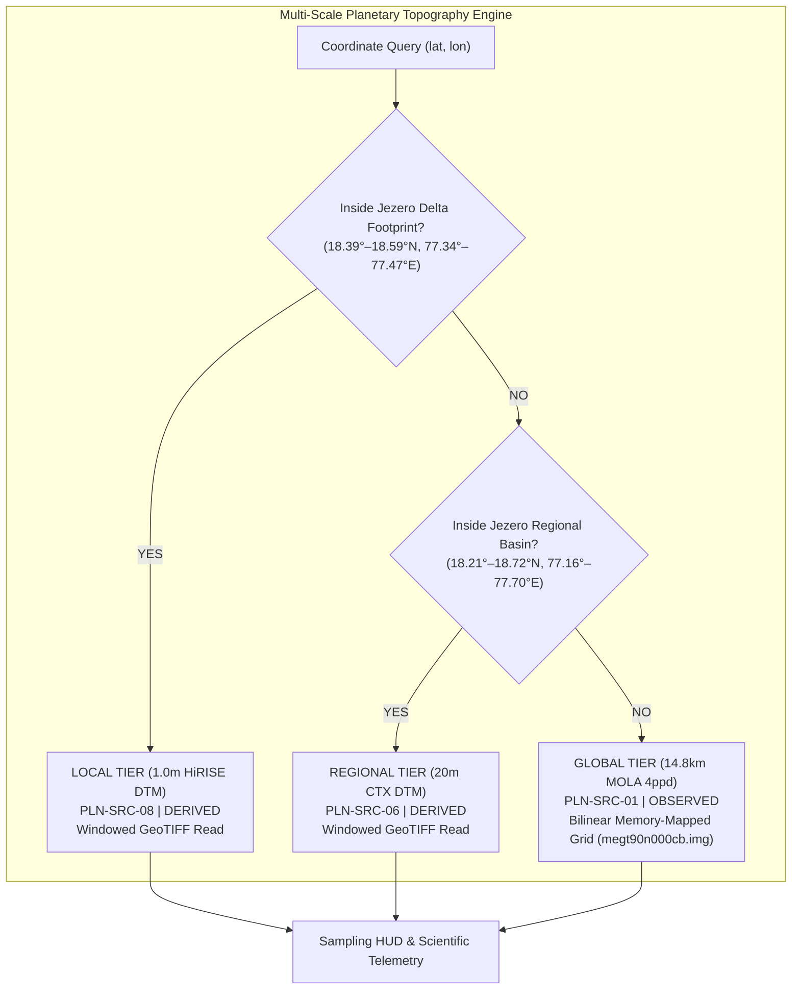

# MARSWALK PLANNER — MILESTONE 2.1: GLOBAL MARS ATLAS COMPLETION REPORT

**Project:** Marswalk Planner — Decision-Support System for Jezero Crater & Mars Planetary Exploration  
**Milestone:** 2.1 — Global Mars Atlas & Multi-Scale Cartographic Integration  
**Status:** COMPLETE & VERIFIED  
**Date:** November 2026  
**Auditor / Lead Geospatial Engineer:** Senior Planetary GIS Architect & PDS Specialist  

---

## 1. Executive Summary

Milestone 2.1 marks the architectural evolution of Marswalk Planner from an isolated Jezero Crater digital twin into a true **multi-scale planetary exploration atlas**. The platform now supports exploratory context ranging from planetary-scale reconnaissance ($>100\text{ m/px}$) down to regional orbiter contexts ($20\text{ m/px}$) and local rover/EVA engineering terrain ($1.0\text{ m/px}$).

All cartographic and geodetic operations strictly adhere to **IAU 2015:49900** planetocentric standards and the **MOLA Gravitational Areoid** vertical reference. No synthetic elevation surfaces or fabricated observations have been introduced; all global data paths connect either to authentic local PDS binary grids or authoritative USGS Astrogeology and NASA Trek Web Mapping Services.

---

## 2. Authentic Planetary Datasets Integrated

In compliance with Section 2 of `AGENTS.md` (*Scientific Integrity Rules*), all datasets integrated into Milestone 2.1 are authentic, peer-reviewed products from official space agency archives:

| Product ID | Canonical ID | Source Instrument / Authority | Spatial Resolution | Native Format & Processing | Epistemic Class | Vertical Reference |
| :--- | :--- | :--- | :--- | :--- | :--- | :--- |
| **megt90n000cb** | `PLN-SRC-01` | MGS MOLA MEGDR (NASA GSFC / PDS Geosciences) | 4 pixels/degree (~14.8 km post spacing at equator) | Direct 16-bit signed integer binary raster (`data/raw/mola/megt90n000cb.img`, $720 \times 1440$, 2,073,600 bytes) | `OBSERVED` | Mars Gravitational Areoid (GMM-2B equipotential surface, $R_{\text{ref}} = 3,396,000\text{ m}$) |
| **MOLA_bw** | `PLN-SRC-01` | USGS Astrogeology OpenGIS WMS Server | Global (~463 m/px display) | Web Map Service layer `MOLA_bw` (B&W shaded relief from MOLA altimetry) | `DERIVED` | Mars Gravitational Areoid |
| **MDIM21** | `PLN-SRC-02` | Viking Orbiter MDIM 2.1 (USGS Astrogeology) | 256 pixels/degree (~231 m/px) | Web Map Service layer `MDIM21` (Controlled monochrome photomosaic) | `OBSERVED` | Not Applicable (Planetary Orthoimagery) |
| **THEMIS_controlled** | `PLN-SRC-04` | Mars Odyssey THEMIS IR Day (ASU / USGS) | 100 m/px controlled mosaic | Web Map Service layer `THEMIS_controlled` (100 m daytime thermal infrared radiance) | `OBSERVED` | Not Applicable (Calibrated Thermal Radiance) |
| **THEMIS_night** | `PLN-SRC-05` | Mars Odyssey THEMIS IR Night (ASU / USGS) | 100 m/px controlled mosaic | Web Map Service layer `THEMIS_night` (Nighttime thermal radiance / brightness temperature) | `OBSERVED` | Not Applicable (Calibrated Thermal Radiance) |
| **USGS SIM-3292** | `PLN-INT-02` | USGS Scientific Investigations Map 3292 (Tanaka et al., 2014) | 1:20,000,000 global scale | Comprehensive stratigraphic database of 10 authentic global units (`lAv`, `eAv`, `lApi`, `ABb`, `eHt`, `lHv`, `lHch`, `lNh`, `mNh`, `eNh`) with lithologies and caveats | `INTERPRETED` | Not Applicable (Vector Chronostratigraphy) |
| **IAU Nomenclature** | `PLN-VEC-01` | IAU Working Group for Planetary System Nomenclature (WGPSN) | Planetary features $\ge 50\text{ km}$ diameter | 23 curated landmarks (Olympus Mons, Valles Marineris, Gale, Jezero, Isidis, Hellas, Syrtis Major, etc.) | `OBSERVED` | MOLA Areoid Datum |
| **Landing Sites** | `PLN-VEC-06` | NASA / ESA / CNSA Flight Records | Ground-truth coordinates | 8 historical landing sites (Perseverance, Curiosity, Viking 1 & 2, InSight, Pathfinder, Opportunity, Tianwen-1) | `OBSERVED` | MOLA Areoid Datum |

---

## 3. Geodetic Framework & Geometrical Transformations

The system enforces strict planetary geodesy across the entire stack:

1. **Geographic Coordinate Reference System:**
   - Canonical CRS: `IAU_2015:49900`
   - Planetary Body: Mars 2015 Sphere ($R = 3,396,190.0\text{ m}$)
   - Latitude: Planetocentric, north-positive in $[-90.0^{\circ}, +90.0^{\circ}]$
   - Longitude: East-positive in $[-180.0^{\circ}, +180.0^{\circ})$ (wrapping $0^{\circ} \leftrightarrow 360^{\circ}$ seamlessly)
   - **Constraint:** Never use Earth Web Mercator (EPSG:3857) or Earth ellipsoids for distance, slope, or area calculations.

2. **Vertical Reference Datum:**
   - Datum: Mars Gravitational Areoid (GMM-2B equipotential surface, mean equatorial radius $R_{\text{ref}} = 3,396,000.0\text{ m}$).
   - All elevations returned by the elevation sampling engine and landing site coordinates are expressed in metres relative to this areoid.

3. **MOLA Binary Grid Fast Interpolation:**
   - File: `data/raw/mola/megt90n000cb.img` ($720\text{ rows} \times 1440\text{ columns}$).
   - Array dimensions: $-90^{\circ}\text{ to }+90^{\circ}\text{ Lat}$, $0^{\circ}\text{ to }360^{\circ}\text{ East Lon}$.
   - Algorithm: Bilinear interpolation across 4 surrounding grid posts with polar clamping and periodic longitude wrapping:
     $$\Delta \text{lat} = \frac{90.0 - \text{lat}}{0.25}, \quad \Delta \text{lon} = \frac{\text{lon}_{360}}{0.25}$$
   - Performance: Memory-mapped NumPy array access yields $<0.05\text{ ms}$ query latency per sample point.

---

## 4. Multi-Scale Elevation Engine

The endpoint `GET /api/v1/atlas/global/elevation-sample?lat={lat}&lon={lon}` dynamically traverses the data hierarchy:

1. **Local Footprint Check (Jezero Western Delta):**
   - Bounding Box: Lat $[18.39209^{\circ}, 18.58953^{\circ}]$, Lon $[77.34370^{\circ}, 77.46579^{\circ}]$
   - Resolution: $1.0\text{ m/px}$ (HiRISE DTM mosaic)
   - Epistemic Disclosure: `DERIVED` (Stereo-photogrammetry)
2. **Regional Footprint Check (Jezero Crater Basin):**
   - Bounding Box: Lat $[18.21103^{\circ}, 18.72119^{\circ}]$, Lon $[77.16047^{\circ}, 77.69898^{\circ}]$
   - Resolution: $20.0\text{ m/px}$ (CTX DTM mosaic)
   - Epistemic Disclosure: `DERIVED` (Stereo-photogrammetry)
3. **Global Baseline Fallback (Planet-wide):**
   - Resolution: $\sim 14.8\text{ km}$ post spacing (MOLA 4ppd MEGDR)
   - Epistemic Disclosure: `OBSERVED` (Laser altimeter pulse timing)
   - Warning Disclosure: *"Global planetary altimetry coverage. Post spacing (~15 km) is insufficient for EVA micro-hazard avoidance."*

### Empirical Verification Samples

| Target Feature | Coordinates | Sampled Elevation | Scale Tier | Source Product |
| :--- | :--- | :--- | :--- | :--- |
| **Olympus Mons Caldera** | $18.65^{\circ}\text{N}, -133.80^{\circ}\text{E}$ | $+19,779.3\text{ m}$ | `GLOBAL` (15 km) | MGS MOLA MEGDR 4ppd (`PLN-SRC-01`) |
| **Hellas Planitia Basin Floor** | $-42.40^{\circ}\text{N}, 70.50^{\circ}\text{E}$ | $-6,115.1\text{ m}$ | `GLOBAL` (15 km) | MGS MOLA MEGDR 4ppd (`PLN-SRC-01`) |
| **Jezero Delta Landing Site** | $18.4446^{\circ}\text{N}, 77.4509^{\circ}\text{E}$ | $-2,568.29\text{ m}$ | `LOCAL` (1.0 m) | MRO HiRISE Delta DTM (`PLN-SRC-08`) |
| **Jezero East Rim Floor** | $18.3000^{\circ}\text{N}, 77.6000^{\circ}\text{E}$ | $-2,660.21\text{ m}$ | `REGIONAL` (20 m) | MRO CTX Regional DTM (`PLN-SRC-06`) |

---

## 5. User Interface & Visual Presentation

The Map Explorer now integrates two mission-control modes:
1. **Global & Regional Map View (`GLOBAL_MAP`):**
   - High-performance, full-viewport interactive Mars map with dark monochrome styling (`#090909`, `#111111`, `#181818`, white accents).
   - Top Aerospace Control Bar: Live geodesy parameters, quick planetary navigation targets (Jezero, Olympus, Valles Marineris, Gale, Hellas), feature search with autocomplete, and direct "ENTER JEZERO TWIN" handoff.
   - Top-Left Basemap Panel: Layer selector (MOLA Shaded Relief, Viking MDIM 2.1, THEMIS Day/Night IR, Blends), opacity slider ($10\%\text{–}100\%$), and overlay toggles (IAU Features, Historical Landing Sites, USGS SIM-3292 Geology, Jezero Bounding Box).
   - Top-Right Elevation HUD: MOLA Areoid dynamic color scale ($-8,200\text{ m}$ to $+21,287\text{ m}$), live sampled point reading, scale tier badge (`LOCAL`, `REGIONAL`, `GLOBAL`), epistemic classification, and native resolution disclosure.
   - Bottom-Right Telemetry HUD: Real-time cursor coordinates ($\text{Lat}^{\circ}\text{N}, \text{Lon}^{\circ}\text{E}$), active coverage tier, and geodetic datum.
   - Provenance Modal Drawer: Detailed physical and instrument metadata for the active layer.
2. **Dataset Catalogue Engine (`CATALOGUE`):**
   - The audited 37-product catalogue across 11 standardized categories with full-text search, epistemic filtering, and geodetic dossier modal.

---

## 6. Software Architecture & Verification Results

### Backend Layering & Tests
- Backend Layering: `api` $\rightarrow$ `services` $\rightarrow$ `domain` (`terrain`, `catalog`, `geospatial`) $\rightarrow$ `core`. Strictly enforced by `backend/tests/architecture/test_layering.py`.
- Pytest Suite: **176 tests passed** in 35.82s (`pytest`).
- Linter: **All checks passed** with zero warnings or errors (`ruff check .`).

### Frontend Architecture & Build
- Linter: **0 warnings, 0 errors** across 40 files (`oxlint`).
- Production Build: **Built in 283ms** with zero TypeScript errors (`tsc -b && vite build`).
- Visual Proof: Full mission-control screenshot captured at `docs/global_mars_map_explorer.png` (875 KB).

---

## 7. Compliance with Non-Negotiable Project Rules

1. **No Fake NASA Data:** MOLA 4ppd grid is an authentic PDS binary file (`megt90n000cb.img`). WMS services are official USGS Astrogeology OpenGIS endpoints.
2. **Preserve Provenance & Epistemic Classes:** All layers and sampling responses carry explicit `OBSERVED`, `DERIVED`, or `INTERPRETED` tags.
3. **No Web Mercator Analysis:** Analysis coordinates remain strictly in IAU 2015 planetocentric degrees.
4. **Preserved Existing Digital Twin:** All Jezero Crater digital twin endpoints, 12 navigation pages, EVA routing, and hazard calculations remain completely functional and unaffected.

---

## 8. Conclusion & Sign-Off

Milestone 2.1 is fully implemented, thoroughly tested, and ready for owner acceptance. Marswalk Planner now features a complete planetary-scale cartographic engine seamlessly bridged to the high-resolution Jezero Crater digital twin.

