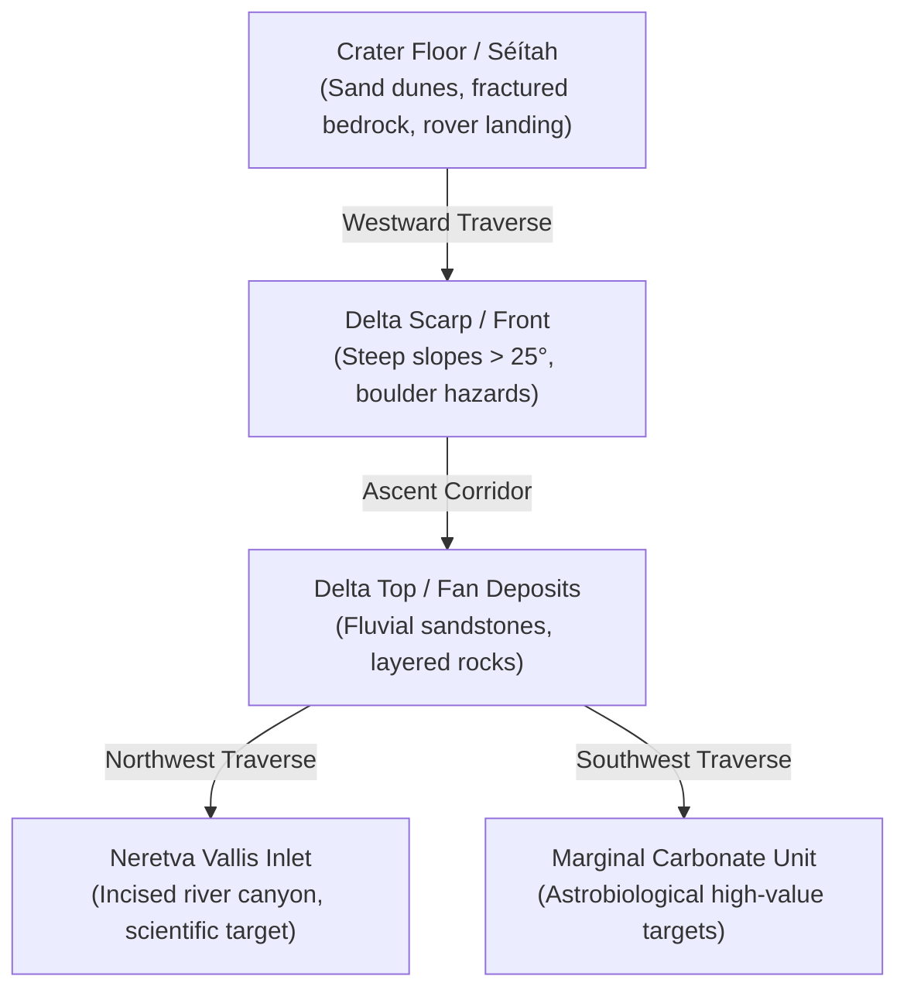

# Marswalk Planner — Initial Study Area Definition

> [!CAUTION]
> Marswalk Planner is a research and education decision-support prototype. It is not NASA software, has not been certified or endorsed by NASA, and must never claim operational astronaut safety.

---

## 1. Executive Summary & Recommendation

For Phase 1 through Phase 5 (the core MVP traversability and route-planning engine), we recommend focusing on the **Jezero Western Fan & Delta Margin Exploration Zone**.

### Why This Specific Study Area?
1. **Maximum Multi-Sensor Overlap:** This footprint contains complete, coincident coverage across ultra-high-resolution HiRISE DTMs (1 m/pixel), HiRISE orthoimages (0.25 m/pixel), CTX mosaics, CRISM targeted spectral cubes, and official USGS 1:75,000 geologic mapping.
2. **Ground Truth & Validation:** The NASA Mars 2020 *Perseverance* rover landed at Octavia E. Butler Landing ($18.4447^\circ\text{ N}, 77.4508^\circ\text{ E}$) and traversed across the crater floor, delta front, and upper delta. This provides real-world rover traverse tracks and in-situ observations to validate orbital traversability models.
3. **Rich Topographic & Scientific Diversity:** Within a compact $\approx 12\text{ km} \times 12\text{ km}$ corridor, the terrain transitions from smooth regolith on the crater floor to boulder-strewn scarps along the delta scarp, steep channel incisions (Neretva Vallis inlet), carbonate-bearing marginal units, and complex sand-ripple/dune hazard fields.
4. **Computational Feasibility:** An area of $12\text{ km} \times 12\text{ km}$ represents $12,000 \times 12,000$ cells at 1 m resolution ($144\text{ M}$ cells) and $600 \times 600$ cells at 20 m resolution ($360\text{ k}$ cells). This fits comfortably within laptop RAM (8 GB) and executes graph searches in seconds.

---

## 2. Spatial Extent & Coordinates

All coordinates follow the canonical project conventions (AGENTS.md):
- **Latitude Type:** Planetocentric
- **Longitude Convention:** East-positive, $[-180^\circ, +180^\circ)$
- **Reference Ellipsoid/Sphere:** IAU 2015 Mars Sphere ($R = 3,396,190\text{ m}$)

### Primary Focus Area: Western Delta Exploration Zone (Tier 1)

| Boundary | Geographic Coordinate | Projected Analysis Metre (Jezero Local Equirectangular)* |
|---|---|---|
| **Northern Latitude** | $18.520^\circ\text{ N}$ | $+1,097,420\text{ m}$ |
| **Southern Latitude** | $18.380^\circ\text{ N}$ | $+1,089,124\text{ m}$ |
| **Western Longitude** | $77.350^\circ\text{ E}$ | $+4,349,020\text{ m}$ |
| **Eastern Longitude** | $77.520^\circ\text{ E}$ | $+4,358,579\text{ m}$ |

*\*Note: Exact projected metric offsets depend on standard parallel $\phi_0 = 18.4^\circ\text{ N}$ and origin $\lambda_0 = 77.45^\circ\text{ E}$, formalized in Phase 2.*

- **Width (East–West):** $\approx 10.1\text{ km}$
- **Height (North–South):** $\approx 8.3\text{ km}$
- **Total Area:** $\approx 83.8\text{ km}^2$

### Regional Context Footprint: Whole Jezero Crater (Tier 2 Context)
- **Bounding Box:** $18.15^\circ\text{ N}$ to $18.75^\circ\text{ N}$, $77.20^\circ\text{ E}$ to $77.85^\circ\text{ E}$
- **Span:** $\approx 45\text{ km} \times 35\text{ km}$
- **Role:** Handled at coarse 20 m (CTX) and 200 m (MOLA-HRSC) grid levels for crater-scale context.

---

## 3. Topographic & Geologic Landmark Inventory

The Western Delta exploration zone incorporates several critical landmarks for human EVA route testing:

1. **Octavia E. Butler Landing Site:** ($18.4447^\circ\text{ N}, 77.4508^\circ\text{ E}$, elev. $\approx -2570\text{ m}$). Flat floor, excellent reference starting base for EVA simulations.
2. **Kodiak Butte:** ($18.411^\circ\text{ N}, 77.426^\circ\text{ E}$). An isolated remnant delta butte featuring steep, impassable cliff faces ($>30^\circ$) to test hard-constraint masks.
3. **Delta Scarp Front ("Three Forks"):** Escarpment rising $\approx 60\text{–}80\text{ m}$ above the floor, with distinct passable ramps and impassable rocky talus slopes.
4. **Séítah Dune Field:** ($18.42^\circ\text{ N}, 77.44^\circ\text{ E}$). Complex transverse aeolian ridges (TARs) and active ripples to evaluate soft-cost sandy terrain penalties.
5. **Neretva Vallis Inlet Channel:** Major breach through the western crater rim where ancient waters flowed into the lake.

---

## 4. Multi-Sensor Data Coincidence Matrix

| Sensor / Dataset | Native Resolution | Spatial Coverage in Study Area | Primary Role in Planner |
|---|---|---|---|
| **HiRISE DTM Mosaic** | 1.0 m/pixel | 100% of Primary Zone | Native slope, roughness, and step hazards |
| **HiRISE Orthomosaic** | 0.25 m/pixel | 100% of Primary Zone | Visual basemap, rock counting, sand detection |
| **CTX DTM Mosaic** | 20.0 m/pixel | 100% of Primary Zone & Context | Global coarse-grid routing, crater base |
| **CTX Orthomosaic** | ~6.0 m/pixel | 100% of Primary Zone & Context | Regional basemap |
| **CRISM FRT000047A3** | ~18 m/pixel | ~85% of Western Delta & Fan | Carbonate & olivine spectral parameter layers |
| **USGS SIM 3464 Geologic Map** | 1:75,000 vector | 100% of Primary Zone & Context | Lithologic units & science value scoring |
| **Perseverance Traverse (PDS PLACES)** | Centimeter telemetry | Crosses Primary Zone | Validation baseline & ground truth |

